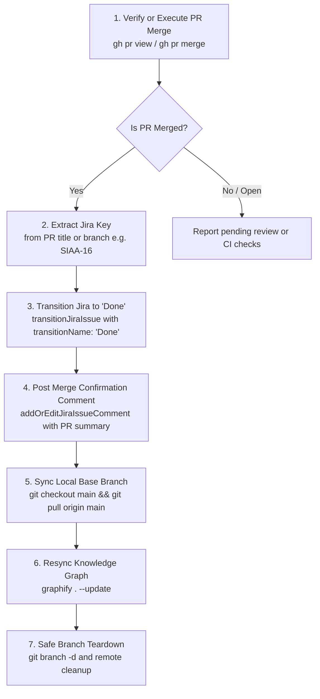

# Pull Request Merge & Jira Automation Skill (`merge-pr`)

This skill defines the standard procedure for completing the Pull Request lifecycle: merging PRs (or verifying already-merged PRs), **automatically transitioning the linked Jira ticket to "Done"**, posting audit closure comments to Jira, syncing `main`, and updating the knowledge graph.

---

## 🎯 Core Lifecycle Workflow



---

## 🛠️ Step-by-Step Procedure

### Step 1: Verify PR State or Execute Merge

Check the current status of the pull request for the active branch or ticket:

```bash
# Check PR state by branch or number
gh pr view <pr-number-or-branch> --json number,title,state,headRefName,url
```

- **If PR is already merged (`state: "MERGED"`)**: Proceed immediately to Step 2.
- **If merging the PR now**:
  ```bash
  # Merge via GitHub CLI (recommended merge method per repo standard)
  gh pr merge <pr-number> --merge --delete-branch
  ```

---

### Step 2: Extract Jira Ticket Key

Parse the Jira issue key from the PR title or branch name:
- Format: `[PROJECT-XXX]` (e.g., `[SIAA-16]`, `[SIAA-17]`) or branch name (`feat/SIAA-16-...`).

---

### Step 3: Transition Jira Issue to "Done"

Call the Atlassian MCP tool **`transitionJiraIssue`**:

```json
{
  "cloudId": "<ATLASSIAN_CLOUD_ID>",
  "issueIdOrKey": "SIAA-XX",
  "transitionName": "Done"
}
```

> [!NOTE]
> In SWIFT Jira workflow, the standard transition ID to close an issue is `Done` (transition ID `31`). Verify available transitions via `listJiraIssueTransitions` if unsure.

---

### Step 4: Post Completion Comment to Jira

Call the Atlassian MCP tool **`addOrEditJiraIssueComment`** to attach a clean closure record to the Jira ticket:

```markdown
🎉 **Pull Request Merged & Feature Released to Main**

- **Pull Request**: [{PR_TITLE}]({PR_URL})
- **Target Branch**: `main`
- **Feature Branch**: `{BRANCH_NAME}`
- **Status**: Transitioned to **Done**
- **Quality Gates**: All pre-flight tests, linter, and typechecks passed prior to merge.
- **Knowledge Graph**: Synced with latest `main`.
```

---

### Step 5: Sync Local `main` Branch

Switch to `main` and pull the newly merged code:

```bash
git checkout main
git pull origin main
```

---

### Step 6: Trigger Knowledge Graph Auto-Sync

Maintain AST code intelligence with the freshly merged feature:

```bash
graphify . --update
```

---

### Step 7: Safe Branch Cleanup

Remove the local branch and prune stale references:

```bash
# Delete local feature branch
git branch -d <feature-branch-name>

# Prune remote tracking references
git fetch --prune origin
```

---

## 📋 Pre-Flight Checklist for Merge Automation

- [ ] PR verified as merged (`state: "MERGED"`).
- [ ] Jira ticket transitioned to `Done` via `transitionJiraIssue`.
- [ ] Closure audit comment posted via `addOrEditJiraIssueComment`.
- [ ] Local `main` pulled up-to-date with `origin/main`.
- [ ] `graphify . --update` executed cleanly.
- [ ] Obsolete local feature branch safely removed.
