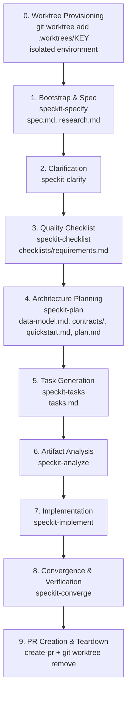

# SpecKit End-to-End Workflow Orchestrator

This skill orchestrates the entire Spec-Driven Development (SDD) lifecycle for SWIFT (Motorcycle Parts POS & Inventory Management System), systematically progressing through requirements, architecture, tasks, and test-driven implementation while honoring SWIFT design tokens, complete 8-artifact spec delivery, and atomic commits.

---

## Workflow Phases & Complete 8-Artifact Deliverable Matrix



---

## 📁 The 8 Canonical SpecKit Artifacts (Mandatory Gate)

Every feature in `specs/<feature-number-and-slug>/` MUST produce all 8 artifacts:

1. `spec.md` — User stories (Mike Cohn), Gherkin acceptance criteria matching Jira tickets, business invariants
2. `research.md` — Stack constraints (Next.js App Router, Supabase, Tailwind CSS v4), architecture decisions
3. `data-model.md` — Entity models, DTOs, storage schemas, state machines, domain models
4. `contracts/` — Component and API route validation contracts (Zod schemas, TypeScript types)
5. `checklists/requirements.md` — Requirements quality validation ("Unit tests for English")
6. `plan.md` — Technical implementation plan, component hierarchy, boundary mapping
7. `quickstart.md` — Verification run guide, walkthrough scenarios
8. `tasks.md` — Actionable implementation tasks ordered by dependency (Schema ➔ Services/API ➔ UI/Hooks ➔ Integration)

---

## Phase-by-Phase Execution Guide

### Phase 0: Git Worktree & Branch Provisioning (Parallel Feature Guard)
To prevent git index lock collisions, branch clobbering, and uncommitted file contamination when working on features concurrently:
1. **Detect Context**: Check if current working directory is already an isolated worktree under `.worktrees/<feature-or-key>`.
2. **Provision Worktree**: If in the repository root or switching to a new ticket/feature, create a separate worktree off `origin/main`:
   ```bash
   git fetch origin main
   git worktree add .worktrees/<JIRA-KEY-or-slug> -b feat/<JIRA-KEY-or-slug> origin/main
   ```
3. **Confine Execution**: All subsequent steps (file generation in `specs/`, source code modifications, tests, and git commits) **MUST** execute within `.worktrees/<JIRA-KEY-or-slug>`.

### Phase 1: Bootstrap & Specification
1. Initialize feature directory under `specs/<feature-number-and-slug>/` (e.g. `specs/007-barcode-fast-lane-pos/`).
2. Populate `specs/<feature>/spec.md` and `specs/<feature>/research.md` with:
   - User stories and Gherkin acceptance criteria derived from the Jira issue.
   - Domain alignment with SWIFT specifications (`../docs/features.md`, `../docs/swift_site_map.md`, and `../mockup/`).

### Phase 2: Targeted Clarification
1. Invoke `speckit-clarify` to inspect `spec.md` for ambiguities and edge cases.
2. Resolve defaults or prompt user, updating `spec.md`.

### Phase 3: Requirements Quality Checklist
1. Invoke `speckit-checklist` to create `specs/<feature>/checklists/requirements.md`.
2. Ensure completeness, clarity, SWIFT design tokens adherence (zero hardcoded colors), and accessibility (WCAG 2.1 AA) criteria are covered.

### Phase 4: Architecture & Technical Planning
1. Produce `specs/<feature>/data-model.md` (Entities, DTOs, storage structures).
2. Produce `specs/<feature>/contracts/` (Typed interfaces, Zod schemas).
3. Produce `specs/<feature>/quickstart.md` (Reproduction steps, validation scenarios).
4. Produce `specs/<feature>/plan.md` (Boundary mapping, test plan, tokens & component mapping).

### Phase 5: Task Generation
1. Invoke `speckit-tasks` to generate `specs/<feature>/tasks.md` with dependency-ordered phases.

### Phase 6: Cross-Artifact Analysis
1. Invoke `speckit-analyze` to confirm zero missing files or unscheduled dependencies before writing code.

### Phase 7: Test-Driven Implementation
1. Invoke `speckit-implement` to execute tasks in `tasks.md` (Red-Green-Refactor).
2. Adhere strictly to the **Atomic Commit** rule (`.agents/rules/atomic-commit.md`).
3. Adhere strictly to **SWIFT Design Tokens** (`lib/tokens.ts`, `app/globals.css`, zero hardcoded hex/rgb).

### Phase 8: Convergence & Verification
1. Run `npm run typecheck`, `npm run lint`, and `npm test` inside the worktree.
2. Trigger `graphify-auto-sync` (`graphify . --update`) to maintain an accurate AST map without circular dependencies.

### Phase 9: Pull Request & Worktree Teardown
1. Push the branch to upstream:
   ```bash
   git push -u origin <branch-name>
   ```
2. Open Pull Request via `gh pr create` (following the `create-pr` skill).
3. Safely remove and prune the worktree after review / completion:
   ```bash
   git worktree remove .worktrees/<JIRA-KEY-or-slug> --force
   git worktree prune
   ```
