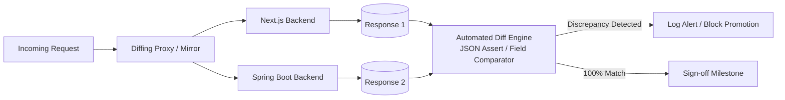

# docs/nextjs-to-springboot-migration-plan.md

# Architecture Blueprint & Migration Plan: Next.js to Java Spring Boot Ecosystem

**Document Reference:** `SWIFT-ARCH-MIG-001`  
**Target System:** SWIFT Motorcycle Spare Parts & Fast-Lane POS Platform  
**Jira Epic Traceability:** [SIAA-87](https://the-three-devsketeers.atlassian.net/browse/SIAA-87) (`EPIC-8: Next.js to Spring Boot Ecosystem Migration`)  
**Author:** Senior Backend Architect  
**Status:** Approved for Implementation  
**Strategy Pattern:** Strangler Fig (Coexistence-First, Zero-Downtime)  
**Target Topology:** Modular Monolith (Java 21 LTS / Spring Boot 3.3+ with Project Loom Virtual Threads)  
**Scope:** 46 Next.js Server Action APIs & 10 PostgreSQL Stored Procedures across 8 Functional Domains  

---

## 1. Executive Summary & Strategy Overview

### 1.1 Strategic Rationale & Migration Goals
The SWIFT platform has matured from an agile Next.js full-stack prototype into an enterprise-grade mission-critical POS and inventory application. While Next.js App Router and React Server Actions provided rapid initial velocity, enterprise scalability demands:
- **Strongly Typed Domain Encapsulation**: Strict multi-tier separation (Controller-Service-Repository) inside a **Modular Monolith** structure (`modules/{auth,catalog,motomatcher,pricing,pos,shift,analytics,audit}`). This eliminates the network latency and distributed transaction overhead (Sagas/2PC) of premature microservices while preserving modular package-private boundaries.
- **Robust Transaction Management**: High-throughput ACID transaction orchestration via Spring `@Transactional` (Repeatable Read isolation), connection pool governance (HikariCP), and database-level row locking (`SELECT FOR UPDATE`) on product stock during POS checkouts.
- **Virtual Thread Concurrency (Project Loom)**: Leveraging Java 21 Virtual Threads to handle massive concurrent POS cashiers, asynchronous read shadowing, and parallel database aggregation for executive analytics without reactive callback complexity.
- **Hardened Enterprise Security**: Spring Security 6 with declarative Method Security (`@PreAuthorize`), fine-grained Role-Based Access Control (RBAC), and dual-session verification supporting both Supabase JWT public JWKS tokens and staff kiosk session cookies.
- **Independent Scalability**: Decoupling the frontend presentation tier (Vercel/Node.js or CDN-hosted SPA) from CPU- and memory-intensive backend operations (financial P&L, stock variance analytics, high-concurrency checkout, and streamed accounting CSV generation).

---

### 1.2 Non-Negotiable Core Tenets

```
                   ┌──────────────────────────────────────────────┐
                   │               CORE PRINCIPLES                │
                   ├──────────────────────────────────────────────┤
                   │ 1. Zero Downtime & Coexistence First         │
                   │ 2. Strangler Fig Incremental Handover (46)   │
                   │ 3. Instantaneous Reverse-Proxy Rollback      │
                   │ 4. Single Shared Database (PostgreSQL)       │
                   │ 5. Automated Parity & Dark Shadow Diffing    │
                   │ 6. Circuit Breaking & Fault Isolation        │
                   └──────────────────────────────────────────────┘
```

1. **Zero-Downtime / Coexistence First**: Under no circumstances will any working Next.js backend code or Server Action be deleted, modified destructively, or deprecated until its Spring Boot counterpart is 100% functionally equivalent, verified by automated parity tests, and operating in production without degradation.
2. **Strangler Fig Incremental Migration**: An edge routing proxy (Reverse Proxy / API Gateway) routes traffic dynamically. All 46 Server Actions migrate incrementally across 6 gated phases (Phase 0 Foundation through Phase 6 Cutover). The Next.js frontend is decoupled via a standardized client SDK targeting either backend transparently.
3. **Instant Fallback Safety**: Routing decisions are controlled at the edge via dynamic proxy rules, HTTP request headers (`X-Swift-Backend`), and centralized configuration toggles. If a Spring Boot service exhibits errors, latency spikes, or contract regressions, traffic switches back to Next.js within sub-seconds (<5s) without deploying new frontend code.
4. **Single Source of Truth Database**: Both Next.js and Spring Boot read and write to the same Supabase/PostgreSQL instance during coexistence, respecting existing battle-tested stored procedures (`process_pos_checkout`, `adjust_product_stock`, `clock_in_shift`). Hibernate DDL auto-generation is strictly set to `validate` or `none`.
5. **Automated Parity & Dark Shadow Diffing**: Read traffic is asynchronously mirrored to Spring Boot (NGINX `mirror` / Diffy) to validate contract matching and response payloads against golden-master snapshots before any write traffic or production cutover is enabled.
6. **Circuit Breaking & Fault Isolation**: Resilience4j circuit breakers, bulkhead limits, and fallback paths are established at service boundaries to prevent cascading failures from database saturation or connection pool exhaustion.

---

### 1.3 High-Level Strangler Fig Architecture

```mermaid
flowchart TD
    subgraph Clients["Client Presentation Tier"]
        B[Staff POS Terminal / Cashier Kiosk]
        A[Admin Browser / Executive Dashboard]
    end

    subgraph Edge["Routing & Edge Layer (Strangler Proxy Gateway)"]
        GW[API Gateway / Reverse Proxy\n(NGINX / Envoy)]
        Rules{Route Rule &\nFeature Weight}
        Mirror[Async Dark Shadow Mirror\n(Read-Only Traffic)]
    end

    subgraph Legacy["Legacy Tier (Next.js 16)"]
        NEXT["Next.js App Router & Server Actions\n(46 Action Endpoints in lib/**/actions.ts)"]
    end

    subgraph Target["Modern Tier (Spring Boot 3.3+ / Java 21)"]
        direction TB
        SB["Modular Monolith (Virtual Threads / Tomcat)\n(Spring Security 6, MVC, Spring Data JPA)"]
        subgraph SB_Modules["Domain Modules"]
            M1[Auth & RBAC]
            M2[Catalog & Locator]
            M3[MotoMatcher]
            M4[Pricing & Labor]
            M5[POS & Checkout]
            M6[Shift Time Clock]
            M7[Analytics & CSV Stream]
            M8[Security & Stock Audit]
        end
        SB --- SB_Modules
    end

    subgraph Data["Persistence Tier"]
        DB[(Shared Supabase PostgreSQL 15+\nTables, RPCs, Audit Triggers, Row-Level Locks)]
    end

    B & A -->|HTTP JSON / REST| GW
    GW --> Rules
    Rules -->|Default / Unmigrated Routes| NEXT
    Rules -->|Migrated Route Handover| SB
    Rules -.->|Sub-Second Fallback on Failure| NEXT
    GW -.->|Async Dark Launch Diffing| Mirror
    Mirror -.->|Verify Parity| SB

    NEXT -->|Prisma Client / PostgREST| DB
    SB -->|HikariCP / JPA / JdbcTemplate| DB
```

---

## 2. Architectural Mapping: Next.js to Spring Boot Ecosystem

This section defines the precise translation of paradigms, frameworks, and patterns between Next.js and Spring Boot 3.x (Java 21 LTS).

| Architectural Concern | Next.js 16 (Current Implementation) | Spring Boot 3.3+ (Target Ecosystem) | Rationale & Architectural Notes |
| :--- | :--- | :--- | :--- |
| **Language & Runtime** | TypeScript 5.x / Node.js 20+ | Java 21 LTS / GraalVM / HotSpot JVM | Virtual threads (Project Loom) deliver massive I/O concurrency without reactive callback complexity. |
| **API / Endpoint Layer** | React Server Actions (`"use server"`) in `lib/**/actions.ts` | Spring MVC `@RestController` + `@RequestMapping("/api/v1/...")` | Replaces proprietary Next.js action POST protocol with standardized RESTful JSON contracts and OpenAPI 3.0 (Swagger) specs. |
| **Request Contracts & DTOs** | Zod schemas (`safeParse`), TypeScript interfaces in `lib/types/` | Java 21 `record` classes + Jakarta Bean Validation (`@Valid`, `@NotNull`, `@Pattern`, `@Size`) | Immutable, concise DTOs with compile-time checks and automatic JSON schema validation. |
| **API Documentation** | Manual Markdown docs (`docs/api-endpoints.md`) | SpringDoc OpenAPI 3.0 (`/swagger-ui.html`, `/v3/api-docs`) | Auto-generated interactive API schema ensuring contract alignment with Next.js frontend client SDK. |
| **Session & Identity** | Cookie reading (`swift-session-role`, `swift-staff-session`) + Supabase Auth client | Spring Security 6 Filter Chain + `OncePerRequestFilter` + Nimbus JOSE/JWT | Standardizes token parsing, extraction of custom claims, and population of `SecurityContextHolder`. |
| **Authorization / RBAC** | Manual checks in actions and `lib/auth/session-guards.ts` | Declarative Method Security (`@PreAuthorize("hasRole('ADMIN')")`, `@PreAuthorize("hasAuthority('PERM_ADJUST_STOCK')")`) | Centralized authorization matrix eliminating scattered ad-hoc guard clauses. |
| **ORM & Data Access** | Prisma Client (`getPrismaClient()`) + direct Supabase queries | Spring Data JPA (Hibernate 6) + Spring Data Repositories (`JpaRepository`) | Enterprise relational mapping, second-level caching, criteria queries, and type-safe auditing. |
| **Database Transactions & RPCs** | Direct calls to `supabase.rpc('<proc_name>')` | `JdbcTemplate` / `SimpleJdbcCall` + `@Transactional` with isolation levels | Reuses battle-tested SQL stored procedures while Spring orchestrates cross-repository transaction boundaries. |
| **Caching Layer** | Next.js `unstable_cache`, `revalidateTag` (`MOTOMATCHER_CACHE_TAGS`) | Spring Cache Abstraction (`@Cacheable`, `@CacheEvict`) backed by Redis / Caffeine | Multi-level distributed caching with explicit TTLs, tag evictions, and cache-aside patterns. |
| **Resilience & Fault Tolerance** | Ad-hoc Node `try/catch` & client retry hooks | Resilience4j (`@CircuitBreaker`, `@RateLimiter`, `@Retry`, `@Bulkhead`) | Circuit breaker trips upon downstream failures, routing traffic immediately to fallback endpoints. |
| **Audit Trails & Triggers** | Inline `supabase.from('audit_logs').insert(...)` + DB Triggers | Spring Data JPA Auditing (`@EntityListeners(AuditingEntityListener.class)`) + Dedicated Audit Aspect (`@Aspect`) | Decouples forensic audit event capture from primary business logic. |
| **Background Tasks & Jobs** | Ad-hoc async Node promises | Spring `@Async` + Virtual Thread Task Executor (`ThreadPoolTaskScheduler`, Quartz) | Managed concurrency queues with backpressure, retry strategies, and observability. |
| **Observability & Health** | Node console logs + Next.js build stats | Spring Boot Actuator (`/actuator/health`, `/actuator/metrics`), Micrometer, Prometheus, OpenTelemetry | Standardized metrics, liveness/readiness probes for Kubernetes, and distributed tracing. |
| **Testing Methodology** | Vitest + React Testing Library | JUnit 5 + Spring Boot Test + REST Assured + Testcontainers | Strict TDD (Red-Green-Refactor) testing contract parity against golden-master JSON snapshots. |

---

## 3. Phased Execution Plan

The migration will proceed across **6 sequentially gated phases**. Advancing to each subsequent phase requires meeting strict quality gates.

```
┌────────────────────────────────────────────────────────────────────────────────────────┐
│                               PHASED TIMELINE OVERVIEW                                 │
├────────────┬─────────────┬─────────────┬─────────────┬─────────────┬───────────────────┤
│  Phase 0   │   Phase 1   │   Phase 2   │   Phase 3   │   Phase 4   │  Phase 5 & 6      │
│ Foundation │ Auth Bridge │ Catalog &   │ POS & Shift │ Analytics & │ Cutover &         │
│ & Gateway  │ & Security  │ MotoMatcher │ Transactions│ CSV Export  │ Next.js Retirement│
└────────────┴─────────────┴─────────────┴─────────────┴─────────────┴───────────────────┘
```

---

### Phase 0: Foundation & Coexistence Infrastructure Setup

#### Step 0.1: Spring Boot Application Scaffolding
Create a modular Spring Boot 3.3.x application with Java 21:
```
swift-backend/
├── pom.xml (or build.gradle.kts)
├── src/main/java/com/swift/
│   ├── SwiftBackendApplication.java
│   ├── common/           # Shared exceptions, base DTOs, response wrappers
│   ├── config/           # SecurityConfig, JpaConfig, CacheConfig, OpenApiConfig
│   ├── security/         # JwtAuthenticationFilter, CookieSessionFilter, RBAC models
│   └── modules/
│       ├── auth/         # Kiosk PIN, admin elevation, session verification
│       ├── catalog/      # Products, categories, rack/shelf locator, inventory
│       ├── motomatcher/  # Compatibility matrix, fitment rules
│       ├── pricing/      # Global markup rules, labor rates
│       ├── pos/          # Cart logic, checkout orchestration, receipt generation
│       ├── shift/        # Digital punch clock, break manager, attendance logs
│       ├── analytics/    # Executive KPIs, 7-day trend, category P&L, CSV export
│       └── audit/        # Security logs, stock adjustment ledger, CSV export
```

#### Step 0.2: Shared Database Connectivity Configuration
Configure Spring Boot's `application.yml` to connect to the active Supabase PostgreSQL database:
```yaml
spring:
  datasource:
    url: ${DATABASE_URL:jdbc:postgresql://db.supabase.co:5432/postgres?sslmode=require}
    username: ${DATABASE_USER:postgres}
    password: ${DATABASE_PASSWORD}
    driver-class-name: org.postgresql.Driver
    hikari:
      maximum-pool-size: 20
      minimum-idle: 5
      idle-timeout: 300000
      connection-timeout: 20000
      max-lifetime: 1200000
  jpa:
    hibernate:
      ddl-auto: validate # STRICTLY validate: never generate or alter schema automatically!
    properties:
      hibernate:
        dialect: org.hibernate.dialect.PostgreSQLDialect
        format_sql: false
```

> [!CAUTION]
> **Strict Rule on DDL Execution:** `spring.jpa.hibernate.ddl-auto` **must** be set to `validate` or `none`. Under no circumstances should Hibernate create or alter database schemas in the shared Supabase database during migration.

#### Step 0.3: Deploy the Strangler Fig Reverse Proxy Layer
Deploy an API Gateway (Envoy or NGINX) in front of both Next.js and Spring Boot:

```nginx
# nginx-strangler-gateway.conf
upstream nextjs_backend {
    server 127.0.0.1:3000 max_fails=3 fail_timeout=10s;
}

upstream springboot_backend {
    server 127.0.0.1:8080 max_fails=2 fail_timeout=5s;
}

server {
    listen 80;
    server_name pos.swiftparts.local;

    # Global proxy headers
    proxy_set_header Host $host;
    proxy_set_header X-Real-IP $remote_addr;
    proxy_set_header X-Forwarded-For $proxy_add_x_forwarded_for;
    proxy_set_header X-Forwarded-Proto $scheme;

    # 1. Fallback & Dynamic Routing Header
    # If request has 'X-Swift-Backend: springboot', route to Spring Boot
    # Default routes fall through to Next.js
    
    # 2. Migrated API Endpoints (Incremental Handover)
    location /api/v1/motomatcher/ {
        proxy_pass http://springboot_backend;
        proxy_next_upstream error timeout http_502 http_503;
        proxy_next_upstream_tries 2;
        
        # Rollback safeguard: If Spring Boot returns 502/503/timeout, fail back to Next.js
        error_page 502 503 504 = @fallback_to_nextjs;
    }

    # Default fallback for Next.js (App router, pages, unmigrated Server Actions)
    location / {
        proxy_pass http://nextjs_backend;
    }

    location @fallback_to_nextjs {
        add_header X-Swift-Fallback "true" always;
        proxy_pass http://nextjs_backend;
    }
}
```

---

### Phase 1: Authentication & Shared Session Interoperability

#### Step 1.1: Dual-Platform Session Recognition
Both Next.js and Spring Boot must validate identical sessions:
1. **Supabase JWTs**: Spring Security validates Bearer tokens using Supabase's Public JWKS (`https://<project-ref>.supabase.co/auth/v1/.well-known/jwks.json`).
2. **Session Cookies**: Spring Boot parses `swift-session-role`, `swift-user-name`, and `swift-staff-session` cookies set by Next.js login routines.

#### Step 1.2: Spring Security Configuration
```java
@Configuration
@EnableWebSecurity
@EnableMethodSecurity(prePostEnabled = true)
public class SecurityConfig {

    private final CookieAuthenticationFilter cookieAuthFilter;
    private final SupabaseJwtAuthFilter supabaseJwtAuthFilter;

    public SecurityConfig(CookieAuthenticationFilter cookieAuthFilter, 
                          SupabaseJwtAuthFilter supabaseJwtAuthFilter) {
        this.cookieAuthFilter = cookieAuthFilter;
        this.supabaseJwtAuthFilter = supabaseJwtAuthFilter;
    }

    @Bean
    public SecurityFilterChain filterChain(HttpSecurity http) throws Exception {
        http
            .csrf(AbstractHttpConfigurer::disable)
            .cors(Customizer.withDefaults())
            .sessionManagement(s -> s.sessionCreationPolicy(SessionCreationPolicy.STATELESS))
            .authorizeHttpRequests(auth -> auth
                .requestMatchers("/api/v1/auth/login", "/api/v1/auth/kiosk-pin", "/actuator/health").permitAll()
                .requestMatchers("/api/v1/admin/**").hasRole("ADMIN")
                .requestMatchers("/api/v1/staff/**").hasAnyRole("STAFF", "ADMIN")
                .anyRequest().authenticated()
            )
            .addFilterBefore(cookieAuthFilter, UsernamePasswordAuthenticationFilter.class)
            .addFilterBefore(supabaseJwtAuthFilter, UsernamePasswordAuthenticationFilter.class);

        return http.build();
    }
}
```

#### Step 1.3: Kiosk PIN & Admin Elevation Parity
Port `verifyStaffPinAction` and `verifyAdminElevationAction` to `@RestController` endpoints:
- `POST /api/v1/auth/kiosk-pin`
- `POST /api/v1/auth/admin-elevation`
- Validate inputs against table `staff_profiles` / `auth.users` with BCrypt encryption.

---

### Phase 2: Read-Heavy & Low-Risk Domain Migration

Migrate modules with low blast-radius first: **MotoMatcher Compatibility** and **Product Price Check**.

#### Step 2.1: MotoMatcher Domain Migration
- **Next.js Action**: `getMotorcycleModelsAction()`, `getFitmentMatrixAction()`
- **Spring Controller**: `MotoMatcherController`
```java
@RestController
@RequestMapping("/api/v1/motomatcher")
public class MotoMatcherController {

    private final MotoMatcherService motoMatcherService;

    public MotoMatcherController(MotoMatcherService motoMatcherService) {
        this.motoMatcherService = motoMatcherService;
    }

    @GetMapping("/models")
    @Cacheable(value = "motorcycleModels", key = "'all'")
    public ResponseEntity<List<MotorcycleModelDto>> getModels() {
        return ResponseEntity.ok(motoMatcherService.getAllModels());
    }

    @GetMapping("/matrix")
    public ResponseEntity<FitmentMatrixResponseDto> getFitmentMatrix(
            @RequestParam UUID modelId,
            @RequestParam(required = false) String category,
            @RequestParam(required = false) String search) {
        return ResponseEntity.ok(motoMatcherService.queryFitmentMatrix(modelId, category, search));
    }
}
```

#### Step 2.2: Reusing PostgreSQL Stored Procedures
In `MotoMatcherServiceImpl.java`, invoke the existing PostgreSQL procedure:
```java
@Service
public class MotoMatcherServiceImpl implements MotoMatcherService {

    private final JdbcTemplate jdbcTemplate;

    public MotoMatcherServiceImpl(JdbcTemplate jdbcTemplate) {
        this.jdbcTemplate = jdbcTemplate;
    }

    @Override
    public FitmentMatrixResponseDto queryFitmentMatrix(UUID modelId, String category, String search) {
        String sql = "SELECT * FROM public.get_moto_matcher_matrix(?, ?, ?)";
        return jdbcTemplate.queryForObject(sql, (rs, rowNum) -> {
            String jsonRaw = rs.getString(1);
            return JacksonUtils.parse(jsonRaw, FitmentMatrixResponseDto.class);
        }, modelId, category, search);
    }
}
```

---

### Phase 3: Catalog Administration & Inventory Management

#### Step 3.1: Product Catalog & Rack/Shelf Locator
- Migrate `getProductsAction()`, `createProductAction()`.
- Standardize pricing rules calculation (markup math, retail vs wholesale) in a dedicated Java domain service: `PricingCalculatorService`.

#### Step 3.2: Stock Adjustment with Audit Immutability
- Migrate `adjustProductStockAction`.
- Invoke the existing stored procedure `public.adjust_product_stock(sku, delta, type, reason, user_id, user_name)`:
```java
@Service
public class InventoryServiceImpl implements InventoryService {

    private final SimpleJdbcCall stockAdjustmentCall;

    public InventoryServiceImpl(DataSource dataSource) {
        this.stockAdjustmentCall = new SimpleJdbcCall(dataSource)
            .withFunctionName("adjust_product_stock");
    }

    @Transactional(isolation = Isolation.REPEATABLE_READ)
    public StockAdjustmentResultDto adjustStock(StockAdjustmentRequestDto request, String userId, String userName) {
        SqlParameterSource in = new MapSqlParameterSource()
            .addValue("p_sku", request.sku())
            .addValue("p_quantity_delta", request.delta())
            .addValue("p_adjustment_type", request.type())
            .addValue("p_reason", request.reason())
            .addValue("p_user_id", UUID.fromString(userId))
            .addValue("p_user_name", userName);

        Map<String, Object> out = stockAdjustmentCall.execute(in);
        return mapToAdjustmentResult(out);
    }
}
```

#### Step 3.3: Workshop Bay Labor Rates & Flat-Rate Service Catalog
- Migrate `getAdminLaborServicesAction`, `createLaborServiceAction`, `updateLaborServiceAction`, `toggleServiceStatusAction`, `deleteLaborServiceAction`, and `getServiceRateAuditLogsAction`.
- Implement `LaborServiceManagementService` managing hourly rates, task durations, and active statuses.
- Record rate changes into `service_rate_audit_logs` table via Spring Data JPA auditing.

#### Step 3.4: Staff User Management & Granular RBAC Permissions
- Migrate `listStaffUsersAction`, `provisionStaffUserAction`, `updateUserPermissionsAction`, `updateStaffUserAction`, and `toggleUserStatusAction`.
- Hydrate and persist individual employee permission flags (`can_adjust_stock`, `can_override_discount`, `can_manage_pricing`, `can_view_reports`) in table `profiles.permissions`.
- Enforce strict self-lockout prevention so administrators cannot deactivate their own root accounts.

#### Step 3.5: Immutable Forensic Security & Stock Adjustment Audit Logging
- Migrate `getSecurityAuditLogsAction`, `logSecurityEventAction`, `exportSecurityAuditLogsAction`, `getStockAdjustmentLogsAction`, and `exportStockAdjustmentLogsAction`.
- Route security events through PostgreSQL RPC `public.log_security_event(event_type, severity, user_id, user_name, metadata)`.
- Implement CSV streaming for large audit trail exports.

---

### Phase 4: Core Transaction Engine (POS & Shift Attendance)

#### Step 4.1: Shift Punch Clock & Attendance Lifecycle Migration
- Migrate `fetchStaffShiftAction`, `clockInShiftAction`, `clockOutShiftAction`, `toggleShiftBreakAction`, and `getStaffAttendanceHistoryAction`.
- Wrap atomic stored procedures:
  - `public.clock_in_shift(staff_id, location)`
  - `public.clock_out_shift(shift_id, staff_id)`
  - `public.toggle_shift_break(shift_id, staff_id, on_break)`
- Ensure shift durations calculate dynamically against the Postgres server UTC clock (`now() - clock_in`), preventing client-clock drift and surviving browser page refreshes (`F5`).

#### Step 4.2: POS Checkout Orchestration & Thermal Receipts
- Migrate `getLaborServicesAction`, `processCheckoutAction`, `getTransactionsAction`, `getTransactionByReceiptAction`, and `getThermalReceiptByReceiptAction`.
- Implement rigorous DTO validation for line items, customer discount tier, and cash tender math:
```java
public record PosCheckoutRequest(
    @NotBlank String cashierId,
    @NotBlank String cashierName,
    @NotEmpty List<@Valid CartLineItemDto> items,
    @NotNull BigDecimal subtotal,
    @NotNull BigDecimal total,
    @NotNull BigDecimal amountTendered,
    @NotNull BigDecimal changeDue,
    String customerType,
    BigDecimal discountPercent
) {}
```
- Execute `public.process_pos_checkout(...)` with database row-level locking (`SELECT ... FOR UPDATE`) on products to prevent inventory overselling race conditions.
- Implement `ThermalReceiptService` to return printable ESC/POS byte streams and formatted JSON payloads for receipt reprinting.

---

### Phase 5: Analytics, P&L Engine & CSV Export

#### Step 5.1: High-Performance Financial Aggregations & Service Bay Monitoring
- Port `getExecutiveKpisAction`, `getRevenueTrendAction`, `getCategoryPnlAction`, `getCategoryPnlBreakdownAction`, `getServiceBayStatusAction`, and `updateWorkOrderStatusAction`.
- Implement parallel database dispatch using Java 21 Virtual Threads (`StructuredTaskScope`):
```java
public ExecutiveDashboardDto getDashboardKpiSummary() {
    try (var scope = new StructuredTaskScope.ShutdownOnFailure()) {
        Supplier<ExecutiveKpiData> kpiTask = scope.fork(() -> analyticsDao.getExecutiveKpis());
        Supplier<WeeklyRevenueTrend> trendTask = scope.fork(() -> analyticsDao.getRevenueTrend7d());
        Supplier<CategoryPnlSummary> pnlTask = scope.fork(() -> analyticsDao.getCategoryPnl("weekly"));
        Supplier<List<ServiceBayStatusDto>> bayTask = scope.fork(() -> analyticsDao.getServiceBayStatuses());

        scope.join();
        scope.throwIfFailed();

        return new ExecutiveDashboardDto(kpiTask.get(), trendTask.get(), pnlTask.get(), bayTask.get());
    }
}
```

#### Step 5.2: Streamed Accounting CSV Generation
- Port `exportAccountingCsvAction`.
- Replace memory-heavy in-memory string concatenation with Spring MVC `StreamingResponseBody` to stream millions of transaction rows directly to client output buffers without JVM heap bloat:
```java
@GetMapping(value = "/reports/sales-csv", produces = "text/csv")
public ResponseEntity<StreamingResponseBody> exportAccountingCsv(@RequestParam String period) {
    StreamingResponseBody responseBody = outputStream -> {
        csvExportService.streamAccountingReport(period, outputStream);
    };
    return ResponseEntity.ok()
        .header(HttpHeaders.CONTENT_DISPOSITION, "attachment; filename=\"swift-sales-" + period + ".csv\"")
        .body(responseBody);
}
```

---

### Phase 6: Shadow Verification, Traffic Ramping & Final Cutover

#### Step 6.1: Shadow Traffic (Dark Launching)
Run Next.js and Spring Boot concurrently. Route production traffic to Next.js, while the API gateway duplicates (mirrors) read-only traffic to Spring Boot asynchronously:

```nginx
# Shadowing in NGINX with mirror directive
location /api/v1/motomatcher/ {
    mirror /shadow/motomatcher;
    mirror_request_body on;
    proxy_pass http://nextjs_backend;
}

location = /shadow/motomatcher {
    internal;
    proxy_pass http://springboot_backend;
}
```

#### Step 6.2: Automated Canary Shifting Schedule
When parity is verified, gradually shift user traffic using gateway weights:

```
Day 1 - 3:   10% Spring Boot  /  90% Next.js (Staff Kiosk in Single Test Store)
Day 4 - 6:   25% Spring Boot  /  75% Next.js
Day 7 - 9:   50% Spring Boot  /  50% Next.js
Day 10 - 13: 80% Spring Boot  /  20% Next.js
Day 14:     100% Spring Boot  /   0% Next.js (Full Cutover)
```

#### Step 6.3: Retirement of Next.js Backend Code
Only after **14 consecutive days** of 100% production traffic running on Spring Boot with:
- Zero rollback triggers
- Latency P99 < 120ms
- Error rates < 0.01%
Next.js Server Actions can be safely removed, and the Next.js frontend transitions permanently to a lean consumer of the Spring Boot REST API.

---

## 4. Verification, Testing & Parity Strategy

To guarantee that Spring Boot behaves as an exact drop-in replacement, we enforce a multi-tiered verification pipeline.



### 4.1 Contract & Golden-Master Testing
1. **Response Snapshotting**: Capture golden-master JSON responses from all 46 Next.js Server Actions across valid, edge-case, and error scenarios.
2. **Automated Assertion Suite**: Use REST Assured in Java to validate that Spring Boot outputs match Next.js snapshots down to JSON field naming, casing, and timestamp formatting (ISO-8601 UTC):
```java
@Test
void verifyProductPriceCheckParity() {
    given()
        .header("Cookie", "swift-session-role=staff")
        .param("sku", "BRK-PAD-001")
    .when()
        .get("/api/v1/staff/pricecheck")
    .then()
        .statusCode(200)
        .body("sku", equalTo("BRK-PAD-001"))
        .body("retailPrice", equalTo(450.00f))
        .body("wholesalePrice", equalTo(380.00f))
        .body("shelfLocation", equalTo("RACK-B-SHELF-02"));
}
```

### 4.2 Shadow Traffic Diffing (Diffy / Custom Comparison)
Deploy an instance of [Diffy](https://github.com/opendiffy/diffy) or an asynchronous comparison filter:
- Reads are mirrored from production to both backends.
- Ignores volatile fields (such as `timestamp`, `traceId`, `durationMs`).
- Flags any business logic discrepancy (such as rounding variance in discount calculations or differences in stock availability count).

### 4.3 High-Concurrency Stress & Race Condition Testing
Using **k6** or **Gatling**, simulate peak shop-floor conditions:
- **50 Concurrent Cashiers checking out simultaneously**:
  - Verify that inventory counts never drop below zero.
  - Verify no deadlocks occur inside `process_pos_checkout`.
  - Validate that receipt numbers remain strictly sequential and collision-free.
- **Stock Adjustment Variance Testing**:
  - Run concurrent positive and negative stock adjustments on the same SKU to ensure idempotency and atomic ledger logging.

---

## 5. Rollback Playbook & Failure Safeguards

### 5.1 Instant Emergency Rollback Triggers
An automated rollback from Spring Boot to Next.js triggers immediately if any of the following occur during canary releases:
- HTTP 5xx error rate exceeds **0.1%** over a 2-minute sliding window.
- API P95 latency exceeds **250ms** for 3 consecutive minutes.
- Database connection pool exhaustion (`HikariPool-1 - Connection is not available`).
- Any unhandled exception during checkout tender or payment recording.

### 5.2 Rollback Execution Steps
1. **Level 1 (Edge Proxy Rollback - 5 seconds)**:  
   Execute NGINX reload or update Cloudflare Worker route weight:
   ```bash
   # Switch traffic back to Next.js 100%
   sed -i 's/weight=10/weight=0/g' /etc/nginx/conf.d/swift-routes.conf
   nginx -s reload
   ```
2. **Level 2 (Application Feature Flag Rollback - Sub-second)**:  
   Flip the global backend provider toggle in Redis / Consul:
   ```bash
   redis-cli set SWIFT_BACKEND_OVERRIDE "NEXTJS"
   ```
3. **Level 3 (Database Health Check)**:  
   Verify that no hanging lock or open transaction remains from the failed service:
   ```sql
   SELECT pid, query, state, age(clock_timestamp(), query_start) 
   FROM pg_stat_activity 
   WHERE state != 'idle' AND query LIKE '%process_pos_checkout%';
   ```

---

## 6. Migration Matrix: Endpoint-by-Endpoint Checklist

| Module | Next.js Server Action | Spring Boot REST Equivalent | Migration Phase | Parity Test Status |
| :--- | :--- | :--- | :--- | :--- |
| **Auth** | `authenticateUserAction` | `POST /api/v1/auth/login` | Phase 1 | 🔲 Pending |
| **Auth** | `logoutAction` | `POST /api/v1/auth/logout` | Phase 1 | 🔲 Pending |
| **Staff** | `verifyStaffPinAction` | `POST /api/v1/staff/kiosk-auth` | Phase 1 | 🔲 Pending |
| **Staff** | `verifyAdminElevationAction`| `POST /api/v1/staff/admin-elevation` | Phase 1 | 🔲 Pending |
| **Staff** | `lookupProductPriceAction` | `GET /api/v1/inventory/pricecheck` | Phase 2 | 🔲 Pending |
| **Staff** | `getStaffAttendanceHistoryAction` | `GET /api/v1/staff/attendance-history` | Phase 4 | 🔲 Pending |
| **MotoMatcher** | `getMotorcycleModelsAction`| `GET /api/v1/motomatcher/models` | Phase 2 | 🔲 Pending |
| **MotoMatcher** | `getFitmentMatrixAction` | `GET /api/v1/motomatcher/matrix` | Phase 2 | 🔲 Pending |
| **MotoMatcher** | `addFitmentRuleAction` | `POST /api/v1/motomatcher/rules` | Phase 2 | 🔲 Pending |
| **Catalog** | `getProductsAction` | `GET /api/v1/admin/products` | Phase 3 | 🔲 Pending |
| **Catalog** | `createProductAction` | `POST /api/v1/admin/products` | Phase 3 | 🔲 Pending |
| **Inventory** | `adjustProductStockAction` | `POST /api/v1/inventory/stock-adjust`| Phase 3 | 🔲 Pending |
| **Inventory** | `getStockAdjustmentLogsAction` | `GET /api/v1/inventory/stock-adjust/logs` | Phase 3 | 🔲 Pending |
| **Inventory** | `exportStockAdjustmentLogsAction` | `GET /api/v1/inventory/stock-adjust/export-csv` | Phase 3 | 🔲 Pending |
| **Pricing** | `getPricingRulesAction` | `GET /api/v1/pricing/rules` | Phase 3 | 🔲 Pending |
| **Pricing** | `updatePricingRulesAction` | `PUT /api/v1/pricing/rules` | Phase 3 | 🔲 Pending |
| **Services** | `getAdminLaborServicesAction`| `GET /api/v1/services/labor` | Phase 3 | 🔲 Pending |
| **Services** | `createLaborServiceAction` | `POST /api/v1/services/labor` | Phase 3 | 🔲 Pending |
| **Services** | `updateLaborServiceAction` | `PUT /api/v1/services/labor/{id}` | Phase 3 | 🔲 Pending |
| **Services** | `toggleServiceStatusAction` | `PATCH /api/v1/services/labor/{id}/status` | Phase 3 | 🔲 Pending |
| **Services** | `deleteLaborServiceAction` | `DELETE /api/v1/services/labor/{id}` | Phase 3 | 🔲 Pending |
| **Services** | `getServiceRateAuditLogsAction` | `GET /api/v1/services/labor/audit-logs` | Phase 3 | 🔲 Pending |
| **Users** | `listStaffUsersAction` | `GET /api/v1/admin/users` | Phase 3 | 🔲 Pending |
| **Users** | `provisionStaffUserAction` | `POST /api/v1/admin/users` | Phase 3 | 🔲 Pending |
| **Users** | `updateUserPermissionsAction`| `PUT /api/v1/admin/users/{id}/permissions` | Phase 3 | 🔲 Pending |
| **Users** | `updateStaffUserAction` | `PUT /api/v1/admin/users/{id}` | Phase 3 | 🔲 Pending |
| **Users** | `toggleUserStatusAction` | `PATCH /api/v1/admin/users/{id}/status` | Phase 3 | 🔲 Pending |
| **Audit** | `getSecurityAuditLogsAction` | `GET /api/v1/admin/audit/security` | Phase 3 | 🔲 Pending |
| **Audit** | `logSecurityEventAction` | `POST /api/v1/admin/audit/security` | Phase 3 | 🔲 Pending |
| **Audit** | `exportSecurityAuditLogsAction` | `GET /api/v1/admin/audit/security/export-csv` | Phase 3 | 🔲 Pending |
| **Shift** | `fetchStaffShiftAction` | `GET /api/v1/shifts/active/{staffId}`| Phase 4 | 🔲 Pending |
| **Shift** | `clockInShiftAction` | `POST /api/v1/shifts/clock-in` | Phase 4 | 🔲 Pending |
| **Shift** | `clockOutShiftAction` | `POST /api/v1/shifts/clock-out` | Phase 4 | 🔲 Pending |
| **Shift** | `toggleShiftBreakAction` | `POST /api/v1/shifts/toggle-break` | Phase 4 | 🔲 Pending |
| **POS** | `getLaborServicesAction` | `GET /api/v1/pos/labor-catalog` | Phase 4 | 🔲 Pending |
| **POS** | `processCheckoutAction` | `POST /api/v1/pos/checkout` | Phase 4 | 🔲 Pending |
| **POS** | `getTransactionsAction` | `GET /api/v1/pos/transactions` | Phase 4 | 🔲 Pending |
| **POS** | `getTransactionByReceiptAction`| `GET /api/v1/pos/receipts/{receiptNo}` | Phase 4 | 🔲 Pending |
| **POS** | `getThermalReceiptByReceiptAction` | `GET /api/v1/pos/receipts/{receiptNo}/thermal` | Phase 4 | 🔲 Pending |
| **Analytics** | `getExecutiveKpisAction` | `GET /api/v1/analytics/kpis` | Phase 5 | 🔲 Pending |
| **Analytics** | `getRevenueTrendAction` | `GET /api/v1/analytics/revenue-trend` | Phase 5 | 🔲 Pending |
| **Analytics** | `getCategoryPnlAction` | `GET /api/v1/analytics/category-pnl` | Phase 5 | 🔲 Pending |
| **Analytics** | `getCategoryPnlBreakdownAction` | `GET /api/v1/analytics/category-pnl-breakdown` | Phase 5 | 🔲 Pending |
| **Analytics** | `getServiceBayStatusAction` | `GET /api/v1/analytics/service-bays` | Phase 5 | 🔲 Pending |
| **Analytics** | `updateWorkOrderStatusAction` | `PATCH /api/v1/analytics/work-orders/{id}/status` | Phase 5 | 🔲 Pending |
| **Analytics** | `exportAccountingCsvAction` | `GET /api/v1/analytics/accounting-csv`| Phase 5 | 🔲 Pending |

---

## 7. Next Steps for Implementation Kickoff

1. **Jira Issue Tracking & Story Slices**:
   - Trace all delivery milestones to Epic [SIAA-87](https://the-three-devsketeers.atlassian.net/browse/SIAA-87) (`EPIC-8: Next.js to Spring Boot Ecosystem Migration`).
   - Execute development sequentially against vertical stories defined in [`docs/user-stories-epic-8.md`](user-stories-epic-8.md) ([SIAA-88](https://the-three-devsketeers.atlassian.net/browse/SIAA-88) through [SIAA-98](https://the-three-devsketeers.atlassian.net/browse/SIAA-98)).
2. **Provision Baseline Infrastructure (`Phase 0`)**:
   - Establish `swift-backend/` Spring Boot 3.3.x application skeleton with Java 21 LTS runtime.
   - Configure HikariCP with Supabase PostgreSQL connection pool with strict `ddl-auto: validate`.
   - Deploy initial NGINX / Envoy strangler proxy with sub-second passive passthrough to Next.js.
3. **Execute Authentication & Session Bridge (`Phase 1`)**:
   - Implement `CookieAuthenticationFilter` and `SupabaseJwtAuthFilter` with public JWKS token verification.
   - Validate dual-session compatibility so staff can authenticate via kiosk PIN and admin elevation identically across both platforms.
4. **Stand up Golden-Master Snapshot Parity Suite**:
   - Record baseline JSON responses for all 46 actions in [`swift/docs/api-endpoints.md`](api-endpoints.md).
   - Enforce JUnit 5 + REST Assured contract assertions across all endpoints before advancing through canary traffic shifting (10% to 100%).
