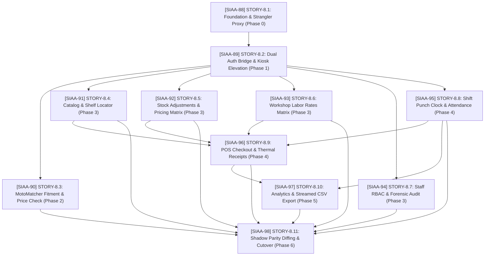

# User Stories: EPIC-8 Next.js to Spring Boot Ecosystem Migration (Strangler Fig)

**Parent Epic:** [SIAA-87](https://the-three-devsketeers.atlassian.net/browse/SIAA-87) (`EPIC-8: Next.js to Spring Boot Ecosystem Migration`)  
**Document Reference:** `SWIFT-ARCH-MIG-001`  
**Architecture Specification:** [`swift/docs/nextjs-to-springboot-migration-plan.md`](file:///c:/Users/Roselle%20Tabuena/workspace/swift/swift/docs/nextjs-to-springboot-migration-plan.md)  
**Target Release Horizon:** 6 Sequential Strangler Gated Phases (Phases 0 through 6)  
**Format:** Mike Cohn User Story Format with Gherkin Acceptance Criteria & Technical Specifications  
**Scope Checksum:** Exactly **46 Next.js Server Actions** & **10 PostgreSQL Stored Procedures** across 8 Functional Domains  

---

## 1. Traceability & Coverage Matrix (Checksum: 46/46 Actions)

| Story ID | Jira Key | Story Title | Next.js Server Action(s) Mapped | Target Spring REST Endpoint(s) | PostgreSQL Stored Procedure / Entity | Phase |
| :--- | :--- | :--- | :--- | :--- | :--- | :--- |
| **STORY-8.1** | [SIAA-88](https://the-three-devsketeers.atlassian.net/browse/SIAA-88) | Foundation & Strangler Proxy Gateway | *N/A (Infrastructure & Edge Routing)* | `/actuator/health`, `/actuator/metrics` | HikariCP Connection Pool (`ddl-auto: validate`) | Phase 0 |
| **STORY-8.2** | [SIAA-89](https://the-three-devsketeers.atlassian.net/browse/SIAA-89) | Dual-Platform Identity & Elevation | `authenticateUserAction`<br>`logoutAction`<br>`verifyStaffPinAction`<br>`verifyAdminElevationAction` | `POST /api/v1/auth/login`<br>`POST /api/v1/auth/logout`<br>`POST /api/v1/staff/kiosk-auth`<br>`POST /api/v1/staff/admin-elevation` | `auth.users`<br>`public.staff_profiles` | Phase 1 |
| **STORY-8.3** | [SIAA-90](https://the-three-devsketeers.atlassian.net/browse/SIAA-90) | MotoMatcher Fitment & Price Check | `getMotorcycleModelsAction`<br>`getFitmentMatrixAction`<br>`addFitmentRuleAction`<br>`lookupProductPriceAction` | `GET /api/v1/motomatcher/models`<br>`GET /api/v1/motomatcher/matrix`<br>`POST /api/v1/motomatcher/rules`<br>`GET /api/v1/inventory/pricecheck` | `public.get_moto_matcher_matrix(...)`<br>`public.products` | Phase 2 |
| **STORY-8.4** | [SIAA-91](https://the-three-devsketeers.atlassian.net/browse/SIAA-91) | Product Catalog & Rack/Shelf Locator | `getProductsAction`<br>`createProductAction` | `GET /api/v1/admin/products`<br>`POST /api/v1/admin/products` | `public.products`<br>`public.categories` | Phase 3 |
| **STORY-8.5** | [SIAA-92](https://the-three-devsketeers.atlassian.net/browse/SIAA-92) | Stock Adjustments & Pricing Matrix | `adjustProductStockAction`<br>`getStockAdjustmentLogsAction`<br>`exportStockAdjustmentLogsAction`<br>`getPricingRulesAction`<br>`updatePricingRulesAction` | `POST /api/v1/inventory/stock-adjust`<br>`GET /api/v1/inventory/stock-adjust/logs`<br>`GET /api/v1/inventory/stock-adjust/export-csv`<br>`GET /api/v1/pricing/rules`<br>`PUT /api/v1/pricing/rules` | `public.adjust_product_stock(...)`<br>`public.product_stock_adjustments`<br>`public.pricing_rules` | Phase 3 |
| **STORY-8.6** | [SIAA-93](https://the-three-devsketeers.atlassian.net/browse/SIAA-93) | Workshop Labor Rates & Service Schedule | `getAdminLaborServicesAction`<br>`createLaborServiceAction`<br>`updateLaborServiceAction`<br>`toggleServiceStatusAction`<br>`deleteLaborServiceAction`<br>`getServiceRateAuditLogsAction` | `GET /api/v1/services/labor`<br>`POST /api/v1/services/labor`<br>`PUT /api/v1/services/labor/{id}`<br>`PATCH /api/v1/services/labor/{id}/status`<br>`DELETE /api/v1/services/labor/{id}`<br>`GET /api/v1/services/labor/audit-logs` | `public.labor_services`<br>`public.service_rate_audit_logs` | Phase 3 |
| **STORY-8.7** | [SIAA-94](https://the-three-devsketeers.atlassian.net/browse/SIAA-94) | Staff RBAC & Forensic Security Audit | `listStaffUsersAction`<br>`provisionStaffUserAction`<br>`updateUserPermissionsAction`<br>`updateStaffUserAction`<br>`toggleUserStatusAction`<br>`getSecurityAuditLogsAction`<br>`logSecurityEventAction`<br>`exportSecurityAuditLogsAction` | `GET /api/v1/admin/users`<br>`POST /api/v1/admin/users`<br>`PUT /api/v1/admin/users/{id}/permissions`<br>`PUT /api/v1/admin/users/{id}`<br>`PATCH /api/v1/admin/users/{id}/status`<br>`GET /api/v1/admin/audit/security`<br>`POST /api/v1/admin/audit/security`<br>`GET /api/v1/admin/audit/security/export-csv` | `public.profiles.permissions`<br>`public.log_security_event(...)`<br>`public.security_audit_logs` | Phase 3 |
| **STORY-8.8** | [SIAA-95](https://the-three-devsketeers.atlassian.net/browse/SIAA-95) | Shift Attendance & Digital Punch Clock | `fetchStaffShiftAction`<br>`clockInShiftAction`<br>`clockOutShiftAction`<br>`toggleShiftBreakAction`<br>`getStaffAttendanceHistoryAction` | `GET /api/v1/shifts/active/{staffId}`<br>`POST /api/v1/shifts/clock-in`<br>`POST /api/v1/shifts/clock-out`<br>`POST /api/v1/shifts/toggle-break`<br>`GET /api/v1/staff/attendance-history` | `public.clock_in_shift(...)`<br>`public.clock_out_shift(...)`<br>`public.toggle_shift_break(...)`<br>`public.staff_shifts` | Phase 4 |
| **STORY-8.9** | [SIAA-96](https://the-three-devsketeers.atlassian.net/browse/SIAA-96) | POS Checkout & Thermal Receipts | `getLaborServicesAction`<br>`processCheckoutAction`<br>`getTransactionsAction`<br>`getTransactionByReceiptAction`<br>`getThermalReceiptByReceiptAction` | `GET /api/v1/pos/labor-catalog`<br>`POST /api/v1/pos/checkout`<br>`GET /api/v1/pos/transactions`<br>`GET /api/v1/pos/receipts/{receiptNo}`<br>`GET /api/v1/pos/receipts/{receiptNo}/thermal` | `public.process_pos_checkout(...)`<br>`public.pos_transactions`<br>`public.pos_transaction_items` | Phase 4 |
| **STORY-8.10** | [SIAA-97](https://the-three-devsketeers.atlassian.net/browse/SIAA-97) | Analytics & Streamed CSV Export | `getExecutiveKpisAction`<br>`getRevenueTrendAction`<br>`getCategoryPnlAction`<br>`getCategoryPnlBreakdownAction`<br>`getServiceBayStatusAction`<br>`updateWorkOrderStatusAction`<br>`exportAccountingCsvAction` | `GET /api/v1/analytics/kpis`<br>`GET /api/v1/analytics/revenue-trend`<br>`GET /api/v1/analytics/category-pnl`<br>`GET /api/v1/analytics/category-pnl-breakdown`<br>`GET /api/v1/analytics/service-bays`<br>`PATCH /api/v1/analytics/work-orders/{id}/status`<br>`GET /api/v1/analytics/accounting-csv` | `public.get_executive_kpis()`<br>`public.get_revenue_trend_7d()`<br>`public.get_category_pnl(...)`<br>`public.service_bay_work_orders` | Phase 5 |
| **STORY-8.11** | [SIAA-98](https://the-three-devsketeers.atlassian.net/browse/SIAA-98) | Shadow Parity Diffing & Full Cutover | *All 46 Actions (Parity Verification)* | *All Endpoints Mirroring & Canary Handover* | Automated Golden-Master Comparison Engine & Diffy | Phase 6 |

---

## 2. Dependency & Execution Graph



---

## 3. Detailed Story Specifications & Gherkin Scenarios

### [SIAA-88](https://the-three-devsketeers.atlassian.net/browse/SIAA-88): STORY-8.1: Baseline Foundation, Modular Monolith Scaffolding & Strangler Reverse-Proxy Gateway
* **Summary**: Initialize the modular Spring Boot 3.3.x / Java 21 repository with strict package boundaries, configure HikariCP against the shared Supabase PostgreSQL instance with schema validation, and deploy the NGINX strangler proxy gateway with automated fallback routing.
* **Migration Phase**: Phase 0 (Foundation)
* **Parent Epic**: [SIAA-87](https://the-three-devsketeers.atlassian.net/browse/SIAA-87)
* **Jira Ticket**: [SIAA-88](https://the-three-devsketeers.atlassian.net/browse/SIAA-88)
* **Target Personas**: Platform Engineer, System Architect, SRE
* **User Story**:
  * **As a** Platform Engineer,  
  * **I want** a production-ready Spring Boot 3.3 modular monolith scaffold and an NGINX strangler reverse-proxy gateway,  
  * **so that** we can incrementally route migrated API calls to Spring Boot micro-modules while retaining the active Next.js backend as a zero-downtime fallback.

#### Acceptance Criteria (Gherkin Scenarios)
```gherkin
Scenario: Strict JPA DDL validation against Supabase PostgreSQL
  Given Spring Boot initializes with "spring.jpa.hibernate.ddl-auto=validate"
  When HikariCP establishes connections to the shared Supabase PostgreSQL instance
  Then all existing tables, stored procedures, and triggers remain completely unmodified
  And any schema discrepancy between Java entity classes and PostgreSQL fails fast during application startup.

Scenario: Edge proxy routing with sub-second automated fallback
  Given the NGINX strangler reverse proxy receives an HTTP request for "/api/v1/motomatcher/models"
  When the Spring Boot service is healthy (HTTP 200)
  Then NGINX proxies the request to "http://127.0.0.1:8080" and returns the response to the client
  When the Spring Boot service responds with HTTP 502, 503, or connection timeout
  Then NGINX automatically reroutes the request to Next.js at "http://127.0.0.1:3000" within 5 seconds
  And appends the response header "X-Swift-Fallback: true".

Scenario: Actuator health and metrics telemetry
  Given the Spring Boot service is running
  When a probe requests "GET /actuator/health"
  Then the response returns status "UP" along with database connection pool metrics.
```

#### Technical Implementation Checklist
- [ ] Initialize `swift-backend` Maven/Gradle project with Java 21 LTS and Spring Boot 3.3+.
- [ ] Package modular structure: `com.swift.modules.{auth,catalog,motomatcher,pricing,pos,shift,analytics,audit}`.
- [ ] Configure `application.yml` HikariCP connection pool (max-size: 20, min-idle: 5, connection-timeout: 20000ms).
- [ ] Enforce `spring.jpa.hibernate.ddl-auto: validate`.
- [ ] Deploy `nginx-strangler-gateway.conf` defining upstreams for Next.js (`127.0.0.1:3000`) and Spring Boot (`127.0.0.1:8080`).
- [ ] Enable Spring Boot Actuator endpoints (`/actuator/health`, `/actuator/metrics`).

---

### [SIAA-89](https://the-three-devsketeers.atlassian.net/browse/SIAA-89): STORY-8.2: Dual-Platform Identity Bridge, Session Interoperability & Elevation
* **Summary**: Implement Spring Security 6 filter chain supporting Supabase JWT token verification via public JWKS, cookie-based session hydration (`swift-session-role`, `swift-staff-session`), and REST endpoints for Kiosk 4-digit PIN verification and Admin Elevation.
* **Migration Phase**: Phase 1 (Auth & Security Bridge)
* **Parent Epic**: [SIAA-87](https://the-three-devsketeers.atlassian.net/browse/SIAA-87)
* **Jira Ticket**: [SIAA-89](https://the-three-devsketeers.atlassian.net/browse/SIAA-89)
* **Actions Replaced (4)**: `authenticateUserAction`, `logoutAction`, `verifyStaffPinAction`, `verifyAdminElevationAction`
* **Target Personas**: Shop Cashier, Store Administrator, Floor Mechanic
* **User Story**:
  * **As a** Shop Cashier or Store Administrator,  
  * **I want** my existing login session, kiosk PIN, and elevation privileges to be seamlessly recognized by Spring Boot,  
  * **so that** I can authenticate at the shared terminal and execute elevated actions without session mismatch errors or repeated logins.

#### Acceptance Criteria (Gherkin Scenarios)
```gherkin
Scenario: Supabase JWT validation via Public JWKS
  Given an incoming request with header "Authorization: Bearer <SUPABASE_JWT>"
  When "SupabaseJwtAuthFilter" validates the token against Supabase Public JWKS
  Then the JWT signature and expiration are verified
  And custom claims ("user_id", "email", "role") are hydrated into Spring "SecurityContextHolder".

Scenario: Dual-Cookie session rehydration
  Given an HTTP request containing cookies "swift-session-role" and "swift-staff-session"
  When "DualSessionCookieFilter" intercepts the request
  Then the staff profile identity, store branch ID, and role are restored without re-prompting login.

Scenario: Floor Terminal 4-digit PIN verification
  Given a cashier enters PIN "1234" for staff ID "staff-uuid"
  When "POST /api/v1/staff/kiosk-auth" executes
  Then Spring Boot verifies the Argon2/Bcrypt hashed PIN in "staff_profiles"
  And returns HTTP 200 with temporary scoped elevation token.
```

#### Technical Implementation Checklist
- [ ] Configure `SecurityFilterChain` with `NimbusJwtDecoder` hooked to Supabase JWKS URL.
- [ ] Implement `SupabaseJwtAuthFilter` and `DualSessionCookieFilter`.
- [ ] Implement `AuthController` with `/api/v1/auth/login` and `/api/v1/auth/logout`.
- [ ] Implement `StaffSecurityController` with `/api/v1/staff/kiosk-auth` and `/api/v1/staff/admin-elevation`.
- [ ] Add REST Assured contract tests verifying exact JSON parity with `lib/auth/actions.ts`.

---

### [SIAA-90](https://the-three-devsketeers.atlassian.net/browse/SIAA-90): STORY-8.3: MotoMatcher Vehicle Fitment & Product Price Checker
* **Summary**: Migrate read-heavy motorcycle model listings, parts compatibility matrix queries, fitment rule registration, and barcode price checks to Spring Boot `@RestController` services utilizing PostgreSQL stored procedures and multi-level caching.
* **Migration Phase**: Phase 2 (Read-Heavy Catalog & Cache)
* **Parent Epic**: [SIAA-87](https://the-three-devsketeers.atlassian.net/browse/SIAA-87)
* **Jira Ticket**: [SIAA-90](https://the-three-devsketeers.atlassian.net/browse/SIAA-90)
* **Actions Replaced (4)**: `getMotorcycleModelsAction`, `getFitmentMatrixAction`, `addFitmentRuleAction`, `lookupProductPriceAction`
* **Target Personas**: Counter Clerk, Mechanic, Walk-in Customer
* **User Story**:
  * **As a** Counter Clerk or Mechanic,  
  * **I want** motorcycle compatibility queries and barcode price checks to resolve in sub-50ms via Spring Boot,  
  * **so that** customer inquiries on the shop floor are resolved instantly without lag or fitment error returns.

#### Acceptance Criteria (Gherkin Scenarios)
```gherkin
Scenario: Querying MotoMatcher fitment matrix via PostgreSQL RPC
  Given a customer requests compatible parts for "modelId=UUID" and category "brakes"
  When "GET /api/v1/motomatcher/matrix" is invoked
  Then Spring Boot executes stored procedure "public.get_moto_matcher_matrix(?, ?, ?)" via JdbcTemplate
  And returns the JSON response containing OEM vs aftermarket parts matching Next.js schema with 100% field parity.

Scenario: In-memory cache hit for static motorcycle models
  Given motorcycle models have been cached under key "motorcycleModels:all"
  When a subsequent request hits "GET /api/v1/motomatcher/models"
  Then the response is served from Caffeine cache in <10ms without querying PostgreSQL.

Scenario: Realtime SKU and barcode price check with margin simulator
  Given a clerk scans barcode "BRK-PAD-001" at "GET /api/v1/inventory/pricecheck"
  When the product is retrieved from table "products"
  Then the response contains cost price, retail price, wholesale price, markup percentage, and physical shelf location.
```

#### Technical Implementation Checklist
- [ ] Create `MotoMatcherController` with endpoints `/api/v1/motomatcher/models`, `/matrix`, and `/rules`.
- [ ] Implement `MotoMatcherServiceImpl` invoking `public.get_moto_matcher_matrix` via `JdbcTemplate`.
- [ ] Configure Caffeine Cache for `@Cacheable("motorcycleModels")` with automatic eviction on `/rules` mutation.
- [ ] Implement `ProductPriceCheckController` handling `GET /api/v1/inventory/pricecheck`.
- [ ] Add REST Assured parity tests against snapshot fixtures from `lib/motomatcher/actions.ts`.

---

### [SIAA-91](https://the-three-devsketeers.atlassian.net/browse/SIAA-91): STORY-8.4: Master Product Catalog & Physical Rack/Shelf Locator
* **Summary**: Port product catalog management, product registration with automated wholesale/retail markup calculations, category hierarchy, and physical warehouse rack/shelf locator mapping to Spring Boot.
* **Migration Phase**: Phase 3 (Catalog & Inventory)
* **Parent Epic**: [SIAA-87](https://the-three-devsketeers.atlassian.net/browse/SIAA-87)
* **Jira Ticket**: [SIAA-91](https://the-three-devsketeers.atlassian.net/browse/SIAA-91)
* **Actions Replaced (2)**: `getProductsAction`, `createProductAction`
* **Target Personas**: Inventory Clerk, Warehouse Manager, Store Owner
* **User Story**:
  * **As an** Inventory Clerk,  
  * **I want** to browse the catalog and register new parts with physical rack and shelf location tags,  
  * **so that** floor mechanics can locate physical inventory in under 5 seconds and prevent stockout confusion.

#### Acceptance Criteria (Gherkin Scenarios)
```gherkin
Scenario: Registering a new product with automated markup calculation
  Given a valid "CreateProductRequest" with SKU "ENG-OIL-10W40", cost "250.00", and category "Oils"
  When "POST /api/v1/admin/products" is called with Admin credentials
  Then "PricingCalculatorService" computes retail price (35% markup) and wholesale price (18% markup)
  And the product is inserted into "public.products" with rack "A-01" and shelf "03"
  And returns HTTP 201 Created with the saved product record.

Scenario: Enforce unique SKU constraint
  Given a product with SKU "ENG-OIL-10W40" already exists
  When another registration request is submitted with the same SKU
  Then Spring Boot returns HTTP 409 Conflict with an informative error message.
```

#### Technical Implementation Checklist
- [ ] Create `ProductCatalogController` with `GET /api/v1/admin/products` and `POST /api/v1/admin/products`.
- [ ] Define Java 21 `record CreateProductRequest` with Jakarta Bean Validations (`@NotBlank`, `@Positive`).
- [ ] Implement `ProductRepository` extending `JpaRepository<ProductEntity, UUID>`.
- [ ] Integrate physical location attributes (`rack_id`, `shelf_id`, `bin_locator`).
- [ ] Write integration tests verifying SKU validation and pricing math parity.

---

### [SIAA-92](https://the-three-devsketeers.atlassian.net/browse/SIAA-92): STORY-8.5: Transactional Stock Adjustment Engine & Pricing Markup Rules
* **Summary**: Implement atomic inventory stock adjustment services executing stored procedure `public.adjust_product_stock` under Repeatable Read isolation, maintaining the immutable stock adjustment ledger, CSV export, and global markup configuration rules.
* **Migration Phase**: Phase 3 (Catalog & Inventory)
* **Parent Epic**: [SIAA-87](https://the-three-devsketeers.atlassian.net/browse/SIAA-87)
* **Jira Ticket**: [SIAA-92](https://the-three-devsketeers.atlassian.net/browse/SIAA-92)
* **Actions Replaced (5)**: `adjustProductStockAction`, `getStockAdjustmentLogsAction`, `exportStockAdjustmentLogsAction`, `getPricingRulesAction`, `updatePricingRulesAction`
* **Target Personas**: Inventory Auditor, Store Administrator
* **User Story**:
  * **As an** Inventory Auditor,  
  * **I want** stock adjustments to execute within ACID transactional boundaries with immutable ledger logs,  
  * **so that** inventory variance and shrinkage are accurately audited without lost updates or race conditions.

#### Acceptance Criteria (Gherkin Scenarios)
```gherkin
Scenario: Atomic stock adjustment via stored procedure
  Given SKU "BRK-PAD-001" has an active stock count of 50
  When an adjustment of "-5" with reason "Damaged" is submitted to "POST /api/v1/inventory/stock-adjust"
  Then Spring Boot executes "public.adjust_product_stock" via SimpleJdbcCall
  And the product stock in table "products" becomes 45
  And an immutable audit record is inserted into "product_stock_adjustments".

Scenario: Concurrent stock adjustments serialization
  Given two concurrent adjustments target SKU "BRK-PAD-001" simultaneously
  When both transactions execute under "@Transactional(isolation = REPEATABLE_READ)"
  Then database row locks ensure serialized execution with 0 lost updates.

Scenario: Streamed stock adjustment audit log CSV export
  Given an auditor requests "GET /api/v1/inventory/stock-adjust/export-csv"
  When the report is generated
  Then Spring MVC streams the CSV data directly to the response output stream without JVM heap bloat.
```

#### Technical Implementation Checklist
- [ ] Build `InventoryStockController` for `/api/v1/inventory/stock-adjust` endpoints and CSV export.
- [ ] Implement `InventoryServiceImpl` with `SimpleJdbcCall` wrapping `public.adjust_product_stock`.
- [ ] Create `PricingRulesController` for `GET` and `PUT` `/api/v1/pricing/rules`.
- [ ] Implement `StreamingResponseBody` for stock adjustment CSV export.
- [ ] Add concurrency tests simulating simultaneous adjustments on the same SKU.

---

### [SIAA-93](https://the-three-devsketeers.atlassian.net/browse/SIAA-93): STORY-8.6: Workshop Bay Labor Rates & Flat-Rate Service Schedule
* **Summary**: Port workshop bay labor service catalog management, flat-rate schedules, task duration configurations, active status toggles, service deactivation, and service rate audit logging to Spring Boot.
* **Migration Phase**: Phase 3 (Services & Pricing)
* **Parent Epic**: [SIAA-87](https://the-three-devsketeers.atlassian.net/browse/SIAA-87)
* **Jira Ticket**: [SIAA-93](https://the-three-devsketeers.atlassian.net/browse/SIAA-93)
* **Actions Replaced (6)**: `getAdminLaborServicesAction`, `createLaborServiceAction`, `updateLaborServiceAction`, `toggleServiceStatusAction`, `deleteLaborServiceAction`, `getServiceRateAuditLogsAction`
* **Target Personas**: Service Desk Manager, Master Admin
* **User Story**:
  * **As a** Service Desk Manager,  
  * **I want** to configure flat-rate repair bay labor services, task durations, and hourly rates,  
  * **so that** workshop services are billed consistently and all rate changes are recorded in tamper-proof audit logs.

#### Acceptance Criteria (Gherkin Scenarios)
```gherkin
Scenario: Creating and updating flat-rate labor service
  Given an admin registers service "CVT Cleaning & Tuning" with rate "350.00" and duration "45 mins"
  When "POST /api/v1/services/labor" is invoked
  Then the service is saved in "public.labor_services" with active status "true"
  When the rate is updated to "400.00" via "PUT /api/v1/services/labor/{id}"
  Then table "service_rate_audit_logs" records the previous rate, new rate, user ID, and timestamp.

Scenario: Deactivating a workshop labor service
  Given an active labor service with ID "UUID"
  When "PATCH /api/v1/services/labor/{id}/status" is called with "active=false"
  Then the service is flagged inactive and immediately excluded from the POS cashier checkout catalog.
```

#### Technical Implementation Checklist
- [ ] Create `LaborServiceController` with CRUD endpoints under `/api/v1/services/labor`.
- [ ] Implement `LaborServiceEntity` and `ServiceRateAuditLogEntity`.
- [ ] Implement rate change audit listener capturing previous and new rates.
- [ ] Add integration tests verifying rate propagation to POS catalog queries.

---

### [SIAA-94](https://the-three-devsketeers.atlassian.net/browse/SIAA-94): STORY-8.7: Staff Account Provisioning, Granular RBAC & Security Audit Trail
* **Summary**: Port staff user account provisioning, role assignments (Admin, Cashier, Mechanic, Clerk), granular permission flag governance (`profiles.permissions`), account status toggling, and forensic security activity logging to Spring Boot.
* **Migration Phase**: Phase 3 (Administration & Security)
* **Parent Epic**: [SIAA-87](https://the-three-devsketeers.atlassian.net/browse/SIAA-87)
* **Jira Ticket**: [SIAA-94](https://the-three-devsketeers.atlassian.net/browse/SIAA-94)
* **Actions Replaced (8)**: `listStaffUsersAction`, `provisionStaffUserAction`, `updateUserPermissionsAction`, `updateStaffUserAction`, `toggleUserStatusAction`, `getSecurityAuditLogsAction`, `logSecurityEventAction`, `exportSecurityAuditLogsAction`
* **Target Personas**: Store Owner, Compliance Auditor
* **User Story**:
  * **As a** Store Owner,  
  * **I want** to provision staff accounts, manage granular permission overrides, and inspect immutable security audit logs,  
  * **so that** unauthorized actions are prevented and administrative activities are forensically auditable.

#### Acceptance Criteria (Gherkin Scenarios)
```gherkin
Scenario: Admin provisions staff user with granular permission flags
  Given an admin provisions a Cashier profile with "can_override_discount: true" and "can_adjust_stock: false"
  When "POST /api/v1/admin/users" executes
  Then the account is created with encrypted credentials and the JSONB "permissions" column is populated
  And a security event "USER_PROVISIONED" is recorded in "security_audit_logs".

Scenario: Prevent administrative self-lockout
  Given an authenticated admin user with ID "admin-01"
  When they attempt to deactivate their own account via "PATCH /api/v1/admin/users/admin-01/status"
  Then Spring Boot returns HTTP 400 Bad Request with error "Self-deactivation is prohibited".

Scenario: Forensic security event logging via stored procedure
  Given any sensitive administrative action executes (e.g. permission update, discount override)
  When "POST /api/v1/admin/audit/security" is called
  Then stored procedure "public.log_security_event" writes an immutable event into "security_audit_logs".
```

#### Technical Implementation Checklist
- [ ] Create `UserAdminController` for staff user CRUD and permission updates under `/api/v1/admin/users`.
- [ ] Implement `SecurityAuditController` handling audit log retrieval, event logging, and CSV export.
- [ ] Wrap `public.log_security_event` stored procedure via `SimpleJdbcCall`.
- [ ] Enforce self-lockout guard inside `UserServiceImpl`.
- [ ] Add contract tests verifying exact JSON schema parity with `lib/admin/user-actions.ts`.

---

### [SIAA-95](https://the-three-devsketeers.atlassian.net/browse/SIAA-95): STORY-8.8: Employee Shift Attendance & Digital Punch Clock Lifecycle
* **Summary**: Migrate the staff terminal digital shift punch clock (active shift rehydration, clock-in, clock-out, meal break toggling, and historical attendance logs) to Spring Boot, executing atomic PostgreSQL shift RPCs.
* **Migration Phase**: Phase 4 (Core Transaction Engine)
* **Parent Epic**: [SIAA-87](https://the-three-devsketeers.atlassian.net/browse/SIAA-87)
* **Jira Ticket**: [SIAA-95](https://the-three-devsketeers.atlassian.net/browse/SIAA-95)
* **Actions Replaced (5)**: `fetchStaffShiftAction`, `clockInShiftAction`, `clockOutShiftAction`, `toggleShiftBreakAction`, `getStaffAttendanceHistoryAction`
* **Target Personas**: Floor Mechanic, Cashier, Store Manager
* **User Story**:
  * **As a** Floor Staff Member and Store Manager,  
  * **I want** shift punch-ins and break toggles to execute atomically against server UTC timestamps and survive browser reloads,  
  * **so that** payroll attendance records are 100% tamper-proof and never lost on device reboot.

#### Acceptance Criteria (Gherkin Scenarios)
```gherkin
Scenario: Clocking in for a work shift via atomic PostgreSQL RPC
  Given an active staff member authenticated at the floor terminal
  When "POST /api/v1/shifts/clock-in" is invoked with staffId and location "Store #1"
  Then Spring Boot executes stored procedure "public.clock_in_shift"
  And table "staff_shifts" inserts a new active shift with server UTC timestamp
  And returns HTTP 200 with shift ID and clock-in time.

Scenario: Shift rehydration surviving browser refresh
  Given a staff member with an active shift clocks in
  When the browser is hard-refreshed (F5) and requests "GET /api/v1/shifts/active/{staffId}"
  Then Spring Boot queries "public.staff_shifts" and returns the active shift
  And active duration is dynamically computed from server UTC "now() - clock_in".

Scenario: Toggle meal break interval
  Given an active shift with "on_break: false"
  When "POST /api/v1/shifts/toggle-break" is called with "on_break: true"
  Then stored procedure "public.toggle_shift_break" updates break state and timestamps break interval.
```

#### Technical Implementation Checklist
- [ ] Create `ShiftAttendanceController` handling `/api/v1/shifts/clock-in`, `/clock-out`, `/toggle-break`, and `/active/{staffId}`.
- [ ] Wrap stored procedures `public.clock_in_shift`, `clock_out_shift`, and `toggle_shift_break`.
- [ ] Implement `GET /api/v1/staff/attendance-history` with pagination and date range filtering.
- [ ] Add unit and integration tests verifying clock-in uniqueness constraints and break math.

---

### [SIAA-96](https://the-three-devsketeers.atlassian.net/browse/SIAA-96): STORY-8.9: High-Concurrency POS Checkout Orchestration & Thermal Receipts
* **Summary**: Port the high-throughput Point of Sale checkout orchestration, line item pricing calculations, cash tender math, row-level product stock deduction (`process_pos_checkout`), transaction history lookup, and thermal ESC/POS receipt generation to Spring Boot.
* **Migration Phase**: Phase 4 (Core Transaction Engine)
* **Parent Epic**: [SIAA-87](https://the-three-devsketeers.atlassian.net/browse/SIAA-87)
* **Jira Ticket**: [SIAA-96](https://the-three-devsketeers.atlassian.net/browse/SIAA-96)
* **Actions Replaced (5)**: `getLaborServicesAction`, `processCheckoutAction`, `getTransactionsAction`, `getTransactionByReceiptAction`, `getThermalReceiptByReceiptAction`
* **Target Personas**: Cashier, Service Advisor, Walk-in Customer
* **User Story**:
  * **As a** Cashier,  
  * **I want** to process combined motorcycle parts and workshop labor checkout transactions with guaranteed row-level inventory locking,  
  * **so that** sales are billed in under 45 seconds, inventory counts never oversell, and formatted thermal receipts print immediately.

#### Acceptance Criteria (Gherkin Scenarios)
```gherkin
Scenario: Atomic POS checkout with row-level stock deduction
  Given a valid "PosCheckoutRequest" containing parts SKUs, labor services, cash tendered, and discounts
  When "POST /api/v1/pos/checkout" is executed
  Then Spring Boot invokes stored procedure "public.process_pos_checkout"
  And product rows are locked with "SELECT ... FOR UPDATE" to prevent concurrent overselling
  And stock is deducted, transaction record is created, and receipt number "REC-YYYYMMDD-XXXX" is returned.

Scenario: Cash tender validation and change calculation
  Given a total bill of "450.00" and tendered cash of "500.00"
  When the checkout request is validated
  Then change due is verified as exactly "50.00"
  And if tendered amount is less than total bill, returns HTTP 400 with "Insufficient cash tendered".

Scenario: Thermal receipt payload generation
  Given an executed transaction with receipt number "REC-20261024-001"
  When "GET /api/v1/pos/receipts/REC-20261024-001/thermal" is requested
  Then "ThermalReceiptService" returns printable ESC/POS formatting commands matching the exact physical receipt template.
```

#### Technical Implementation Checklist
- [ ] Create `PosCheckoutController` handling checkout execution and receipt lookups.
- [ ] Define Java 21 `record PosCheckoutRequest` with Jakarta Bean Validations (`@Valid`, `@NotEmpty`, `@NotNull`).
- [ ] Wrap `public.process_pos_checkout` stored procedure via `SimpleJdbcCall`.
- [ ] Implement `ThermalReceiptService` generating ESC/POS print streams and styled receipt JSON.
- [ ] Execute stress tests simulating 50 concurrent cashiers checking out simultaneously without deadlocks.

---

### [SIAA-97](https://the-three-devsketeers.atlassian.net/browse/SIAA-97): STORY-8.10: High-Performance Executive Analytics Virtual Threads & Streamed Accounting CSV
* **Summary**: Port executive KPI metrics, 7-day revenue trend comparison, categorized P&L breakdowns, service bay workshop monitoring, and accounting CSV export to Spring Boot using Java 21 Virtual Threads (`StructuredTaskScope`) and non-blocking `StreamingResponseBody`.
* **Migration Phase**: Phase 5 (Analytics & Reporting)
* **Parent Epic**: [SIAA-87](https://the-three-devsketeers.atlassian.net/browse/SIAA-87)
* **Jira Ticket**: [SIAA-97](https://the-three-devsketeers.atlassian.net/browse/SIAA-97)
* **Actions Replaced (7)**: `getExecutiveKpisAction`, `getRevenueTrendAction`, `getCategoryPnlAction`, `getCategoryPnlBreakdownAction`, `getServiceBayStatusAction`, `updateWorkOrderStatusAction`, `exportAccountingCsvAction`
* **Target Personas**: Store Owner, Financial Accountant, General Manager
* **User Story**:
  * **As a** Store Owner and Accountant,  
  * **I want** executive dashboard KPIs and large accounting CSV exports to dispatch in parallel on virtual threads and stream continuously,  
  * **so that** financial reporting is instantaneous without blocking worker threads or overflowing JVM heap memory.

#### Acceptance Criteria (Gherkin Scenarios)
```gherkin
Scenario: Parallel database query dispatch via Java 21 Virtual Threads
  Given an executive accesses the dashboard at "GET /api/v1/analytics/kpis"
  When Spring Boot dispatches queries for KPIs, revenue trend, category P&L, and bay statuses
  Then all queries execute concurrently using Java 21 "StructuredTaskScope" on virtual threads
  And the aggregated dashboard payload resolves in under 150ms.

Scenario: Non-blocking streaming accounting CSV export
  Given an accountant requests an annual sales export at "GET /api/v1/analytics/accounting-csv?period=annual"
  When "StreamingResponseBody" writes transaction rows directly to client output stream
  Then data streams continuously with Content-Disposition header "attachment; filename=..."
  And JVM heap memory remains stable without buffering the complete dataset in memory.

Scenario: Service bay work order status update
  Given an active work order in Bay #2
  When "PATCH /api/v1/analytics/work-orders/{id}/status" is called with "COMPLETED"
  Then the bay status updates immediately and real-time bay utilization recalculates.
```

#### Technical Implementation Checklist
- [ ] Create `AnalyticsController` handling KPI endpoints, P&L breakdown, and bay monitoring.
- [ ] Implement `StructuredTaskScope.ShutdownOnFailure` parallel query dispatching.
- [ ] Wrap stored procedures `public.get_executive_kpis`, `get_revenue_trend_7d`, and `get_category_pnl`.
- [ ] Implement `StreamingResponseBody` CSV export in `CsvExportService`.
- [ ] Run benchmark tests validating memory consumption during 100,000+ row export streams.

---

### [SIAA-98](https://the-three-devsketeers.atlassian.net/browse/SIAA-98): STORY-8.11: Dark Traffic Shadowing, Canary Traffic Ramping & Next.js Backend Decommissioning
* **Summary**: Establish asynchronous read traffic mirroring (NGINX `mirror` / Diffy) to validate contract and behavior parity between Next.js and Spring Boot, followed by automated weighted canary shifting (10% to 100%) and safe decommissioning of legacy Server Actions after 14 defect-free days.
* **Migration Phase**: Phase 6 (Shadow Parity & Cutover)
* **Parent Epic**: [SIAA-87](https://the-three-devsketeers.atlassian.net/browse/SIAA-87)
* **Jira Ticket**: [SIAA-98](https://the-three-devsketeers.atlassian.net/browse/SIAA-98)
* **Actions Replaced**: All 46 Server Actions (Final Decommissioning & Retirement)
* **Target Personas**: Lead Architect, SRE, Platform Team
* **User Story**:
  * **As a** Lead Architect,  
  * **I want** dark traffic shadowing and automated parity diffing across all 46 endpoints,  
  * **so that** we can prove 100% bug-free equivalence in production before retiring legacy Next.js backend code.

#### Acceptance Criteria (Gherkin Scenarios)
```gherkin
Scenario: Dark traffic shadowing with zero production latency impact
  Given live production traffic hits "/api/v1/motomatcher/"
  When NGINX asynchronously mirrors read requests to Spring Boot via "mirror /shadow/motomatcher"
  Then the client receives the Next.js response with 0 added latency
  And the Parity Diff Engine verifies that Spring Boot and Next.js responses match 100%.

Scenario: 14-day canary graduation and safe code retirement
  Given weighted canary routing reaches 100% on Spring Boot
  When the system operates for 14 consecutive days with 0 rollbacks, P99 < 120ms, and error rate < 0.01%
  Then legacy Next.js Server Actions in "lib/**/actions.ts" are safely retired
  And the Next.js application permanently transitions to a lean client of the Spring Boot REST API.
```

#### Technical Implementation Checklist
- [ ] Deploy NGINX traffic mirroring (`mirror` directive) for read endpoints.
- [ ] Run REST Assured automated parity assertion suite against golden-master JSON responses for all 46 endpoints.
- [ ] Configure canary upstream weights in NGINX configuration (10%, 25%, 50%, 80%, 100%).
- [ ] Monitor Prometheus / Actuator dashboards for error rates and P95 latency.
- [ ] Safely decommission and delete unneeded Next.js Server Actions after fulfilling the 14-day zero-defect criteria.
