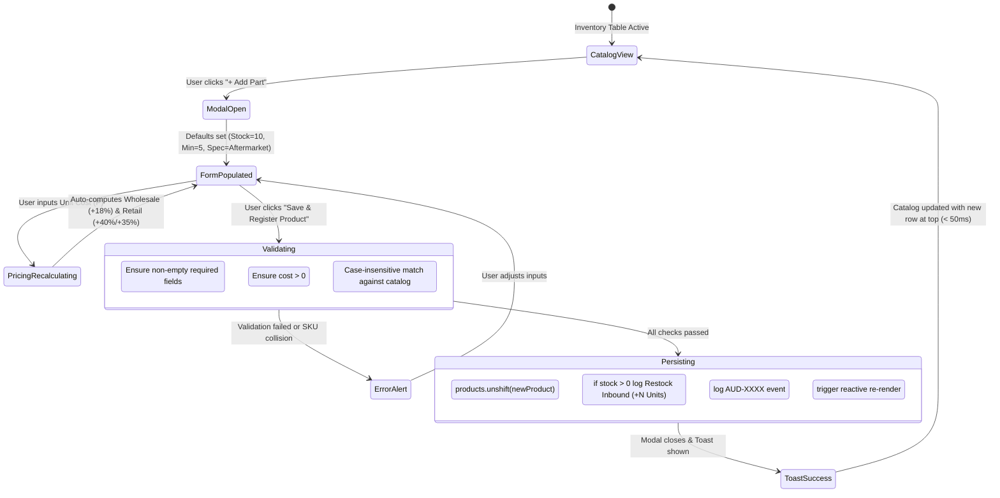

# Data Model: New Product Registration with Automated Markup & Location Assignment

**Feature**: `SIAA-16` (STORY-2.4: New Product Registration with Automated Markup & Location Assignment)  
**Parent Epic**: `SIAA-2` (EPIC-2: Inventory & Warehouse Rack/Shelf Management)  
**Branch**: `feat/SIAA-16-new-product-registration`

---

## 1. Domain Entities & Schemas

### 1.1. Product (Catalog Item)
Canonical inventory item in `@/lib/types/product`:

```typescript
export interface Product {
  sku: string;           // Normalized uppercase identifier (e.g., "RCB-AER-BP01")
  name: string;          // Descriptive part name (e.g., "RCB Ceramic Brake Pads Front")
  category: string;      // Workshop category (e.g., "Brakes", "Drivetrain", "Fluids")
  stock: number;         // Initial on-hand count (non-negative integer)
  minThreshold: number;  // Reorder alert threshold (positive integer >= 1)
  location: string;      // Physical rack/shelf locator (e.g., "Rack A-02 / Shelf 1")
  cost: number;          // Supplier purchase unit cost (₱)
  wholesale: number;     // Reseller trade price (₱)
  retail: number;        // Walk-in retail customer price (₱)
  oem: boolean;          // true = OEM Standard Replacement, false = Performance / Aftermarket
  model: string;         // Target motorcycle model or "Universal"
  brand: string;         // Brand or manufacturer name (e.g., "Racing Boy")
  description?: string;  // Optional extended notes
  imageUrl?: string;     // Optional product image asset
}
```

### 1.2. ProductRegistrationInput (Form Input State)
Data structure captured by the `<ProductRegistrationModal>`:

```typescript
export interface ProductRegistrationInput {
  sku: string;
  name: string;
  category: string;
  brand: string;
  model: string;
  location: string;
  specType: 'oem' | 'aftermarket';
  stock: number;
  minThreshold: number;
  cost: number;
  wholesale?: number;
  retail?: number;
}
```

### 1.3. PricingRules (Markup Configurations)
Store pricing multipliers in `@/lib/types/pricing`:

```typescript
export interface PricingRules {
  retailMarkup: number;      // Standard OEM retail markup percentage (e.g., 35)
  wholesaleMarkup: number;   // Wholesale trade markup percentage (e.g., 18)
  aftermarketMarkup: number; // Performance aftermarket retail markup percentage (e.g., 40)
  hourlyLaborRate: number;   // Hourly service labor rate (₱)
}
```

### 1.4. StockAdjustmentLog (Initial Intake Record)
Initial inbound movement entry logged when `stock > 0`:

```typescript
export interface StockAdjustmentLog {
  id: string;        // Unique identifier (format: "ADJ-XXXX")
  timestamp: string; // Formatted date/time (e.g., "2026-10-11 11:30")
  sku: string;       // Newly registered product SKU
  type: string;      // "Restock Inbound"
  change: string;    // Human-readable signed change (e.g., "+10 Units")
  reason: string;    // "New product master registration"
  user: string;      // Performing user attribution
}
```

### 1.5. AuditLog (Administrative Event Record)
Administrative audit entry recording registration event:

```typescript
export interface AuditLog {
  id: string;        // Unique identifier (format: "AUD-XXXX")
  timestamp: string; // Event timestamp
  user: string;      // Performing administrator
  action: string;    // "Created new inventory product SKU: {sku} ({name})"
  ip?: string;       // Client IP or environment identifier
}
```

---

## 2. Dynamic Pricing Calculation Matrix

| Part Specification | Base Cost | Applied Markup Field | Multiplier Formula | Default Rate | Example (Cost = ₱500) |
| :--- | :---: | :--- | :--- | :---: | :---: |
| **Wholesale (All Types)** | Cost | `wholesaleMarkup` | $\text{Cost} \times (1 + \frac{18}{100})$ | $+18\%$ | ₱590.00 |
| **Retail (OEM)** | Cost | `retailMarkup` | $\text{Cost} \times (1 + \frac{35}{100})$ | $+35\%$ | ₱675.00 |
| **Retail (Aftermarket)** | Cost | `aftermarketMarkup` | $\text{Cost} \times (1 + \frac{40}{100})$ | $+40\%$ | ₱700.00 |

*Note: Calculations round to 2 decimal places. Users may manually edit wholesale and retail values to override the automatic computation.*

---

## 3. Invariants & Business Validation Rules

1. **Case-Insensitive SKU Uniqueness**:
   $$\forall p \in \text{products}, \quad p.\text{sku}.\text{toUpperCase}() \neq \text{newSku}.\text{trim}().\text{toUpperCase}()$$
   Any collision blocks submission and surfaces an inline duplicate alert.

2. **Non-Negative Stock & Positive Cost**:
   - $\text{cost} > 0$ (must be a positive decimal currency amount).
   - $\text{stock} \ge 0$ (non-negative integer; items can be pre-registered with 0 stock).
   - $\text{minThreshold} \ge 1$ (reorder alert threshold must be at least 1).

3. **Mandatory Field Completeness**:
   - `sku`, `name`, `category`, `brand`, `model`, `location`, and `cost` must be non-empty strings/numbers.

4. **Dual Audit Logging Rule**:
   - If $\text{stock} > 0$: Log new `StockAdjustmentLog` (`type: "Restock Inbound"`, `change: "+{stock} Units"`).
   - If $\text{stock} = 0$: Skip inbound stock adjustment log (prevent false positive stock movements).
   - Always log `AuditLog` entry for catalog creation.

---

## 4. State Transition & Registration Lifecycle


