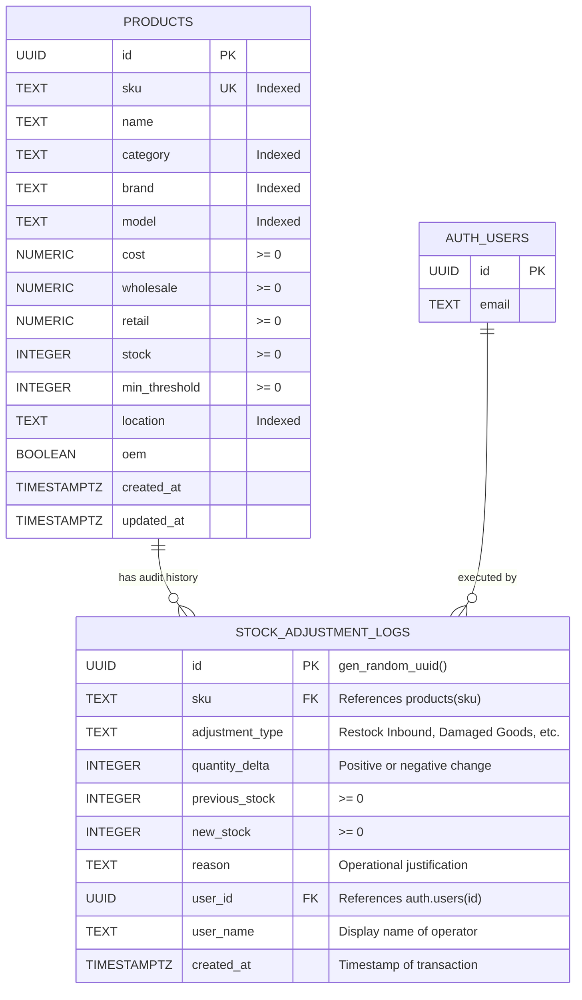
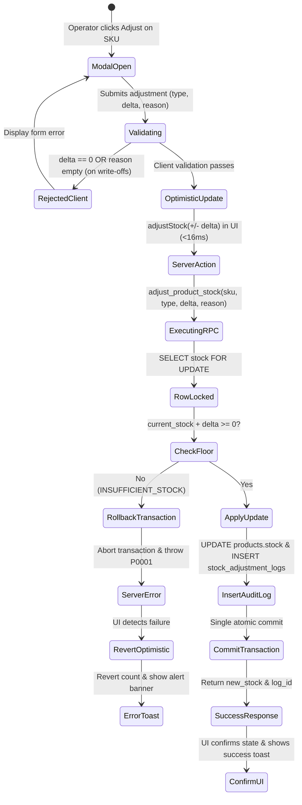

# Data Model: Supabase Atomic Stock Adjustment RPC & Immutable Audit Ledger

**Feature Branch**: `feat/SIAA-46-atomic-stock-adjustment-rpc`  
**Feature Spec**: [`specs/013-atomic-stock-adjustment-rpc/spec.md`](spec.md)  
**Jira Issue**: [SIAA-46](https://the-three-devsketeers.atlassian.net/browse/SIAA-46)  

---

## 1. Entity Overview

The stock adjustment and audit ledger subsystem manages two core entities and their relational integrity:
1. **`Product` (`public.products`)**: The master motorcycle parts record containing the current on-hand quantity (`stock`), unique `sku`, pricing tiers, and shelf locators.
2. **`StockAdjustmentLog` (`public.stock_adjustment_logs`)**: An append-only historical audit ledger recording every inventory modification, before-and-after balances, quantity deltas, operator notes, and authenticated staff attribution.



---

## 2. PostgreSQL Table Specifications

### 2.1. `public.stock_adjustment_logs`

| Column | Type | Nullable | Constraints & Defaults | Description |
| :--- | :--- | :---: | :--- | :--- |
| `id` | `UUID` | No | `PRIMARY KEY DEFAULT gen_random_uuid()` | Unique log identifier |
| `sku` | `TEXT` | No | `REFERENCES public.products(sku) ON UPDATE CASCADE ON DELETE RESTRICT` | Target product part number |
| `adjustment_type` | `TEXT` | No | `CHECK (length(adjustment_type) > 0)` | Operational category (Restock, Damage, Audit, etc.) |
| `quantity_delta` | `INTEGER` | No | `CHECK (quantity_delta != 0)` | Number of units added or deducted |
| `previous_stock` | `INTEGER` | No | `CHECK (previous_stock >= 0)` | Stock level immediately prior to adjustment |
| `new_stock` | `INTEGER` | No | `CHECK (new_stock >= 0)` | Resulting stock level after applying delta |
| `reason` | `TEXT` | No | `DEFAULT ''` | Audit rationale note |
| `user_id` | `UUID` | Yes | `REFERENCES auth.users(id) ON DELETE SET NULL` | Authenticated staff account identifier |
| `user_name` | `TEXT` | No | `DEFAULT 'Staff Member'` | Operator display name at transaction time |
| `created_at` | `TIMESTAMPTZ` | No | `DEFAULT timezone('utc'::text, now())` | Immutable transaction timestamp |

### 2.2. Indexes & Performance

```sql
-- Fast audit history lookup by product SKU (<50ms)
CREATE INDEX IF NOT EXISTS idx_stock_adjustment_logs_sku 
    ON public.stock_adjustment_logs(sku);

-- Chronological audit ledger queries and reporting
CREATE INDEX IF NOT EXISTS idx_stock_adjustment_logs_created_at 
    ON public.stock_adjustment_logs(created_at DESC);

-- Staff accountability and shrinkage audit filtering
CREATE INDEX IF NOT EXISTS idx_stock_adjustment_logs_user_id 
    ON public.stock_adjustment_logs(user_id);
```

---

## 3. Prisma Schema Definition (`prisma/schema.prisma`)

```prisma
model StockAdjustmentLog {
  id             String    @id @default(dbgenerated("gen_random_uuid()")) @db.Uuid
  sku            String
  adjustmentType String    @map("adjustment_type")
  quantityDelta  Int       @map("quantity_delta")
  previousStock  Int       @map("previous_stock")
  newStock       Int       @map("new_stock")
  reason         String    @default("")
  userId         String?   @map("user_id") @db.Uuid
  userName       String    @default("Staff Member") @map("user_name")
  createdAt      DateTime  @default(now()) @map("created_at") @db.Timestamptz(6)

  product        Product   @relation(fields: [sku], references: [sku], onDelete: Restrict, onUpdate: Cascade)

  @@index([sku])
  @@index([createdAt])
  @@index([userId])
  @@map("stock_adjustment_logs")
}
```

And in the existing `Product` model:
```prisma
model Product {
  // ... existing fields ...
  stockAdjustments StockAdjustmentLog[]
  // ...
}
```

---

## 4. TypeScript Domain Interfaces (`lib/types/stock-adjustment.ts`)

```typescript
export type StockAdjustmentCategory =
  | 'Restock Inbound'
  | 'Damaged Goods'
  | 'Physical Audit'
  | 'Shrinkage'
  | 'Store Transfer'
  | 'Return / Exchange';

export interface StockAdjustmentPayload {
  sku: string;
  type: StockAdjustmentCategory | string;
  delta: number;
  reason: string;
}

export interface StockAdjustmentResult {
  success: boolean;
  sku: string;
  previousStock: number;
  newStock: number;
  quantityDelta: number;
  logId?: string;
  error?: string;
}

export interface DbStockAdjustmentLog {
  id: string;
  sku: string;
  adjustmentType: string;
  quantityDelta: number;
  previousStock: number;
  newStock: number;
  reason: string;
  userId: string | null;
  userName: string;
  createdAt: string;
}
```

---

## 5. State Lifecycle & Validation Rules


