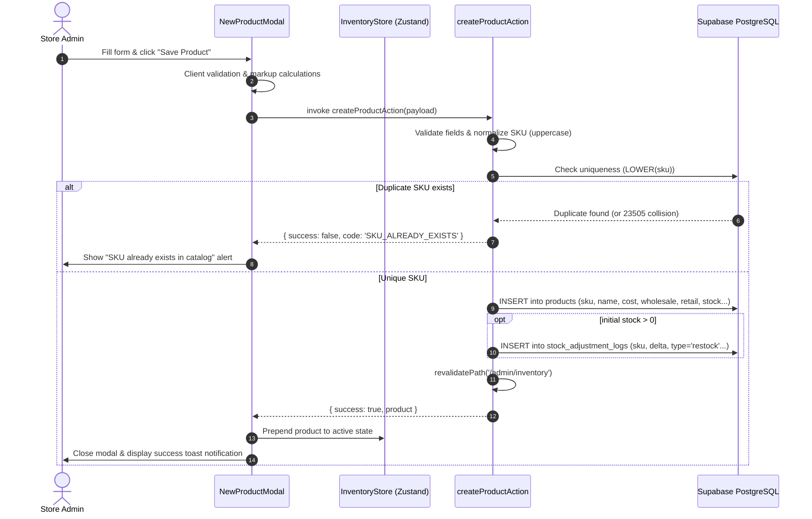

# Data Model: Supabase New Product Registration Server Action & SKU Uniqueness

**Feature**: `014-supabase-new-product-registration` (Jira: `SIAA-47`)
**Status**: Ready

## 1. Domain Entities & Database Mapping

### Product Entity (`public.products`)

| Column | Type | Nullable | Constraints & Defaults | Description |
| :--- | :--- | :--- | :--- | :--- |
| `id` | `UUID` | No | `PRIMARY KEY DEFAULT gen_random_uuid()` | Unique product identifier |
| `sku` | `TEXT` | No | `UNIQUE`, normalized uppercase | Master stock keeping unit |
| `name` | `TEXT` | No | Non-empty string | Human-readable part name |
| `category` | `TEXT` | No | Valid catalog category | Classification category |
| `brand` | `TEXT` | No | Non-empty string | Manufacturer / aftermarket brand |
| `model` | `TEXT` | No | `DEFAULT 'Universal'` | Compatible motorcycle model |
| `cost` | `NUMERIC(10, 2)` | No | `CHECK (cost >= 0)` | Base wholesale acquisition cost |
| `wholesale` | `NUMERIC(10, 2)` | No | `CHECK (wholesale >= 0)` | Wholesale tier selling price |
| `retail` | `NUMERIC(10, 2)` | No | `CHECK (retail >= 0)` | Retail counter selling price |
| `stock` | `INTEGER` | No | `DEFAULT 0 CHECK (stock >= 0)` | Current on-hand quantity |
| `min_threshold` | `INTEGER` | No | `DEFAULT 0 CHECK (min_threshold >= 0)` | Low stock reorder threshold |
| `location` | `TEXT` | Yes | Warehouse rack/shelf identifier | Physical shelf coordinate |
| `oem` | `BOOLEAN` | No | `DEFAULT false` | True if OEM part, false if aftermarket |
| `image_url` | `TEXT` | Yes | Valid image URI | Product showcase photo |
| `description` | `TEXT` | Yes | Optional part details | Extended description |
| `created_at` | `TIMESTAMPTZ` | No | `DEFAULT timezone('utc'::text, now())` | Record creation timestamp |
| `updated_at` | `TIMESTAMPTZ` | No | `DEFAULT timezone('utc'::text, now())` | Record update timestamp |

### Indexes & Uniqueness Constraints:
- `idx_products_sku`: Standard B-tree on `sku`.
- `idx_products_sku_lower`: Functional unique B-Tree index on `LOWER(sku)` enforcing case-insensitive uniqueness:
  ```sql
  CREATE UNIQUE INDEX IF NOT EXISTS idx_products_sku_lower ON public.products (LOWER(sku));
  ```

---

### Initial Stock Adjustment Log (`public.stock_adjustment_logs`)

When initial stock > 0, an initial inbound record is inserted:

| Column | Type | Value / Source | Description |
| :--- | :--- | :--- | :--- |
| `id` | `UUID` | `gen_random_uuid()` | Audit entry unique ID |
| `sku` | `TEXT` | `product.sku` | Target product SKU |
| `adjustment_type` | `TEXT` | `'restock'` | Classification |
| `quantity_delta` | `INTEGER` | `product.stock` | Initial quantity arrived |
| `previous_stock` | `INTEGER` | `0` | Prior on-hand balance |
| `new_stock` | `INTEGER` | `product.stock` | Starting balance |
| `reason` | `TEXT` | `'Initial inventory registration'` | Contextual audit reason |
| `user_id` | `UUID` | Active session user ID (optional) | Staff ID |
| `user_name` | `TEXT` | Session display name or `'Inventory Manager (Admin)'` | Staff attribution |
| `created_at` | `TIMESTAMPTZ` | `now()` | Timestamp |

---

## 2. TypeScript Data Transfer Objects (DTOs)

```typescript
export interface CreateProductPayload {
  sku: string;
  name: string;
  category: string;
  brand: string;
  model: string;
  cost: number;
  wholesale?: number;
  retail?: number;
  stock: number;
  minThreshold: number;
  location?: string;
  oem?: boolean;
  imageUrl?: string;
  description?: string;
  userName?: string;
}

export type CreateProductErrorCode =
  | 'SKU_ALREADY_EXISTS'
  | 'VALIDATION_ERROR'
  | 'DATABASE_ERROR'
  | 'UNAUTHORIZED';

export interface CreateProductResult {
  success: boolean;
  product?: Product;
  error?: string;
  code?: CreateProductErrorCode;
  fieldErrors?: Record<string, string>;
}
```

---

## 3. Product Registration Lifecycle & State Machine


