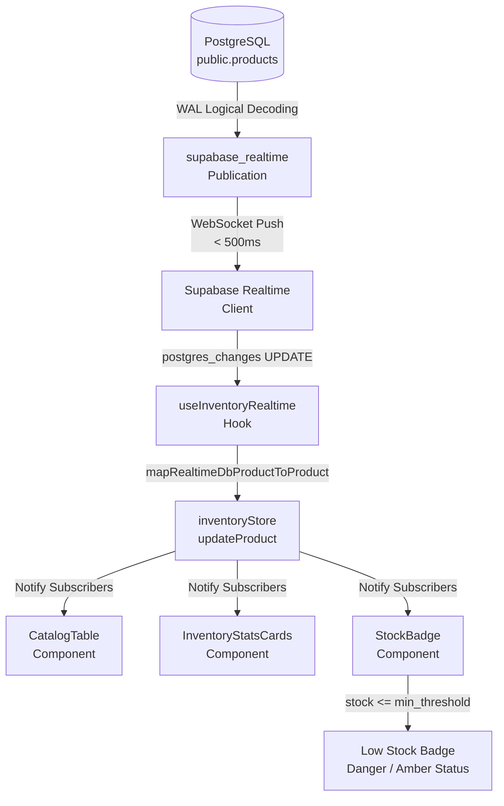
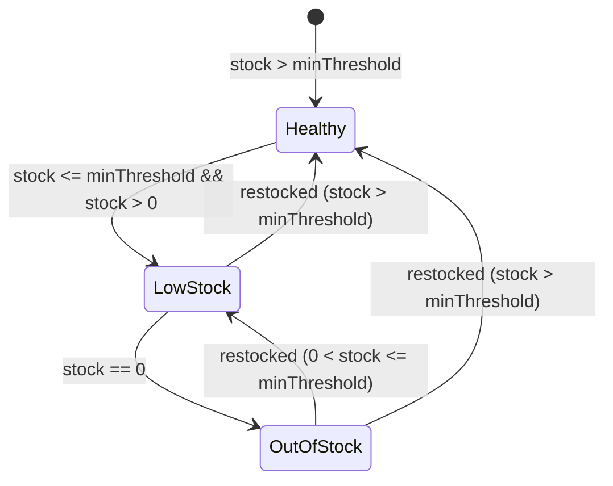

# Data Model: Supabase Realtime Multi-Terminal Sync & Low-Stock Alerts Engine

**Feature Branch**: `feat/SIAA-48-supabase-realtime-multi-terminal-sync`  
**Feature Spec**: [`specs/014-supabase-realtime-multi-terminal-sync/spec.md`](spec.md)  
**Jira Issue**: [SIAA-48](https://the-three-devsketeers.atlassian.net/browse/SIAA-48)  

---

## 1. Entity Overview & Flow Diagram

The real-time synchronization subsystem links database-level product state modifications directly with client-side reactive UI stores:



---

## 2. Database Schema & Publication Definition

### `public.products` Realtime Configuration

```sql
-- 1. Register public.products with Supabase Realtime Publication
ALTER PUBLICATION supabase_realtime ADD TABLE public.products;

-- 2. Configure Full Replica Identity to guarantee complete row context on UPDATE
ALTER TABLE public.products REPLICA IDENTITY FULL;
```

### Table Structure (`public.products`)
| Column | Type | Constraints | Description |
| :--- | :--- | :--- | :--- |
| `id` | UUID | PRIMARY KEY, DEFAULT gen_random_uuid() | Unique product identifier |
| `sku` | TEXT | NOT NULL, UNIQUE, Indexed | Part SKU code (e.g. `BRK-PAD-001`) |
| `name` | TEXT | NOT NULL | Part display name |
| `category` | TEXT | NOT NULL, Indexed | Part category (Brakes, Engine, etc.) |
| `brand` | TEXT | NOT NULL, Indexed | Manufacturer brand |
| `model` | TEXT | NOT NULL, DEFAULT 'Universal' | Motorcycle model fitment |
| `cost` | NUMERIC(10,2) | NOT NULL, CHECK (cost >= 0) | Acquisition cost |
| `wholesale` | NUMERIC(10,2) | NOT NULL, CHECK (wholesale >= 0) | Wholesale trade price |
| `retail` | NUMERIC(10,2) | NOT NULL, CHECK (retail >= 0) | Over-the-counter retail price |
| `stock` | INTEGER | NOT NULL, DEFAULT 0, CHECK (stock >= 0) | Physical on-hand inventory |
| `min_threshold` | INTEGER | NOT NULL, DEFAULT 0, CHECK (min_threshold >= 0) | Minimum reorder threshold |
| `location` | TEXT | NULL | Shelf / rack locator tag |
| `oem` | BOOLEAN | NOT NULL, DEFAULT false | Genuine OEM indicator |
| `image_url` | TEXT | NULL | Product thumbnail URL |
| `description` | TEXT | NULL | Part technical notes |
| `created_at` | TIMESTAMPTZ | NOT NULL, DEFAULT now() | Creation timestamp |
| `updated_at` | TIMESTAMPTZ | NOT NULL, DEFAULT now() | Auto-updated timestamp |

---

## 3. TypeScript Domain Models & Contracts

### 3.1 Realtime Payload Interface

```typescript
export type RealtimeEventType = 'INSERT' | 'UPDATE' | 'DELETE' | '*';

export interface RealtimePostgresChangesPayload<T = Record<string, unknown>> {
  schema: string;
  table: string;
  commit_timestamp: string;
  eventType: RealtimeEventType;
  new: T;
  old: Partial<T>;
  errors?: string[];
}

export interface DbProductRow {
  id: string;
  sku: string;
  name: string;
  category: string;
  brand: string;
  model: string;
  cost: number | string;
  wholesale: number | string;
  retail: number | string;
  stock: number;
  min_threshold: number;
  location?: string | null;
  oem: boolean;
  image_url?: string | null;
  description?: string | null;
  created_at?: string;
  updated_at?: string;
}
```

### 3.2 Canonical Application `Product` Model

```typescript
export interface Product {
  id?: string;
  sku: string;
  name: string;
  category: string;
  stock: number;
  minThreshold: number;
  location: string;
  cost: number;
  wholesale: number;
  retail: number;
  oem: boolean;
  model: string;
  brand: string;
  description?: string;
  imageUrl?: string;
  createdAt?: string | Date;
  updatedAt?: string | Date;
}
```

### 3.3 Stock Health Status State Machine



| State | Condition | Badge Styling (SWIFT Tokens) |
| :--- | :--- | :--- |
| **Healthy** | `stock > minThreshold` | `bg-success-light text-success border-success/30` |
| **Low Stock** | `stock <= minThreshold && stock > 0` | `bg-danger-light text-danger border-danger/30` |
| **Out of Stock**| `stock === 0` | `bg-danger text-text-light` |
