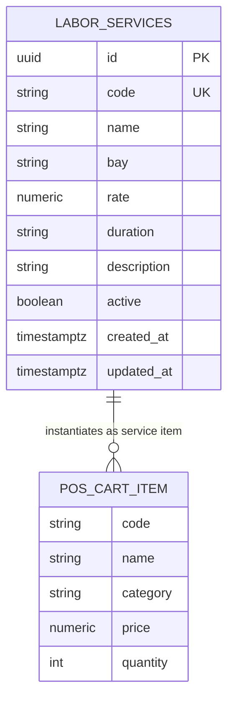

# Data Model: Supabase Workshop Labor Services

**Feature Branch**: `feat/SIAA-49-supabase-labor-services-schema-rates`  
**Jira Issue**: [SIAA-49](https://the-three-devsketeers.atlassian.net/browse/SIAA-49)  

---

## 1. Database Entity: `public.labor_services`

| Column | Type | Constraints | Description |
| :--- | :--- | :--- | :--- |
| `id` | `UUID` | `PRIMARY KEY DEFAULT gen_random_uuid()` | Unique service identifier |
| `code` | `TEXT` | `NOT NULL UNIQUE` | Human-readable service code (e.g. `SRV-OIL-01`) |
| `name` | `TEXT` | `NOT NULL` | Full display name of the workshop service |
| `bay` | `TEXT` | `NOT NULL` | Repair bay allocation (e.g. `Bay 1 / Quick Bay`) |
| `rate` | `NUMERIC(10, 2)` | `NOT NULL CHECK (rate >= 0)` | Standard flat labor rate in Philippine Peso (₱) |
| `duration` | `TEXT` | `NOT NULL` | Estimated turnaround time (e.g. `15 mins`) |
| `description` | `TEXT` | `NULL` | Detailed description of service tasks |
| `active` | `BOOLEAN` | `NOT NULL DEFAULT true` | Active flag for catalog availability |
| `created_at` | `TIMESTAMPTZ` | `NOT NULL DEFAULT timezone('utc'::text, now())` | Creation timestamp |
| `updated_at` | `TIMESTAMPTZ` | `NOT NULL DEFAULT timezone('utc'::text, now())` | Auto-updated modification timestamp |

---

## 2. Prisma Model: `LaborService`

```prisma
model LaborService {
  id          String   @id @default(dbgenerated("gen_random_uuid()")) @db.Uuid
  code        String   @unique
  name        String
  bay         String
  rate        Decimal  @db.Decimal(10, 2)
  duration    String
  description String?
  active      Boolean  @default(true)
  createdAt   DateTime @default(now()) @map("created_at") @db.Timestamptz(6)
  updatedAt   DateTime @default(now()) @updatedAt @map("updated_at") @db.Timestamptz(6)

  @@index([code])
  @@index([active])
  @@map("labor_services")
}
```

---

## 3. TypeScript Domain Interface (`lib/types/service.ts`)

```typescript
export interface LaborService {
  id?: string;
  code: string;
  name: string;
  bay: string; // e.g. "Bay 1 / Quick Bay"
  rate: number; // Flat labor rate in PHP
  duration: string; // e.g. "15 mins", "45 mins"
  description?: string;
  active?: boolean;
}
```

---

## 4. Entity Relationship Diagram


