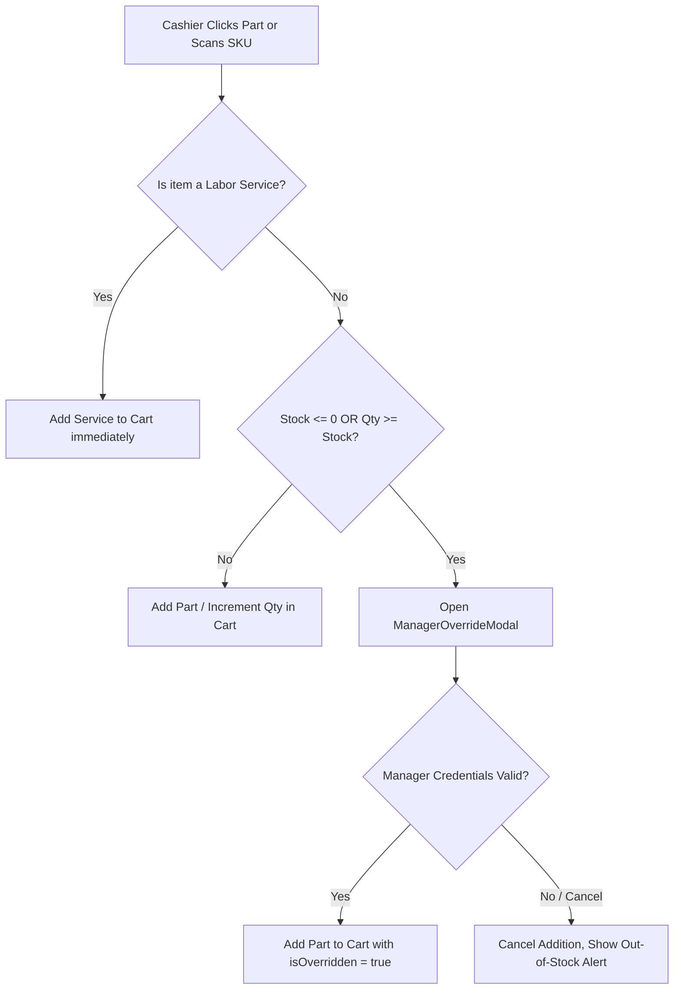

# Research & Architecture Decisions: Hybrid POS Cart & Joint Line-Item Engine

**Feature**: Hybrid POS Cart & Joint Parts + Workshop Labor Line-Item Engine  
**Jira Issue**: [SIAA-18](https://the-three-devsketeers.atlassian.net/browse/SIAA-18) (STORY-3.1)  
**Parent Epic**: [SIAA-3](https://the-three-devsketeers.atlassian.net/browse/SIAA-3)  
**Date**: 2026-10-11  

---

## 1. Technical Context & Existing Architecture

### 1.1 Existing State & Components
- **Cart Types**: `lib/types/cart.ts` defines `BaseCartItem`, `PartCartItem`, `ServiceCartItem`, `CartItem`, and `CartTotals`.
- **Cart Store**: `lib/store/cart-store.ts` implements a singleton store using React's `useSyncExternalStore` for flicker-free subscription and zero re-render lag.
- **Staff POS (`app/staff/pos/page.tsx`)**:
  - Implemented an inline `useState<PosCartItem[]>` which bypassed the centralized `cartStore`.
  - Coerced `LaborService` objects into synthetic `Product` items with category `"SERVICES"` instead of leveraging native `ServiceCartItem`.
  - Implemented manager override modal and zero-stock guards locally.
- **Admin POS (`app/admin/pos/page.tsx`)**:
  - Currently a placeholder card referencing SIAA-18 through SIAA-22.
- **Supabase Realtime & Actions**:
  - `lib/pos/actions.ts`: `getLaborServicesAction` fetches services from `public.labor_services`.
  - `lib/admin/product-actions.ts`: `getProductsAction`, `adjustProductStockAction`.
  - `lib/hooks/use-labor-services-realtime.ts`: Realtime subscription for labor rates.

### 1.2 Gaps Addressed by SIAA-18
1. **Unified Discriminated Union Cart**:
   - `CartItem = PartCartItem | ServiceCartItem`.
   - Clear distinction in UI:
     - Parts display: SKU, Aisle/Shelf location, stock level, unit retail/wholesale price.
     - Services display: Service Code, Workshop Service tag, designated repair bay, estimated duration, flat rate (₱).
2. **Centralized Cart Store (`cartStore`)**:
   - Move state management from ad-hoc component `useState` into `@/lib/store/cart-store`.
   - Incorporate stock guards and manager override flags directly into `addPart` and `updateQuantity`.
   - Guarantee subtotal and total recalculations in `< 50ms`.
3. **Multi-Portal Parity**:
   - Connect both `/staff/pos` and `/admin/pos` to the shared `useCartStore`.
   - Admin and Staff experiences share identical checkout math and line-item capabilities.

---

## 2. Core Architecture Decisions

### 2.1 Discriminated Union Cart Item Model
```typescript
export interface BaseCartItem {
  id: string;
  name: string;
  price: number;
  qty: number;
}

export interface PartCartItem extends BaseCartItem {
  type: 'part';
  sku: string;
  location?: string;
  retailPrice?: number;
  wholesalePrice?: number;
  stock?: number;
  isOverridden?: boolean;
}

export interface ServiceCartItem extends BaseCartItem {
  type: 'service';
  code: string;
  bay?: string;
  duration?: string;
}

export type CartItem = PartCartItem | ServiceCartItem;
```

### 2.2 Instant Subtotal & Cart Totals Engine
- The subtotal computation is an $O(N)$ pure function executed synchronously on every mutation:
$$\text{subtotal} = \sum_{i=1}^N (\text{item}_i.\text{price} \times \text{item}_i.\text{qty})$$
$$\text{discountAmount} = \text{round}(\text{subtotal} \times \text{discountRate}, 2)$$
$$\text{total} = \max(0, \text{subtotal} - \text{discountAmount})$$
- Because $N$ in a retail POS cart is typically $< 100$, calculations take $< 0.1\text{ms}$, well below the $50\text{ms}$ threshold.

### 2.3 Physical Stock Guard & Manager Override Flow


### 2.4 Modular Component Decomposition
To maintain clean separation of concerns and reuse between `/staff/pos` and `/admin/pos`:
- `components/pos/hybrid-cart-pane.tsx`: Standalone reactive cart ticket pane displaying items list, quantity steppers, item removal, pricing mode toggle, discount selector, subtotal breakdown, and checkout button.
- `components/pos/pos-item-card.tsx`: Fast-item catalog card supporting both physical parts (with stock badges) and workshop services (with bay & duration badges).

---

## 3. SWIFT Design Tokens Adherence

- Card / Pane surfaces: `bg-bg-surface`, `bg-bg-card`, `bg-bg-base`, `bg-bg-muted`
- Typography: `text-text-primary`, `text-text-secondary`, `text-text-muted`, `text-text-light`
- Action & Status:
  - Brand: `bg-primary`, `text-primary`, `bg-primary-light`, `border-primary`
  - Secondary: `bg-secondary`, `text-secondary`
  - Success (Total Due): `text-success`, `bg-success`
  - Danger (Out-of-Stock / Discount): `text-danger`, `bg-danger-light`
- Zero hardcoded colors: Strict compliance with `app/globals.css` and `lib/tokens.ts`.

---

## 4. Verification & Testing Strategy

1. **Unit Tests**:
   - `lib/store/__tests__/cart-store.test.ts`:
     - Test adding physical part (`MOT-3100-10W40`) creates `PartCartItem` with qty 1; repeat clicks increment qty.
     - Test adding workshop service (`SRV-CVT-01`) creates `ServiceCartItem` with bay, duration, flat rate.
     - Test quantity increment, decrement, and automatic removal when reaching 0.
     - Test subtotal math updates synchronously in <50ms.
     - Test out-of-stock guard rejects un-overridden items with 0 stock.
     - Test override flag allows addition of zero-stock parts.
     - Test dual-mode pricing switch updates parts without affecting fixed service rates.
2. **Component & Integration Tests**:
   - Test rendering of `HybridCartPane` on `/staff/pos` and `/admin/pos`.
   - Test manager override modal interaction and authorization callback.
