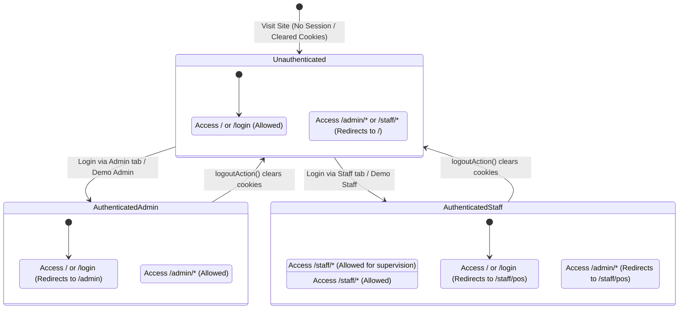

# Data Model: Authenticated Session Route Guards & Navigation State

**Feature**: Authenticated Session Route Guards & Login Redirects ([SIAA-71](https://the-three-devsketeers.atlassian.net/browse/SIAA-71))
**Status**: Draft

---

## 1. Domain Types & State Models

```typescript
/**
 * Supported user roles across the SWIFT system
 */
export type PortalRole = "admin" | "staff";

/**
 * Route category classification based on request pathname
 */
export type RouteClassification =
  | "AUTH_HUB"       // Routes: '/', '/login'
  | "ADMIN_PORTAL"   // Routes: '/admin', '/admin/*'
  | "STAFF_PORTAL"   // Routes: '/staff', '/staff/*'
  | "PUBLIC_ASSET"   // Routes: '_next/*', static assets, favicons
  | "OTHER";         // Other public or API routes

/**
 * Normalized session evaluation snapshot
 */
export interface ResolvedSession {
  isAuthenticated: boolean;
  role: PortalRole | null;
  userId?: string;
  source: "supabase" | "demo" | "none";
}

/**
 * Guard policy evaluation result
 */
export interface GuardDecision {
  action: "ALLOW" | "REDIRECT";
  destination?: string;
  statusCode?: 307 | 308;
}

/**
 * Input context supplied to the guard engine
 */
export interface RouteGuardContext {
  pathname: string;
  session: ResolvedSession;
}
```

---

## 2. Session State Transition Machine



---

## 3. Storage & Cookie Schemas

| Cookie Name | Purpose | Value Format | Scope / Security |
| :--- | :--- | :--- | :--- |
| `swift-session-role` | Encodes active portal authority | `"admin"` \| `"staff"` | `Path=/; HttpOnly; SameSite=Lax` |
| `swift-user-name` | Display name for navigation shell | String (e.g. `"Shop Administrator"`) | `Path=/; SameSite=Lax` |
| `sb-*-auth-token` | Supabase SSR session token array | Base64 JSON token pair | Managed by `@supabase/ssr` |
