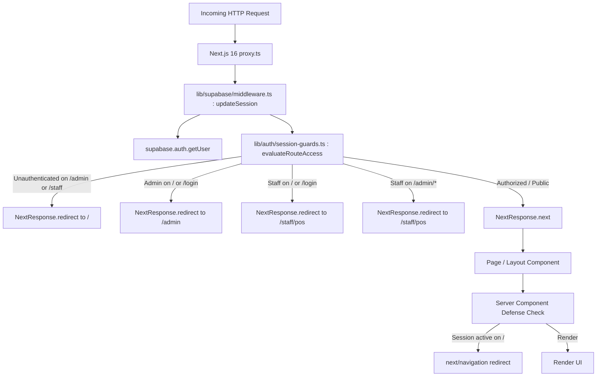

# Implementation Plan: Authenticated Session Route Guards & Login Redirects

**Feature**: Authenticated Session Route Guards & Login Redirects ([SIAA-71](https://the-three-devsketeers.atlassian.net/browse/SIAA-71))
**Parent Epic**: Foundation, Authentication Hub & App Shell ([SIAA-1](https://the-three-devsketeers.atlassian.net/browse/SIAA-1))
**Status**: Draft

---

## 1. Architecture Overview & Boundary Mapping

---

## 2. Component Hierarchy & Module Touchpoints

1. **`lib/auth/session-guards.ts`** (New Domain Logic Module):
   - `classifyRoute(pathname: string): RouteClassification`
   - `evaluateRouteAccess(pathname: string, session: ResolvedSession): GuardDecision`
   - `resolveSessionFromCookies(cookieStore)` & `resolveSession(supabaseUser, cookies)`
2. **`lib/auth/__tests__/session-guards.test.ts`** (New Unit Test Suite):
   - Comprehensive test cases covering all 12+ matrix combinations of route categories, roles, and auth states.
3. **`lib/supabase/middleware.ts` & `proxy.ts`** (Network Layer Integration):
   - Integrate `evaluateRouteAccess` directly inside `updateSession(request: NextRequest)`.
   - Issue `NextResponse.redirect(new URL(destination, request.url))` when a redirect decision is made, preserving updated session cookies on the redirect response.
4. **`app/page.tsx` & `app/(auth)/login/page.tsx`** (Server Component Defense-in-Depth):
   - Check `cookies()` on initial server render; if session exists, invoke `redirect("/admin")` or `redirect("/staff/pos")`.
5. **`app/admin/layout.tsx` & `app/staff/layout.tsx`** (Portal Layout Defense-in-Depth):
   - Check session cookies at the layout boundary and redirect unauthorized callers to `/`.

---

## 3. Implementation Phases & Gate Sequence

- **Phase A**: Domain Engine & Pure Guard Module (`lib/auth/session-guards.ts`)
- **Phase B**: Automated TDD Unit Tests (`lib/auth/__tests__/session-guards.test.ts`)
- **Phase C**: Edge Proxy Guard Integration (`lib/supabase/middleware.ts`, `proxy.ts`)
- **Phase D**: Server Component Defense-in-Depth (`app/page.tsx`, `app/(auth)/login/page.tsx`, layouts)
- **Phase E**: End-to-End Verification (`npm test`, `npx tsc --noEmit`, `npm run lint`)
