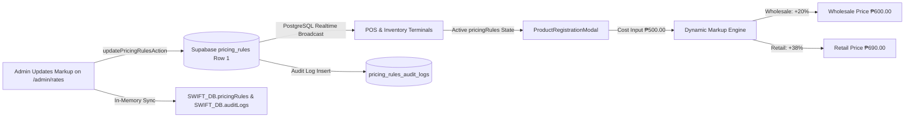

# Data Model: Global Markup Rules Configuration

**Feature**: `019-global-markup-rules-configuration`  
**Jira Issue**: [SIAA-39](https://the-three-devsketeers.atlassian.net/browse/SIAA-39)  

---

## 1. Entities & Data Structures

### 1.1 `PricingRules` (Domain Interface)

```typescript
export interface PricingRules {
  id?: number;
  retailMarkup: number;      // percentage, e.g. 35 (0 < markup <= 200)
  wholesaleMarkup: number;   // percentage, e.g. 18 (0 < markup <= 200)
  aftermarketMarkup: number; // percentage, e.g. 40 (0 < markup <= 200)
  hourlyLaborRate: number;   // PHP/hour, e.g. 450 (rate >= 0)
  updatedAt?: string;
  updatedBy?: string | null;
}
```

### 1.2 `AuditLog` (In-Memory / Mock Model)

```typescript
export interface AuditLog {
  id: string;
  timestamp: string;
  user: string;
  action: string;
  ip?: string;
}
```

### 1.3 `PricingRulesAuditLog` (Database Structured Model)

```typescript
export interface PricingRulesAuditLog {
  id: string;
  changedBy: string | null;
  userName: string;
  oldRetailMarkup: number;
  newRetailMarkup: number;
  oldWholesaleMarkup: number;
  newWholesaleMarkup: number;
  oldAftermarketMarkup: number;
  newAftermarketMarkup: number;
  oldHourlyLaborRate: number;
  newHourlyLaborRate: number;
  reason?: string;
  createdAt: string;
}
```

---

## 2. State Lifecycle & Calculation Engine


