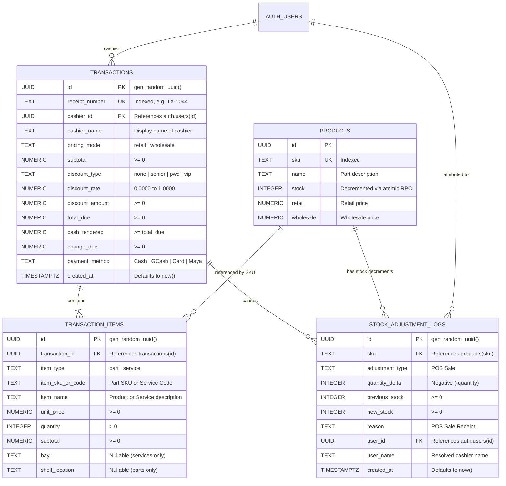

# Data Model: Supabase Atomic Checkout RPC with Stock Decrements & Audit Logging

**Feature Branch**: `feat/SIAA-51-atomic-checkout-rpc-stock-decrements`  
**Feature Spec**: [`specs/019-pos-checkout-atomic-rpc/spec.md`](spec.md)  
**Jira Issue**: [SIAA-51](https://the-three-devsketeers.atlassian.net/browse/SIAA-51)  

---

## 1. Entity-Relationship Overview

The atomic POS checkout system orchestrates changes across four core tables in a single transaction:
1. **`Transaction` (`public.transactions`)**: Master receipt record storing financial totals, pricing mode, cashier attribution, and payment method.
2. **`TransactionItem` (`public.transaction_items`)**: Itemized lines storing physical parts or workshop services.
3. **`Product` (`public.products`)**: Master motorcycle parts catalog where `stock` is decremented with pessimistic locking (`FOR UPDATE`).
4. **`StockAdjustmentLog` (`public.stock_adjustment_logs`)**: Immutable audit ledger logging each physical stock decrement with `adjustment_type: 'POS Sale'`.



---

## 2. Stored Procedure Input & Return DTOs

### 2.1 `p_transaction` JSONB Payload
```json
{
  "receipt_number": "TX-1044",
  "cashier_id": "c0000000-0000-0000-0000-000000000002",
  "cashier_name": "Mike Morales",
  "pricing_mode": "retail",
  "subtotal": 880.00,
  "discount_type": "none",
  "discount_rate": 0.0000,
  "discount_amount": 0.00,
  "total_due": 880.00,
  "cash_tendered": 1000.00,
  "change_due": 120.00,
  "payment_method": "Cash"
}
```

### 2.2 `p_items` JSONB Array Payload
```json
[
  {
    "item_type": "part",
    "item_sku_or_code": "MOT-3100-10W40",
    "item_name": "Motul 3100 Gold 4T 10W40 (1L)",
    "unit_price": 390.00,
    "quantity": 2,
    "subtotal": 780.00,
    "shelf_location": "Aisle 1 / Shelf 1",
    "bay": null
  },
  {
    "item_type": "service",
    "item_sku_or_code": "SRV-OIL-01",
    "item_name": "Labor: Standard Oil Change",
    "unit_price": 100.00,
    "quantity": 1,
    "subtotal": 100.00,
    "shelf_location": null,
    "bay": "Bay 1 / Quick Bay"
  }
]
```

### 2.3 RPC Success Response JSONB
```json
{
  "success": true,
  "transaction_id": "t1111111-2222-3333-4444-555555555555",
  "receipt_number": "TX-1044",
  "items_count": 2,
  "parts_decremented": 1,
  "created_at": "2026-10-11T12:00:00.000Z"
}
```

---

## 3. TypeScript Interfaces

```typescript
export interface CheckoutPayload {
  receiptNumber?: string;
  cashierId?: string | null;
  cashierName?: string;
  pricingMode: 'retail' | 'wholesale';
  subtotal: number;
  discountType?: string | null;
  discountRate: number;
  discountAmount: number;
  totalDue: number;
  cashTendered: number;
  changeDue: number;
  paymentMethod: string;
  items: Array<{
    itemType: 'part' | 'service';
    itemSkuOrCode: string;
    itemName: string;
    unitPrice: number;
    quantity: number;
    subtotal: number;
    shelfLocation?: string | null;
    bay?: string | null;
  }>;
}

export type CheckoutActionResult =
  | {
      success: true;
      transactionId: string;
      receiptNumber: string;
      itemsCount: number;
      createdAt: string;
    }
  | {
      success: false;
      code: 'INSUFFICIENT_STOCK' | 'PRODUCT_NOT_FOUND' | 'CHECKOUT_FAILED' | 'VALIDATION_ERROR';
      sku?: string;
      error: string;
    };
```
