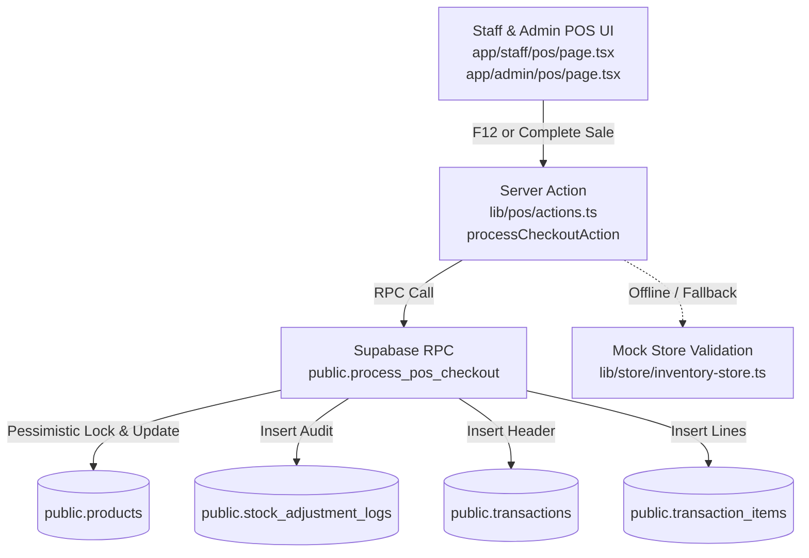

# Implementation Plan: Supabase Atomic Checkout RPC with Stock Decrements & Audit Logging

**Feature**: SIAA-51 (STORY-3.8)  
**Spec Directory**: `specs/019-pos-checkout-atomic-rpc/`  
**Feature Branch**: `feat/SIAA-51-atomic-checkout-rpc-stock-decrements`  

---

## 1. Technical Architecture & File Boundaries

### 1.1 Files to Create or Modify
1. **Migration Artifact**:
   - `supabase/migrations/20261014010000_process_pos_checkout_rpc.sql` (Creates `public.process_pos_checkout` stored procedure).
2. **Contracts & Validation**:
   - `specs/019-pos-checkout-atomic-rpc/contracts/checkout-rpc.ts` (Zod schemas and TypeScript types).
   - `lib/types/transaction.ts` (Add `CheckoutActionResult` and `CheckoutPayload` exports).
3. **Server Action & Business Logic**:
   - `lib/pos/actions.ts` (Add `processCheckoutAction(payload)` calling Supabase RPC with fallback handling).
4. **UI Integration**:
   - `app/staff/pos/page.tsx` (Wire `processCheckoutAction`, replace naive loop, add toast error handling for `INSUFFICIENT_STOCK`).
   - `app/admin/pos/page.tsx` (Wire `processCheckoutAction`, replace naive loop, add toast error handling).
5. **Automated Unit & Integration Tests**:
   - `lib/pos/__tests__/atomic-checkout-rpc.test.ts` (Validate atomic checkout action, rollback on out-of-stock, non-repudiation, and service exemption).

---

## 2. Design Tokens & Visual Hierarchy (Rule 3 Adherence)

- Error toast notifications MUST use semantic SWIFT design token classes:
  - Background: `bg-danger/10` or `bg-bg-card` with `border-danger`
  - Text: `text-danger`
  - Icons: Lucide `AlertCircle` or `XCircle` with `text-danger`
- Zero hardcoded colors (`#hex` or non-token Tailwind colors).

---

## 3. Test Plan

### Unit & Integration Test Matrix (`lib/pos/__tests__/atomic-checkout-rpc.test.ts`)
1. **Successful Multi-Item Hybrid Sale**: Validates that parts and services in the cart correctly produce a transaction, decrement part inventory stock, and generate `'POS Sale'` audit logs.
2. **Insufficient Stock Rollback (`INSUFFICIENT_STOCK`)**: Asserts that when a part has on-hand `stock = 1` and `quantity = 2` is requested, the action returns `{ success: false, code: 'INSUFFICIENT_STOCK', sku }`, and no stock is changed.
3. **Pure Workshop Service Sale**: Asserts that a cart containing only workshop services completes with zero stock deductions and zero stock adjustment logs.
4. **Validation Failure on Empty or Malformed Payload**: Asserts that empty items array or invalid pricing mode is rejected with `VALIDATION_ERROR`.

---

## 4. Risk Mitigation & Edge Cases

| Risk | Impact | Mitigation Strategy |
| :--- | :--- | :--- |
| Deadlock during concurrent multi-item checkouts | Transaction timeout | Order parts deterministically by SKU before acquiring `FOR UPDATE` lock. |
| Network disconnect or offline kiosk terminal | POS crash | Graceful fallback in Server Action with mock store verification. |
| Negative stock edge case | Inventory corruption | PostgreSQL check constraint `CHECK (stock >= 0)` and procedure pre-check `IF v_new_stock < 0 THEN RAISE EXCEPTION`. |
