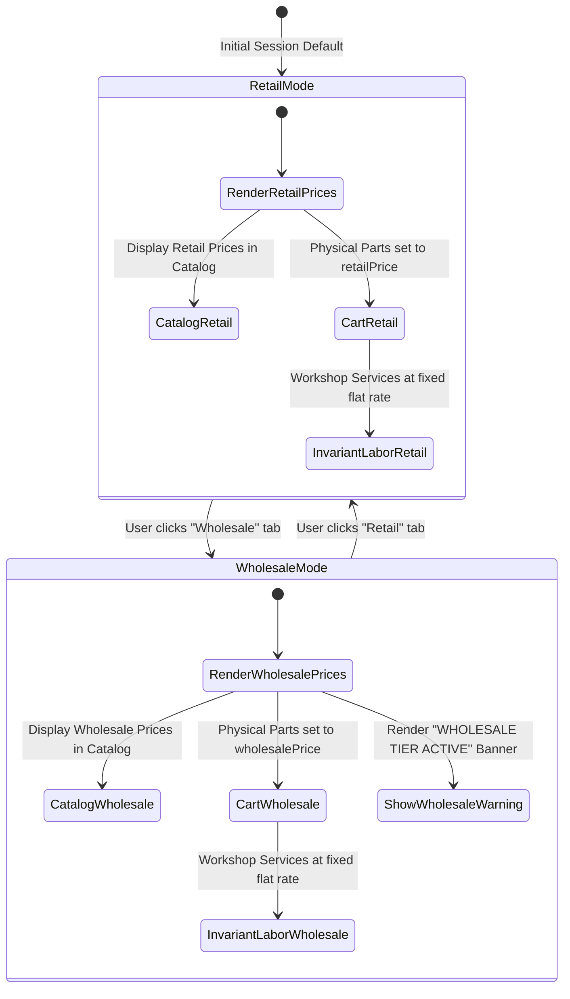

# Data Models & Schemas: Dual-Tier Pricing Switcher

**Feature**: Dual-Tier Pricing Switcher (Retail vs. Wholesale) with Dynamic Cart Recalculation  
**Branch**: `feat/SIAA-19-dual-tier-pricing-switcher`  
**Date**: 2026-10-11  

---

## 1. Domain Entities & Type Definitions

### 1.1 Pricing Mode
```typescript
export type PricingMode = 'retail' | 'wholesale';
```

### 1.2 Cart Item Types (Hybrid Line Items)

```typescript
export type CartItemType = 'part' | 'service';

export interface BaseCartItem {
  id: string;
  type: CartItemType;
  name: string;
  price: number; // Active unit price according to active PricingMode
  qty: number;
}

export interface PartCartItem extends BaseCartItem {
  type: 'part';
  sku: string;
  location?: string;
  retailPrice?: number;
  wholesalePrice?: number;
  stock?: number;
  minThreshold?: number;
  isOverridden?: boolean;
}

export interface ServiceCartItem extends BaseCartItem {
  type: 'service';
  code: string;
  bay?: string;
  duration?: string;
}

export type CartItem = PartCartItem | ServiceCartItem;
```

### 1.3 Cart Totals Math
```typescript
export interface CartTotals {
  subtotal: number;
  discountRate: number;
  discountAmount: number;
  total: number;
  itemCount: number;
}
```

### 1.4 Cart Store State
```typescript
export interface CartStoreState {
  items: CartItem[];
  pricingMode: PricingMode;
  discountRate: number;
  totals: CartTotals;
}
```

---

## 2. Dynamic Recalculation State Machine



---

## 3. Mathematical Invariants

1. **Part Recalculation**:
   $$\text{item.price} = \begin{cases} \text{item.wholesalePrice} & \text{if } \text{pricingMode} = \text{'wholesale'} \\ \text{item.retailPrice} & \text{if } \text{pricingMode} = \text{'retail'} \end{cases}$$
2. **Labor Service Flat-Rate Invariance**:
   $$\forall \text{item} \in \text{items}, \text{item.type} = \text{'service'} \implies \Delta(\text{item.price}) = 0$$
3. **Quantity Conservation**:
   $$\forall \text{item} \in \text{items}, \text{item.qty}_{\text{new}} = \text{item.qty}_{\text{old}}$$
4. **Subtotal Invariance**:
   $$\text{subtotal} = \sum_{i=1}^N (\text{item}_i.\text{price} \times \text{item}_i.\text{qty})$$
