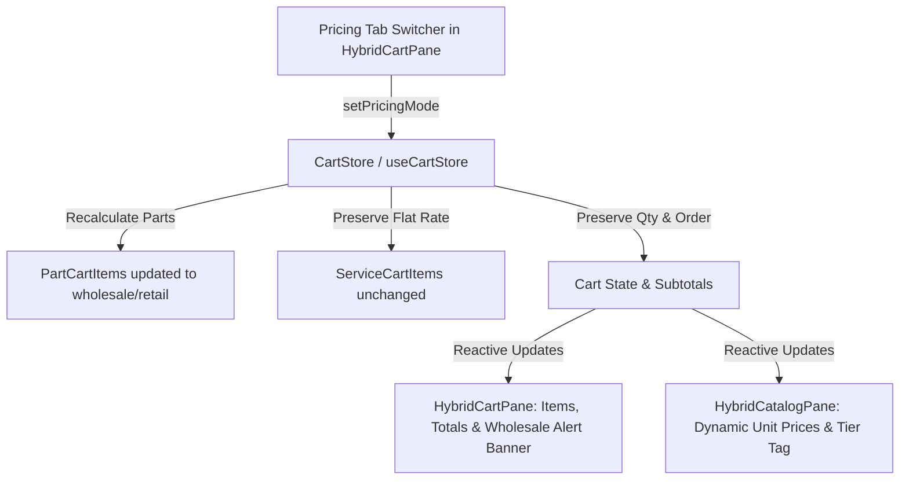

# Implementation Plan: Dual-Tier Pricing Switcher (Retail vs. Wholesale)

**Feature**: Dual-Tier Pricing Switcher (Retail vs. Wholesale) with Dynamic Cart Recalculation  
**Branch**: `feat/SIAA-19-dual-tier-pricing-switcher`  
**Ticket**: [SIAA-19](https://the-three-devsketeers.atlassian.net/browse/SIAA-19)  
**Date**: 2026-10-11  

---

## 1. Architectural Scope & Boundary Mapping

This feature touches the reactive POS state management and presentation layers:

---

## 2. File Modification & Creation Inventory

| File Path | Action | Purpose & Scope |
| :--- | :--- | :--- |
| `specs/020-dual-tier-pricing-switcher/*` | Create | 8 canonical SpecKit artifacts |
| `lib/store/cart-store.ts` | Refactor/Verify | Ensure `setPricingMode` robustly preserves quantities, falls back correctly, preserves labor invariant, and fires listeners |
| `components/pos/hybrid-cart-pane.tsx` | Refactor | Render high-contrast `WHOLESALE TIER ACTIVE` warning alert banner above checkout button; ensure token styling on tabs |
| `components/pos/hybrid-catalog-pane.tsx` | Refactor | Enhance catalog price display with active tier badge/tag when Wholesale tier is engaged |
| `lib/pos/__tests__/dual-tier-pricing-switcher.test.ts` | Create | Unit & integration tests for all 4 acceptance scenarios in SIAA-19 |

---

## 3. Design Token Compliance Checklist

- **Warning Banner**: `bg-accent/15`, `text-accent`, `border-accent/40`, `text-text-primary`
- **Active Tab**: `bg-primary`, `text-text-light`
- **Inactive Tab**: `text-text-muted`, `hover:text-text-primary`
- **Price Displays**: `text-primary`, `font-mono`
- **Zero hardcoded colors**: Strictly verified via SWIFT design system rules.

---

## 4. Test Strategy

1. **Test Scenario 1 (Wholesale Tier Switch)**: Adding physical parts at retail, toggling to wholesale, verifying each part's price updates to wholesale price, and subtotal recalculates.
2. **Test Scenario 2 (Labor Rate Invariance)**: Cart containing physical parts and labor services; toggling mode leaves labor rate and bay unchanged.
3. **Test Scenario 3 (Cart Quantity Preservation)**: Modifying line item quantities (e.g. qty 4, qty 2); toggling preserves quantities, item order, and recalculates line totals.
4. **Test Scenario 4 (Visual Indicator & Active State)**: State exposes `pricingMode === 'wholesale'`, catalog prices reflect active mode, and banner condition is verified.
