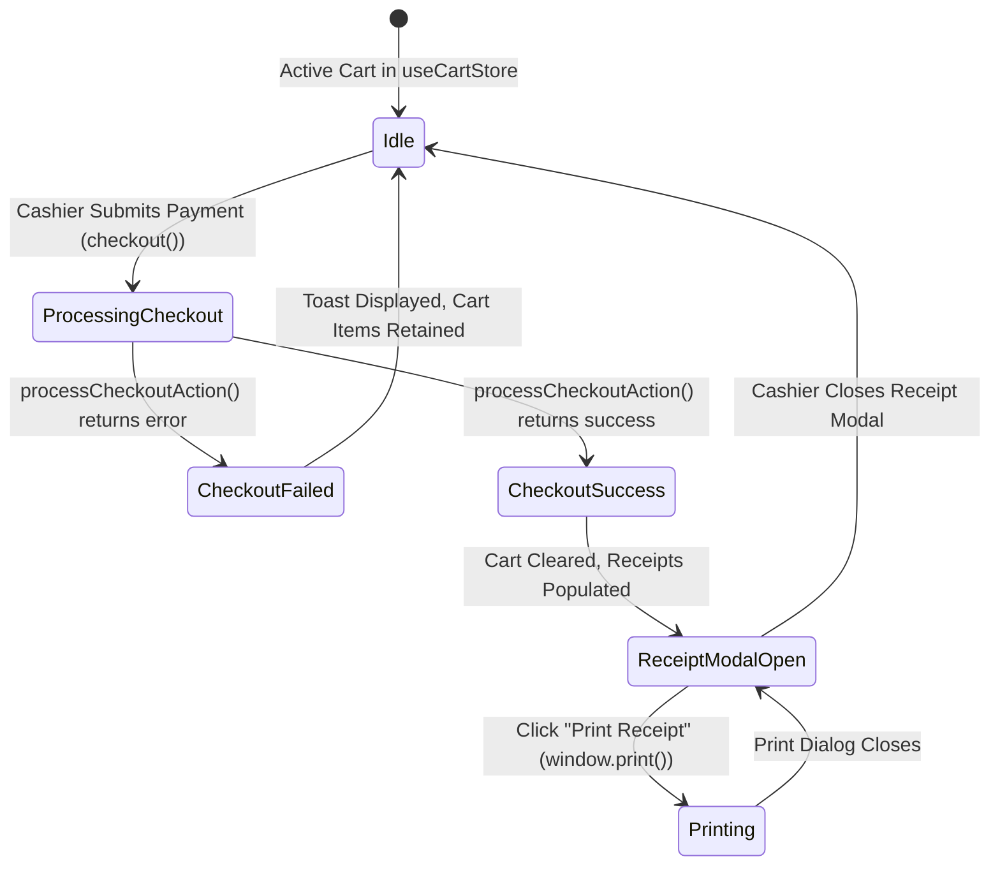

# Data Model: POS Server Actions, Receipt Persistence & Thermal Modal UI Wiring

**Feature**: `020-pos-server-actions-receipt-modal-wiring`  
**Jira Ticket**: [SIAA-52](https://the-three-devsketeers.atlassian.net/browse/SIAA-52)  
**Date**: 2026-10-11  

---

## 1. Domain Entities & Interfaces

### 1.1 Thermal Receipt Data Structure (`ThermalReceiptData`)

```typescript
export interface ThermalReceiptItem {
  id: string;
  itemType: 'part' | 'service';
  skuOrCode: string;
  name: string;
  unitPrice: number;
  quantity: number;
  subtotal: number;
  shelfLocation?: string | null;
  bay?: string | null;
  duration?: string | null;
}

export interface ThermalReceiptData {
  id: string;
  receiptNumber: string;
  timestamp: string;
  cashierName: string;
  pricingMode: 'retail' | 'wholesale';
  items: ThermalReceiptItem[];
  subtotal: number;
  discountType?: string | null;
  discountRate: number;
  discountAmount: number;
  totalDue: number;
  cashTendered: number;
  changeDue: number;
  paymentMethod: string;
}
```

### 1.2 Cart Store Checkout State & Async Result

```typescript
export interface CheckoutResult {
  success: boolean;
  transactionId?: string;
  receiptNumber?: string;
  itemsCount?: number;
  partsDecremented?: number;
  receiptData?: ThermalReceiptData;
  error?: string;
  code?: 'INSUFFICIENT_STOCK' | 'PRODUCT_NOT_FOUND' | 'VALIDATION_ERROR' | 'CHECKOUT_FAILED';
  sku?: string;
}
```

### 1.3 Thermal Paper Format Mode

```typescript
export type ThermalRollWidth = '58mm' | '80mm';
```

---

## 2. State Machine: POS Checkout & Receipt Modal



---

## 3. Storage & Cache Tag Mapping

| Cache Tag / Path | Target Resource | Invalidation Trigger |
|---|---|---|
| `pos-cart` | Next.js Server Components | `processCheckoutAction()` completion |
| `inventory-catalog` | Product Stock Counts | `processCheckoutAction()` completion |
| `/admin` | Admin Dashboard KPI Overview | `processCheckoutAction()` completion |
| `/staff/pos` | Staff POS Terminal | `processCheckoutAction()` completion |
