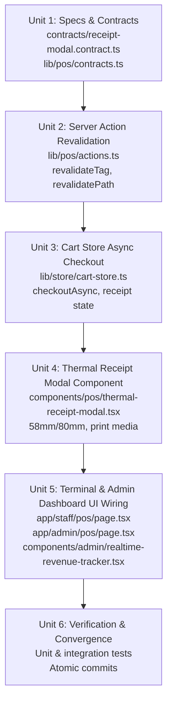

# Implementation Plan: POS Server Actions, Receipt Persistence & Thermal Modal UI Wiring

**Feature**: `020-pos-server-actions-receipt-modal-wiring`  
**Jira Ticket**: [SIAA-52](https://the-three-devsketeers.atlassian.net/browse/SIAA-52)  
**Date**: 2026-10-11  

---

## 1. Architectural Strategy & Phasing

---

## 2. Component Hierarchy & File Mapping

1. **Contracts & Validation**:
   - `specs/020-pos-server-actions-receipt-modal-wiring/contracts/receipt-modal.contract.ts`: Zod schema and TypeScript types for receipt data.
   - `lib/pos/contracts.ts`: Re-export or integrate `ThermalReceiptData` types.
2. **Server Action & Revalidation**:
   - `lib/pos/actions.ts`: Add Next.js cache revalidation (`pos-cart`, `inventory-catalog`, path `/admin`) to `processCheckoutAction`.
   - `lib/pos/transaction-actions.ts`: Enhance `getTransactionByReceiptAction` to format data directly into `ThermalReceiptData`.
3. **Store State Management**:
   - `lib/store/cart-store.ts`:
     - Update `checkout` method to be async and call `processCheckoutAction`.
     - Add `activeReceiptData?: ThermalReceiptData | null`.
     - Add `isReceiptModalOpen: boolean`.
     - Add `openReceiptModal(data?: ThermalReceiptData)` and `closeReceiptModal()`.
4. **UI Components**:
   - `components/pos/thermal-receipt-modal.tsx`: Dedicated 58mm/80mm printable modal adhering to SWIFT design tokens.
   - `app/staff/pos/page.tsx`: Connect `<ThermalReceiptModal>` to cart store state.
   - `app/admin/pos/page.tsx`: Connect `<ThermalReceiptModal>` to cart store state.
   - `components/admin/realtime-revenue-tracker.tsx` / `app/admin/page.tsx`: Realtime subscription to increment Gross Revenue on incoming transactions.
5. **Tests**:
   - `lib/store/__tests__/cart-store-checkout.test.ts`: Verify async checkout, cart clearing, and receipt modal state.
   - `components/pos/__tests__/thermal-receipt-modal.test.tsx`: Verify rendering of parts, services, 58mm/80mm toggle, and print trigger.
   - `lib/pos/__tests__/checkout-revalidation.test.ts`: Verify revalidation tags and error recovery.

---

## 3. Strict Token Governance Rule

All components MUST utilize SWIFT tokens:
- Backgrounds: `bg-bg-base`, `bg-bg-surface`, `bg-bg-card`, `bg-bg-muted`
- Text: `text-text-primary`, `text-text-secondary`, `text-text-muted`
- Accents: `bg-primary`, `text-primary`, `bg-success`, `text-success`, `bg-danger`, `text-danger`
- Borders: `border-border`, `border-border-subtle`
- Zero hardcoded hex/rgb colors!
