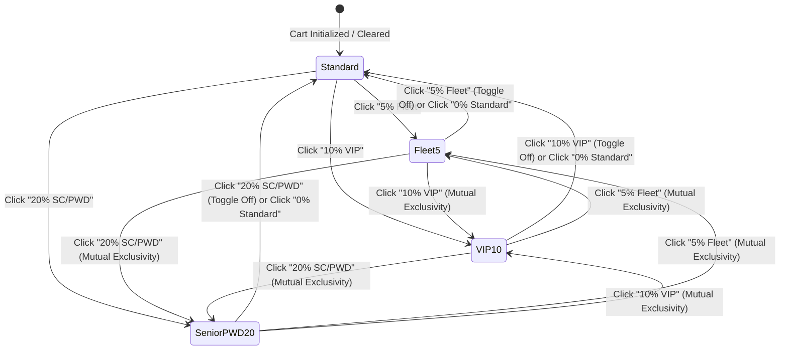

# Data Model & State Architecture: Customer Discount Matrix Engine

**Feature**: Customer Discount Matrix Engine (Senior, PWD & VIP) & Subtotal Computation  
**Branch**: `feat/SIAA-20-customer-discount-matrix-engine`  
**Date**: 2026-10-12  

---

## 1. Entity Models & DTOs

### 1.1 Discount Tier Definitions
```ts
export type DiscountTierId = 'none' | 'fleet' | 'vip' | 'senior_pwd';

export type DiscountCategory = 'none' | 'commercial' | 'statutory';

export interface DiscountTier {
  id: DiscountTierId;
  label: string;
  shortLabel: string;
  rate: number;
  type: DiscountCategory;
  description: string;
}
```

### 1.2 Cart State Enhancements (`lib/types/cart.ts`)
```ts
export interface CartTotals {
  subtotal: number;
  discountRate: number;
  discountAmount: number;
  discountType?: DiscountTierId | string;
  total: number;
  itemCount: number;
}

export interface CartStoreState {
  items: CartItem[];
  pricingMode: PricingMode;
  discountRate: number;
  discountType: DiscountTierId;
  totals: CartTotals;
}
```

### 1.3 Transaction Schema (`public.transactions`)
```sql
ALTER TABLE public.transactions 
DROP CONSTRAINT IF EXISTS transactions_discount_type_check;

ALTER TABLE public.transactions
ADD CONSTRAINT transactions_discount_type_check 
CHECK (discount_type IS NULL OR discount_type IN ('none', 'senior', 'pwd', 'vip', 'fleet', 'senior_pwd'));
```

---

## 2. State Machine: Discount Selection Life Cycle



---

## 3. Subtotal Computation Math & Precision

Given a list of cart line items $I$ with active prices $p_i$ and quantities $q_i$:

1. **Gross Subtotal**:
   $$S = \sum_{i \in I} (p_i \times q_i)$$

2. **Discount Amount**:
   $$D = \text{round}(S \times r, 2)$$
   where $r \in \{0.00, 0.05, 0.10, 0.20\}$

3. **Net Total Due**:
   $$T = \max(0, S - D)$$

All calculations in TypeScript use cent-precision rounding:
```ts
const subtotal = items.reduce((sum, item) => sum + item.price * item.qty, 0);
const discountAmount = Math.round(subtotal * discountRate * 100) / 100;
const total = Math.max(0, Math.round((subtotal - discountAmount) * 100) / 100);
```
