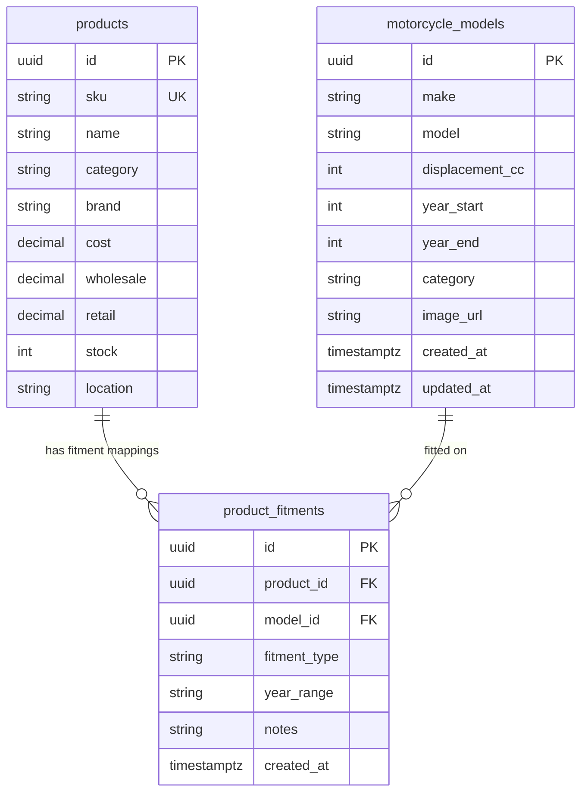

# Data Model: Motorcycle Models & Fitment Compatibility Matrix

**Feature**: `021-motomatcher-compatibility-schema-seed`  
**Jira Ticket**: [SIAA-53](https://the-three-devsketeers.atlassian.net/browse/SIAA-53) (STORY-4.6)  

---

## 1. Entity-Relationship Diagram



---

## 2. Table Schemas (PostgreSQL / Supabase)

### 2.1 Table: `public.motorcycle_models`

| Column | Type | Constraints | Description |
| :--- | :--- | :--- | :--- |
| `id` | UUID | PRIMARY KEY DEFAULT `gen_random_uuid()` | Unique identifier |
| `make` | TEXT | NOT NULL | Motorcycle manufacturer (e.g., 'Yamaha', 'Honda', 'Suzuki') |
| `model` | TEXT | NOT NULL | Model designation (e.g., 'NMAX 155', 'ADV 160') |
| `displacement_cc` | INTEGER | NOT NULL CHECK (`displacement_cc > 0`) | Engine displacement in cubic centimeters |
| `year_start` | INTEGER | NOT NULL CHECK (`year_start > 1900`) | Production introduction year |
| `year_end` | INTEGER | NULLABLE CHECK (`year_end IS NULL OR year_end >= year_start`) | End of production year, or NULL if current |
| `category` | TEXT | NOT NULL | Category e.g. 'Scooter', 'Underbone', 'Backbone' |
| `image_url` | TEXT | NULLABLE | Motorcycle illustration or photo URL |
| `created_at` | TIMESTAMPTZ | NOT NULL DEFAULT `timezone('utc'::text, now())` | Creation audit timestamp |
| `updated_at` | TIMESTAMPTZ | NOT NULL DEFAULT `timezone('utc'::text, now())` | Modification audit timestamp |

- **Table Constraints**:
  - `CONSTRAINT uq_motorcycle_models_make_model_year UNIQUE (make, model, year_start)`
- **Indexes**:
  - `CREATE INDEX idx_motorcycle_models_make_model ON public.motorcycle_models (make, model);`

---

### 2.2 Table: `public.product_fitments`

| Column | Type | Constraints | Description |
| :--- | :--- | :--- | :--- |
| `id` | UUID | PRIMARY KEY DEFAULT `gen_random_uuid()` | Unique fitment link ID |
| `product_id` | UUID | NOT NULL REFERENCES `public.products(id)` ON DELETE CASCADE | Target product part |
| `model_id` | UUID | NOT NULL REFERENCES `public.motorcycle_models(id)` ON DELETE CASCADE | Compatible vehicle model |
| `fitment_type` | TEXT | NOT NULL CHECK (`fitment_type IN ('oem', 'aftermarket', 'universal')`) | Fitment grade |
| `year_range` | TEXT | NULLABLE | Display year range (e.g., '2020-2026') |
| `notes` | TEXT | NULLABLE | Fitment specifications or notes |
| `created_at` | TIMESTAMPTZ | NOT NULL DEFAULT `timezone('utc'::text, now())` | Creation timestamp |

- **Table Constraints**:
  - `CONSTRAINT uq_product_fitments_product_model UNIQUE (product_id, model_id)`
- **Indexes**:
  - `CREATE INDEX idx_product_fitments_model_type ON public.product_fitments (model_id, fitment_type);`
  - `CREATE INDEX idx_product_fitments_product ON public.product_fitments (product_id);`

---

## 3. Row-Level Security (RLS) Specification

```sql
ALTER TABLE public.motorcycle_models ENABLE ROW LEVEL SECURITY;
ALTER TABLE public.product_fitments ENABLE ROW LEVEL SECURITY;

-- 1. Read Policies (Open to all anon & authenticated users)
CREATE POLICY "Public read access on motorcycle models"
    ON public.motorcycle_models FOR SELECT
    TO anon, authenticated
    USING (true);

CREATE POLICY "Public read access on product fitments"
    ON public.product_fitments FOR SELECT
    TO anon, authenticated
    USING (true);

-- 2. Write Policies (Restricted to Shop Admin)
CREATE POLICY "Admin full control on motorcycle models"
    ON public.motorcycle_models FOR ALL
    TO authenticated
    USING (
        EXISTS (
            SELECT 1 FROM public.profiles
            WHERE profiles.id = auth.uid()
            AND profiles.role = 'admin'::public.user_role
        )
    )
    WITH CHECK (
        EXISTS (
            SELECT 1 FROM public.profiles
            WHERE profiles.id = auth.uid()
            AND profiles.role = 'admin'::public.user_role
        )
    );

CREATE POLICY "Admin full control on fitments"
    ON public.product_fitments FOR ALL
    TO authenticated
    USING (
        EXISTS (
            SELECT 1 FROM public.profiles
            WHERE profiles.id = auth.uid()
            AND profiles.role = 'admin'::public.user_role
        )
    )
    WITH CHECK (
        EXISTS (
            SELECT 1 FROM public.profiles
            WHERE profiles.id = auth.uid()
            AND profiles.role = 'admin'::public.user_role
        )
    );
```

---

## 4. Prisma ORM Synchronization Specification

```prisma
model MotorcycleModel {
  id             String           @id @default(dbgenerated("gen_random_uuid()")) @db.Uuid
  make           String
  model          String
  displacementCc Int              @map("displacement_cc")
  yearStart      Int              @map("year_start")
  yearEnd        Int?             @map("year_end")
  category       String
  imageUrl       String?          @map("image_url")
  createdAt      DateTime         @default(now()) @map("created_at") @db.Timestamptz(6)
  updatedAt      DateTime         @default(now()) @updatedAt @map("updated_at") @db.Timestamptz(6)

  fitments       ProductFitment[]

  @@unique([make, model, yearStart], map: "uq_motorcycle_models_make_model_year")
  @@index([make, model])
  @@map("motorcycle_models")
}

model ProductFitment {
  id          String          @id @default(dbgenerated("gen_random_uuid()")) @db.Uuid
  productId   String          @map("product_id") @db.Uuid
  modelId     String          @map("model_id") @db.Uuid
  fitmentType String          @map("fitment_type")
  yearRange   String?         @map("year_range")
  notes       String?
  createdAt   DateTime        @default(now()) @map("created_at") @db.Timestamptz(6)

  product     Product         @relation(fields: [productId], references: [id], onDelete: Cascade)
  model       MotorcycleModel @relation(fields: [modelId], references: [id], onDelete: Cascade)

  @@unique([productId, modelId], map: "uq_product_fitments_product_model")
  @@index([modelId, fitmentType])
  @@index([productId])
  @@map("product_fitments")
}
```
