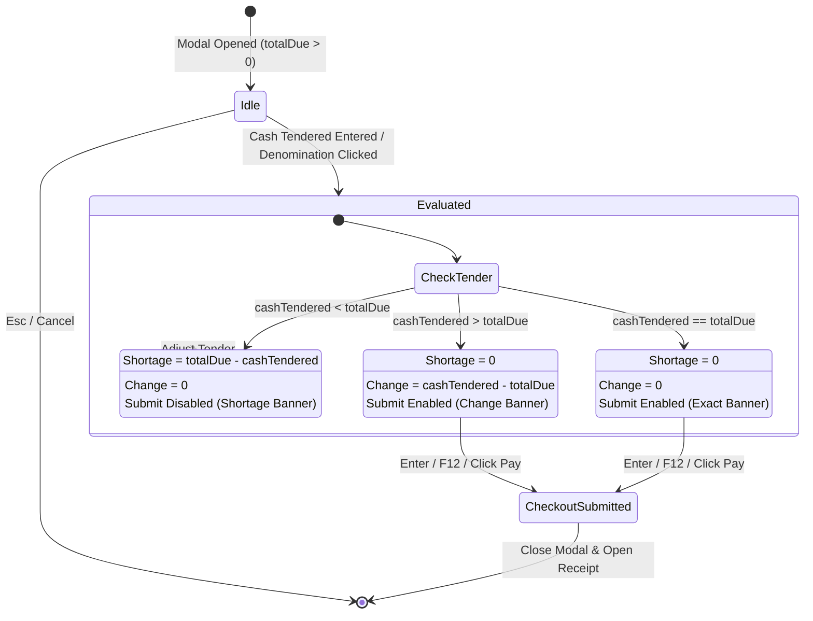

# Data Model: Cash Tender & Payment Processing with Real-Time Change Calculation

**Feature**: `022-cash-tender-payment-processing`  
**Ticket**: [SIAA-21](https://the-three-devsketeers.atlassian.net/browse/SIAA-21)  
**Date**: 2026-10-12  

---

## 1. Domain Entities & State Structures

### `CashTenderResult`
Represents the evaluated mathematical state of the cash tender against total due:

```typescript
export interface CashTenderResult {
  totalDue: number;       // e.g. 880.00
  cashTendered: number;   // e.g. 1000.00
  changeDue: number;      // e.g. 120.00 (0 if under-tendered)
  shortage: number;       // e.g. 0.00 (or 380.00 if under-tendered)
  isValid: boolean;       // true if cashTendered >= totalDue && totalDue > 0
  isExact: boolean;       // true if cashTendered === totalDue
}
```

### `QuickDenomination`
Represents a smart quick-cash button:

```typescript
export interface QuickDenomination {
  label: string;          // e.g. "Exact ₱880", "₱1,000", "₱1,500", "₱2,000"
  amount: number;         // e.g. 880, 1000, 1500, 2000
  isExact: boolean;       // true for exact amount
}
```

### `CashTenderModalProps`
Modal interface props:

```typescript
export interface CashTenderModalProps {
  isOpen: boolean;
  totalDue: number;
  isProcessing?: boolean;
  onClose: () => void;
  onConfirmPayment: (tenderedAmount: number, changeDue: number) => Promise<void> | void;
}
```

---

## 2. Mathematical Invariants & State Transitions



---

## 3. Storage & Transaction Mapping

The verified `cashTendered` and `changeDue` flow directly into the existing database schema:
- `pos_transactions.cash_tendered`: `DECIMAL(10, 2)`
- `pos_transactions.change_due`: `DECIMAL(10, 2)`
- `pos_transactions.payment_method`: `'Cash'`
- `thermal_receipt_data.cashTendered`: `number`
- `thermal_receipt_data.changeDue`: `number`
