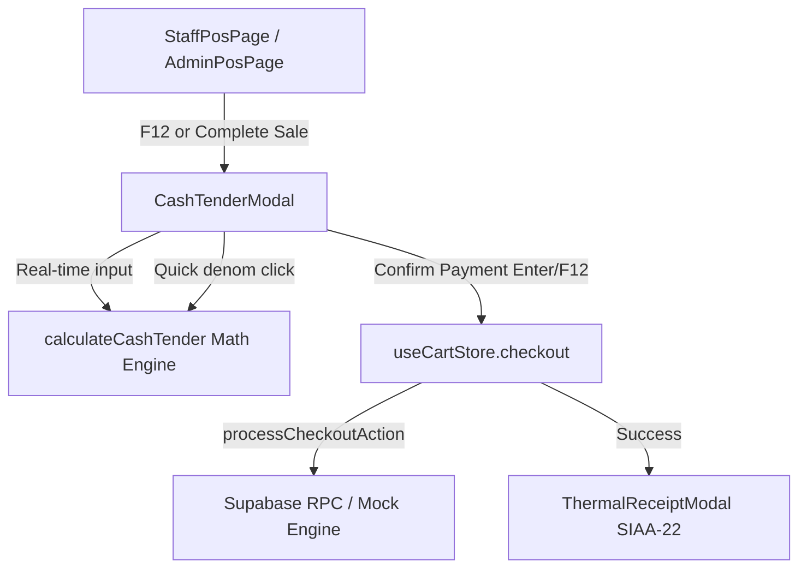

# Implementation Plan: Cash Tender & Payment Processing with Real-Time Change Calculation

**Feature**: `022-cash-tender-payment-processing`  
**Ticket**: [SIAA-21](https://the-three-devsketeers.atlassian.net/browse/SIAA-21)  
**Date**: 2026-10-12  

---

## 1. Architecture & Component Hierarchy

### File Placement:
1. `lib/pos/cash-tender.ts`:
   - Pure domain calculation functions: `calculateCashTender`, `generateQuickDenominations`, `formatCurrency`.
2. `lib/pos/__tests__/cash-tender.test.ts`:
   - Unit tests covering all 4 Jira scenarios and boundary conditions.
3. `components/pos/cash-tender-modal.tsx`:
   - High-contrast modal dialog matching SWIFT design tokens (`app/globals.css`, `lib/tokens.ts`).
   - Quick denomination chips, auto-focused cash input, real-time change/shortage alert, keyboard listeners.
4. `app/staff/pos/page.tsx` & `app/admin/pos/page.tsx`:
   - Integrate `CashTenderModal`.
   - Update `handleCompleteSale` to open the modal instead of bypassing tender.
   - Pass validated cash tender to `checkout()` and open `ThermalReceiptModal`.

---

## 2. Token & Styling Boundaries

- Container Backdrop: `fixed inset-0 z-50 flex items-center justify-center bg-black/60 backdrop-blur-xs p-4`
- Modal Card: `bg-bg-surface border border-border rounded-xl shadow-xl max-w-md w-full`
- Input field: `bg-bg-input border border-border focus:border-primary text-text-primary font-mono text-2xl`
- Change Due Badge: `bg-success-light text-success border border-success/30 font-mono text-lg font-bold`
- Shortage Badge: `bg-danger-light text-danger border border-danger/30 font-mono text-sm font-bold`
- Quick Denomination Chip: `bg-bg-base hover:bg-bg-hover text-text-primary border border-border rounded-lg`
- Submit Button: `bg-primary hover:bg-primary-hover text-text-light font-bold rounded-lg`

---

## 3. TDD Strategy (Red-Green-Refactor)

1. Write `lib/pos/__tests__/cash-tender.test.ts`:
   - Test Scenario 1: Quick denomination generation (Total ₱880 -> Exact ₱880, ₱1,000, ₱1,500, ₱2,000).
   - Test Scenario 2: Real-time change calculation (Total ₱880, Tender ₱1,000 -> Change ₱120.00, isValid true).
   - Test Scenario 3: Under-tender validation guard (Total ₱880, Tender ₱500 -> Shortage ₱380.00, Change 0, isValid false).
   - Test Scenario 4: Exact tender (Total ₱880, Tender ₱880 -> Change 0, Shortage 0, isExact true).
   - Test Scenario 5: Decimal precision and edge cases (Tender with cents, zero total, etc.).
2. Implement `lib/pos/cash-tender.ts` to make tests pass.
3. Build `components/pos/cash-tender-modal.tsx` with WCAG AA compliance and semantic tokens.
4. Integrate with `app/staff/pos/page.tsx` and `app/admin/pos/page.tsx`.
5. Run full test suite, lint, and typecheck.
