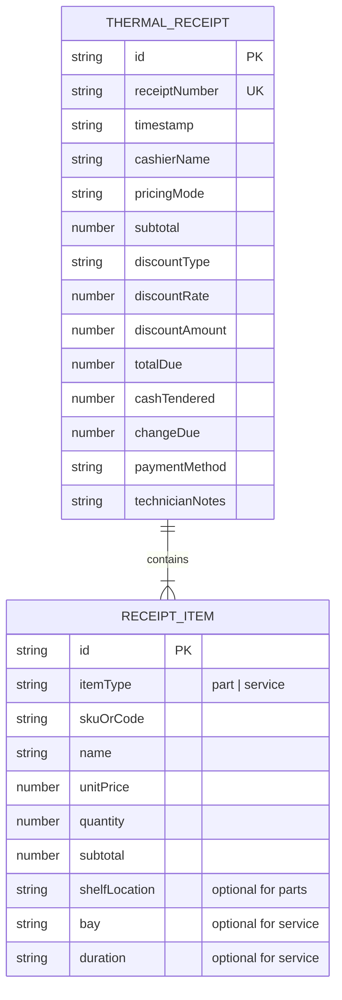
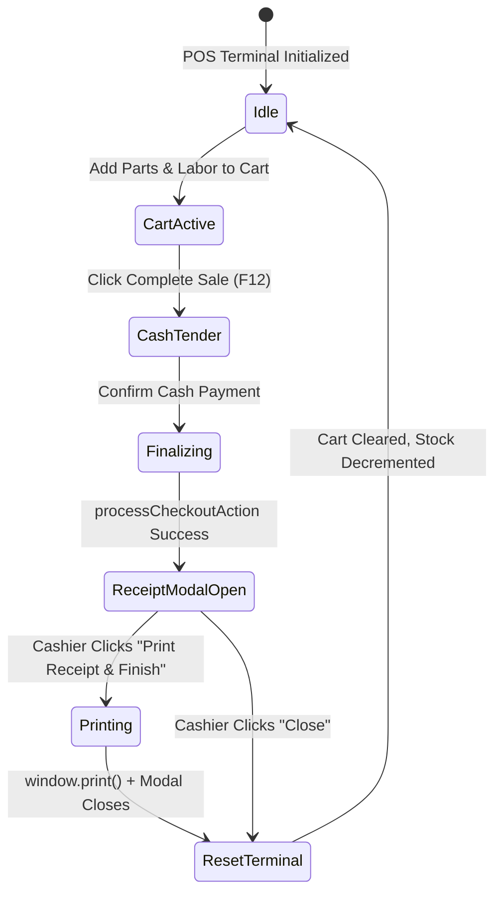

# Data Model & Domain Entities: Thermal Receipt Generation

**Feature Branch**: `feat/SIAA-22-thermal-receipt-generation-printable-modal`  
**Jira Issue**: [SIAA-22](https://the-three-devsketeers.atlassian.net/browse/SIAA-22)  
**Spec Reference**: `specs/023-thermal-receipt-generation-printable-modal/spec.md`  

---

## 1. Domain Entities & Type Definitions



### 1.1 `ThermalReceiptItem`
Represents an itemized line item formatted specifically for monospace thermal print rendering.

| Field | Type | Description | Required | Validation / Rule |
| :--- | :--- | :--- | :--- | :--- |
| `id` | `string` | Unique line item identifier | Yes | Non-empty string |
| `itemType` | `'part' \| 'service'` | Item discriminator | Yes | Must be `'part'` or `'service'` |
| `skuOrCode` | `string` | Master SKU (parts) or Service Code (labor) | Yes | Uppercase alphanumeric (e.g., `PART-OIL-10W40`, `SRV-OIL-CHANGE`) |
| `name` | `string` | Full human-readable description | Yes | Truncated to max 24 chars on 58mm, 36 on 80mm |
| `unitPrice` | `number` | Unit selling price or flat labor rate | Yes | Floating point number >= 0.00 |
| `quantity` | `number` | Item count | Yes | Integer >= 1 |
| `subtotal` | `number` | Line total (`unitPrice * quantity`) | Yes | Rounded to 2 decimal places |
| `shelfLocation` | `string \| null` | Physical rack / shelf locator badge | No | Only present on physical parts |
| `bay` | `string \| null` | Workshop service bay identifier | No | E.g. `Bay 1 - Quick Service` |
| `duration` | `string \| null` | Estimated job duration | No | E.g. `20 mins`, `45 mins` |

### 1.2 `ThermalReceiptData`
Full receipt payload required for rendering, browser printing, and offline persistence.

| Field | Type | Description | Required | Validation / Rule |
| :--- | :--- | :--- | :--- | :--- |
| `id` | `string` | Unique transaction ID (UUID or `TX-XXXX`) | Yes | Non-empty |
| `receiptNumber` | `string` | Sequential human-readable ticket number | Yes | Matches `TX-XXXX` pattern |
| `timestamp` | `string` | ISO timestamp or locale date string | Yes | Valid date string |
| `cashierName` | `string` | Name of cashier who finalized sale | Yes | E.g. `Admin Cashier`, `Mike Morales` |
| `pricingMode` | `'retail' \| 'wholesale'` | Tier applied during cart session | Yes | Discriminator |
| `items` | `ThermalReceiptItem[]` | Itemized parts and labor list | Yes | Array with at least 1 item |
| `technicianNotes` | `string \| null` | Optional technician notes for repair work | No | Plaintext string |
| `subtotal` | `number` | Gross pre-discount subtotal | Yes | Non-negative currency |
| `discountType` | `string \| null` | Discount policy applied (`Senior`, `PWD`, `VIP`, etc.) | No | Null if no discount |
| `discountRate` | `number` | Fractional discount rate (e.g. `0.20` for 20%) | Yes | Between `0` and `1` |
| `discountAmount` | `number` | Computed discount reduction in PHP | Yes | `subtotal * discountRate` |
| `totalDue` | `number` | Net balance required (`subtotal - discountAmount`) | Yes | Non-negative |
| `cashTendered` | `number` | Amount provided by customer | Yes | Must be `>= totalDue` |
| `changeDue` | `number` | Computed change (`cashTendered - totalDue`) | Yes | `>= 0.00` |
| `paymentMethod` | `string` | Tender method (`Cash`, `GCash`, `Card`) | Yes | Default `'Cash'` |

---

## 2. Roll Width Configuration & State

```typescript
export type ThermalRollWidth = '58mm' | '80mm';

export interface RollWidthConfig {
  widthClass: string;       // e.g. 'w-[270px] max-w-[270px]' vs 'w-[350px] max-w-[350px]'
  fontSizeClass: string;    // e.g. 'text-[11px] leading-tight' vs 'text-xs leading-normal'
  maxItemTitleLength: number;
}
```

---

## 3. State Transitions & Lifecycle


