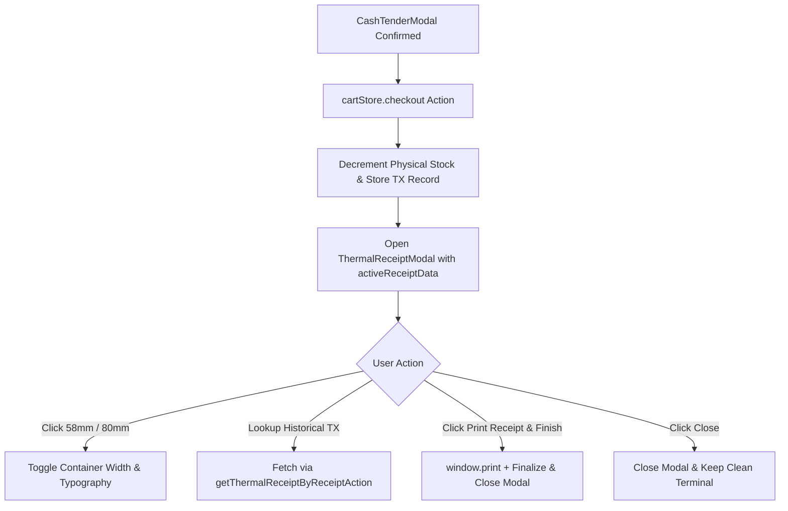

# Technical Implementation Plan: Thermal Receipt Generation & Printable Modal

**Feature Branch**: `feat/SIAA-22-thermal-receipt-generation-printable-modal`  
**Created**: 2026-10-12  
**Status**: Ready for Tasks  
**Jira Issue**: [SIAA-22](https://the-three-devsketeers.atlassian.net/browse/SIAA-22) (STORY-3.5)  
**Parent Epic**: [SIAA-3](https://the-three-devsketeers.atlassian.net/browse/SIAA-3)  

---

## 1. Executive Summary & Architecture Blueprint

This technical plan delivers the frontend and integration wiring for **STORY-3.5: Industry-Standard Thermal Receipt Generation & Printable Modal**. It refines and elevates `<ThermalReceiptModal>` to strictly meet all acceptance criteria of SIAA-22, ensuring complete itemized visibility of SKUs, labor service codes, technician duration, labor rates, technician notes, 7-day warranty terms, dual-roll width switching (58mm/80mm), clean browser print isolation (`@media print`), and full state finalization ("Print Receipt & Finish" resetting cart and syncing stock decrements).

---

## 2. Constitutional Principles Verification

| Principle | Verification Strategy | Status |
| :--- | :--- | :--- |
| **I. Semantic Design Tokens** | Modal and controls use only semantic CSS variables (`bg-bg-surface`, `text-text-primary`, `border-border`, `bg-primary`, `bg-secondary`, etc.). Zero hardcoded hex/RGB values. Print mode isolates pure `#000000` text on pure `#ffffff` paper via Tailwind `print:text-black print:bg-white`. | PASS |
| **II. Specification Fidelity** | Directly adheres to `specs/023-thermal-receipt-generation-printable-modal/spec.md`, `../docs/features.md`, and `../mockup/admin.html` / `staff.html`. | PASS |
| **III. Type-Safe Data Architecture** | Full TypeScript types derived from `lib/types/transaction.ts` and `contracts/receipt.contract.ts`. No `any` types. | PASS |
| **IV. Test-First Quality** | Automated unit tests covering receipt formatting, roll width toggling, item breakdown calculations, warranty text presence, and "Print Receipt & Finish" trigger. | PASS |
| **V. Server-First & Accessibility** | `<ThermalReceiptModal>` is a client leaf component (`'use client'`). Conforms to WCAG AA with `role="dialog"`, `aria-modal="true"`, `aria-labelledby`, Esc keyboard shortcut, and focus control. | PASS |

---

## 3. Component Architecture & File Plan

### 3.1 Component Enhancement
- **File**: `components/pos/thermal-receipt-modal.tsx`
  - Update `ThermalReceiptItem` rendering in itemized table:
    - Display SKU for physical parts (`item.skuOrCode`).
    - Display Service Code (`item.skuOrCode`), Bay Name (`item.bay`), Estimated Duration (`item.duration`), and Unit Labor Rate (`₱${item.unitPrice.toFixed(2)}`) for workshop services.
    - Display Technician Notes (`activeReceipt.technicianNotes` or per-item notes) when present.
  - Enhance Modal Actions:
    - Add primary button **"Print Receipt & Finish"** with `onFinish` handler that calls `handlePrint()` and clears modal.
    - Support optional `onFinish?: () => void` prop.
  - Print Styles Verification:
    - Ensure `@media print` rules hide all modal buttons, search bars, close icons, background backdrops, and page headers.
    - Receipt print container formatted for 58mm / 80mm widths.

### 3.2 Integration & Page Verification
- **Files**:
  - `app/admin/pos/page.tsx`
  - `app/staff/pos/page.tsx`
  - `lib/types/transaction.ts`
  - Verify that `onFinish` or `closeReceiptModal` integration properly executes on both Admin and Staff POS cashiers.

### 3.3 Test Suite
- **File**: `__tests__/pos/thermal-receipt-modal.test.tsx`
  - Test Case 1: Renders store header, receipt #, cashier name, and 7-day warranty disclaimer.
  - Test Case 2: Renders physical parts with SKU, name, quantity, and subtotal.
  - Test Case 3: Renders workshop labor with service code, bay name, duration, and labor rate.
  - Test Case 4: Renders payment summary (subtotal, discount, total due, cash tendered, change).
  - Test Case 5: Toggles between 58mm and 80mm roll width classes.
  - Test Case 6: "Print Receipt & Finish" button triggers print and onFinish callback.
  - Test Case 7: Keyboard shortcut (Escape) closes modal.
  - Test Case 8: Historical receipt search lookup displays found receipt.

---

## 4. Dependencies & Implementation Sequencing

1. **Phase 1: Contracts & Types**: Verify `ThermalReceiptItem` and `ThermalReceiptData` in `lib/types/transaction.ts` has all required fields (`skuOrCode`, `technicianNotes`, etc.).
2. **Phase 2: Unit Tests (Red)**: Write unit tests in `__tests__/pos/thermal-receipt-modal.test.tsx`.
3. **Phase 3: Component Implementation (Green)**: Update `components/pos/thermal-receipt-modal.tsx` with enhanced itemized breakdown, technician notes, and "Print Receipt & Finish" action.
4. **Phase 4: POS Pages Integration**: Wire `onFinish` callback in `app/admin/pos/page.tsx` and `app/staff/pos/page.tsx`.
5. **Phase 5: Verification & Typecheck**: Run `npm test` and `npm run typecheck`.
