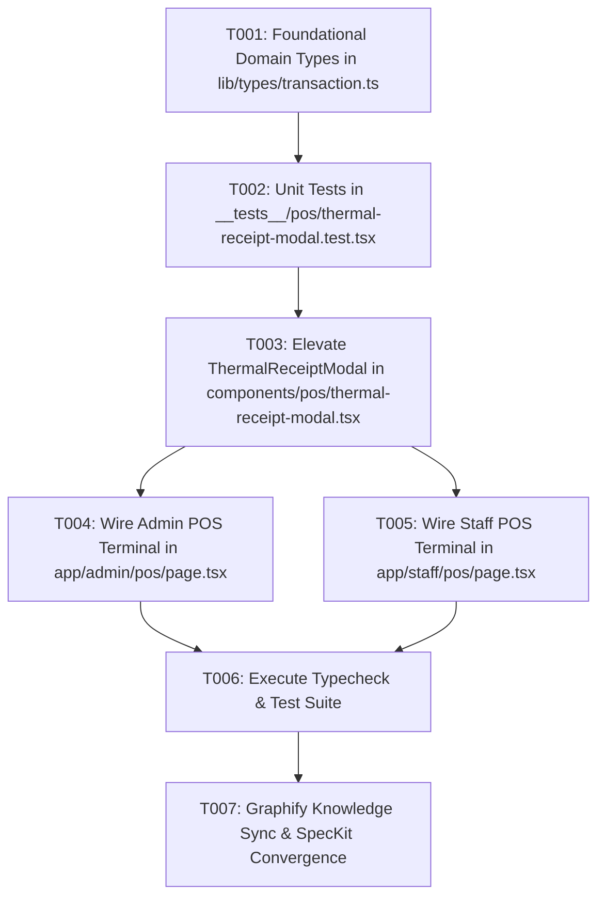

# Implementation Tasks: Thermal Receipt Generation & Printable Modal

**Feature Branch**: `feat/SIAA-22-thermal-receipt-generation-printable-modal`  
**Jira Issue**: [SIAA-22](https://the-three-devsketeers.atlassian.net/browse/SIAA-22) (STORY-3.5)  
**Spec Reference**: `specs/023-thermal-receipt-generation-printable-modal/spec.md`  
**Plan Reference**: `specs/023-thermal-receipt-generation-printable-modal/plan.md`  

---

## Task Overview & Sequencing

---

## Phase 1: Setup & Foundational Types

- [x] T001 Verify and enhance thermal receipt data models and interfaces in `lib/types/transaction.ts` ensuring `technicianNotes`, `skuOrCode`, `shelfLocation`, `bay`, `duration`, and `unitPrice` are fully typed.

---

## Phase 2: User Story 1 (P1) - Thermal Receipt Generation & Printable Modal

**Story Goal**: As a Cashier or Motorcycle Owner, I want to preview and print a clean, industry-standard thermal receipt detailing parts, labor services, technician notes, discounts, and payment math, so that the customer receives a valid proof of purchase and warranty document while store inventory is automatically decremented.

**Independent Test Criteria**:
- Store header renders with `"SWIFT MOTO SERVICE"`, address, TIN, and phone.
- Physical parts display SKU, product name, quantity, and subtotal.
- Workshop labor services display service code, bay name, estimated duration, and labor rate.
- Totals section itemizes subtotal, discount, total due, cash tendered, and change due.
- 7-day parts warranty disclaimer renders prominently in the receipt footer.
- 58mm and 80mm roll width toggles correctly update formatting classes.
- "Print Receipt & Finish" button triggers window print and completes modal session.

### Tasks:
- [x] T002 [US1] Create unit test suite for thermal receipt generation and printable modal interactions in `__tests__/pos/thermal-receipt-modal.test.tsx`.
- [x] T003 [US1] Elevate `components/pos/thermal-receipt-modal.tsx` to render itemized SKUs for physical parts, service codes and unit labor rates for workshop services, technician notes, 7-day warranty disclaimer, and "Print Receipt & Finish" action.
- [x] T004 [US1] Wire receipt finalization and "Print Receipt & Finish" callbacks in Admin POS cashier at `app/admin/pos/page.tsx`.
- [x] T005 [US1] Wire receipt finalization and "Print Receipt & Finish" callbacks in Staff Fast-Lane POS cashier at `app/staff/pos/page.tsx`.

---

## Phase 3: Polish, Verification & Convergence

- [x] T006 Run static verification (`npm run typecheck`, `npm test`) to guarantee zero compilation errors and passing test suites.
- [x] T007 Validate constitutional compliance (zero hardcoded colors, semantic tokens) and perform Graphify auto-sync.
