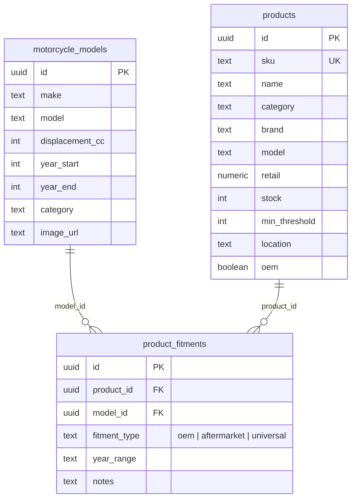

# Data Models & Schemas: Supabase Atomic MotoMatcher Matrix Search RPC & Fitment Verification Engine

**Feature**: `024-motomatcher-matrix-search-rpc`  
**Jira Issue**: [SIAA-54](https://the-three-devsketeers.atlassian.net/browse/SIAA-54) (STORY-4.7)  
**Parent Epic**: [SIAA-4](https://the-three-devsketeers.atlassian.net/browse/SIAA-4) (EPIC-4: Smart MotoMatcher)  

---

## 1. Relational Entity Architecture



---

## 2. PostgreSQL Stored Procedure Signature

```sql
CREATE OR REPLACE FUNCTION public.get_moto_matcher_matrix(
    p_model_id UUID,
    p_category TEXT DEFAULT NULL,
    p_search TEXT DEFAULT NULL
)
RETURNS JSONB
LANGUAGE plpgsql
SECURITY DEFINER
SET search_path = public
AS $$
...
$$;
```

### Parameters:
| Parameter | Type | Required | Description |
| :--- | :--- | :--- | :--- |
| `p_model_id` | `UUID` | Yes | Target motorcycle model UUID from `public.motorcycle_models` |
| `p_category` | `TEXT` | No | Subsystem category filter (e.g. `'Brakes'`, `'Drivetrain'`, `'Fluids'`, `'Ignition'`) |
| `p_search` | `TEXT` | No | Search keyword matched against SKU, name, brand, or notes (case-insensitive substring) |

---

## 3. JSON Output Schema

```json
{
  "oem_parts": [
    {
      "id": "uuid",
      "sku": "YAM-NMAX-BL01",
      "name": "Yamaha Genuine Front Brake Pad Set",
      "brand": "Yamaha",
      "category": "Brakes",
      "retail_price": 450.00,
      "stock_level": 12,
      "min_threshold": 3,
      "shelf_location": "B-02-1",
      "fitment_type": "oem",
      "fitment_notes": "Front caliper OEM direct fit",
      "year_range": "2020-2026",
      "is_universal": false,
      "upsell_delta_amount": null,
      "upsell_delta_percent": null,
      "upsell_badge": null,
      "oem_reference_sku": null
    }
  ],
  "aftermarket_parts": [
    {
      "id": "uuid",
      "sku": "RCB-NMAX-BP02",
      "name": "RCB Racing Ceramic Brake Pads",
      "brand": "Racing Boy (RCB)",
      "category": "Brakes",
      "retail_price": 580.00,
      "stock_level": 8,
      "min_threshold": 2,
      "shelf_location": "B-02-2",
      "fitment_type": "aftermarket",
      "fitment_notes": "High-temp racing ceramic compound",
      "year_range": "2019-2026",
      "is_universal": false,
      "upsell_delta_amount": 130.00,
      "upsell_delta_percent": 28.9,
      "upsell_badge": "+₱130.00 (+28.9%)",
      "oem_reference_sku": "YAM-NMAX-BL01"
    },
    {
      "id": "uuid",
      "sku": "MOT-3100-10W40",
      "name": "Motul 3100 Gold 4T 10W40 1L",
      "brand": "Motul",
      "category": "Fluids",
      "retail_price": 340.00,
      "stock_level": 25,
      "min_threshold": 5,
      "shelf_location": "A-01-3",
      "fitment_type": "universal",
      "fitment_notes": "Compatible with all 4T air and liquid cooled engines",
      "year_range": null,
      "is_universal": true,
      "upsell_delta_amount": null,
      "upsell_delta_percent": null,
      "upsell_badge": null,
      "oem_reference_sku": null
    }
  ]
}
```

---

## 4. TypeScript DTO Interfaces

```typescript
export interface MotoMatcherMatrixPart {
  id: string;
  sku: string;
  name: string;
  brand: string;
  category: string;
  retail_price: number;
  stock_level: number;
  min_threshold: number;
  shelf_location: string | null;
  fitment_type: 'oem' | 'aftermarket' | 'universal';
  fitment_notes: string | null;
  year_range: string | null;
  is_universal: boolean;
  upsell_delta_amount: number | null;
  upsell_delta_percent: number | null;
  upsell_badge: string | null;
  oem_reference_sku: string | null;
}

export interface MotoMatcherMatrixResult {
  oem_parts: MotoMatcherMatrixPart[];
  aftermarket_parts: MotoMatcherMatrixPart[];
}

export interface GetFitmentMatrixParams {
  modelId: string;
  category?: string | null;
  search?: string | null;
}
```
