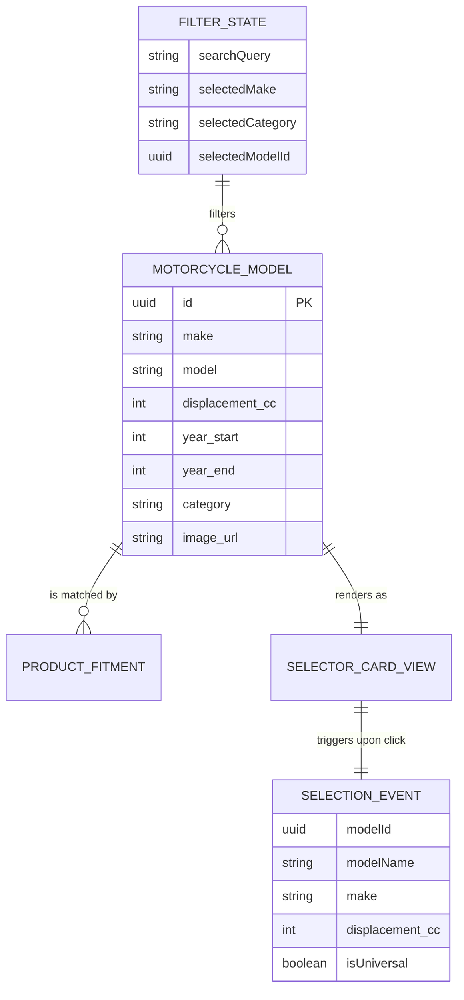
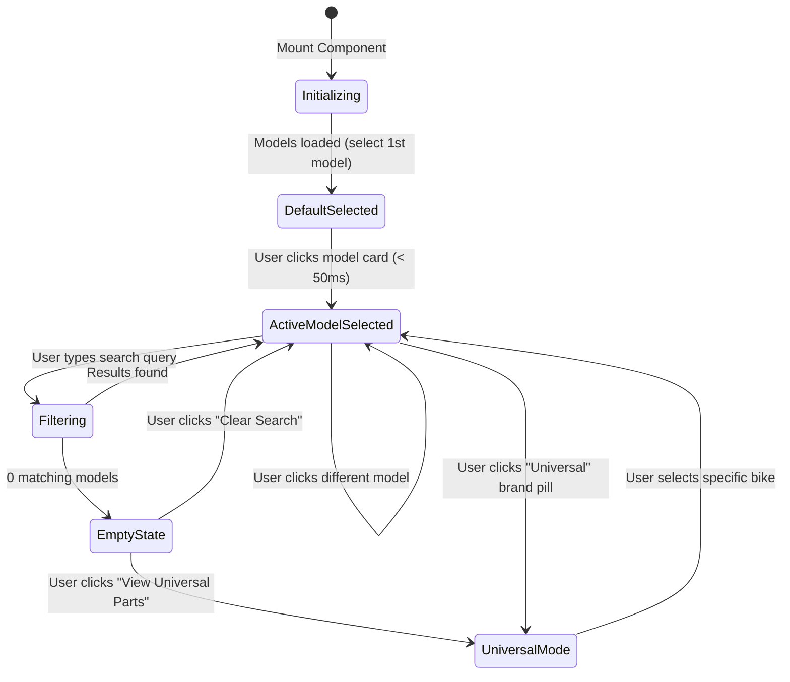

# Data Model: Motorcycle Make, Model & Displacement Selector Engine

**Feature**: `024-motorcycle-model-displacement-selector`  
**Jira Ticket**: [SIAA-23](https://the-three-devsketeers.atlassian.net/browse/SIAA-23) (STORY-4.1)  
**Parent Epic**: [SIAA-4](https://the-three-devsketeers.atlassian.net/browse/SIAA-4) (EPIC-4: Smart MotoMatcher)  

---

## 1. Domain Model & Entity Relationships



---

## 2. State Machine: Motorcycle Selection Lifecycle



---

## 3. Data Structures & Types

### 3.1 Motorcycle Model Record (`MotorcycleModelRecord`)
```typescript
export interface MotorcycleModelRecord {
  id: string;
  make: string;               // e.g. "Yamaha", "Honda", "Suzuki"
  model: string;              // e.g. "NMAX 155", "Click 125i/150i"
  displacement_cc: number;    // e.g. 155, 150, 160
  year_start: number;         // e.g. 2020
  year_end: number | null;    // e.g. 2026 or null (ongoing)
  category: string;           // e.g. "Scooter", "Underbone", "Manual"
  image_url?: string | null;
  created_at?: string | Date;
  updated_at?: string | Date;
}
```

### 3.2 Selector Filter State (`MotorcycleFilterState`)
```typescript
export interface MotorcycleFilterState {
  searchQuery: string;
  selectedMake: string;        // "ALL", "Yamaha", "Honda", "Suzuki", "Universal"
  selectedCategory: string;    // "ALL", "Scooter", "Underbone"
  selectedModelId: string | null;
}
```

### 3.3 Selection Event (`MotorcycleSelectionEvent`)
```typescript
export interface MotorcycleSelectionEvent {
  modelId: string | null;
  modelName: string;
  make: string;
  displacement_cc: number | null;
  isUniversal: boolean;
}
```

---

## 4. Invariants & Storage Guarantees

1. **Immutability of Model Records**: Model records passed to the selector are read-only and never mutated during filtering or sorting.
2. **Deterministic Sort Order**: When rendered, models are ordered primarily by popularity / make, preserving predictable positioning across re-renders.
3. **Graceful Fallbacks**: If the database yields an empty array or throws an error, the selector falls back to `MOCK_MOTORCYCLE_MODEL_RECORDS` ensuring zero blank UI screens.
