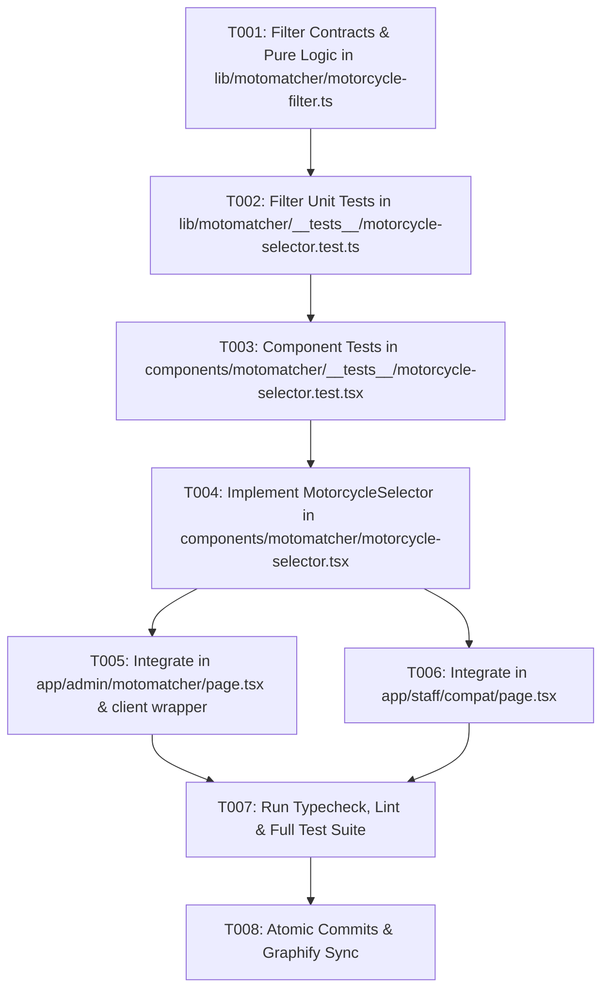

# Implementation Tasks: Motorcycle Make, Model & Displacement Selector Engine

**Feature Branch**: `feat/SIAA-23-motorcycle-model-displacement-selector`  
**Jira Issue**: [SIAA-23](https://the-three-devsketeers.atlassian.net/browse/SIAA-23) (STORY-4.1)  
**Spec Reference**: `specs/024-motorcycle-model-displacement-selector/spec.md`  
**Plan Reference**: `specs/024-motorcycle-model-displacement-selector/plan.md`  

---

## Task Overview & Sequencing

---

## Phase 1: Setup & Foundational Contracts

- [ ] T001 Export pure filter predicate `matchesMotorcycleFilter` and schemas in `lib/motomatcher/motorcycle-filter.ts` mirroring `specs/024-motorcycle-model-displacement-selector/contracts/motorcycle-selector.contract.ts`.

---

## Phase 2: Test-Driven Development (TDD) Tests

- [ ] T002 Implement unit tests in `lib/motomatcher/__tests__/motorcycle-selector.test.ts` verifying text search, brand filter pills, displacement matching, and case insensitivity.
- [ ] T003 Implement component tests in `components/motomatcher/__tests__/motorcycle-selector.test.tsx` verifying default model selection, < 50ms highlight shifts, real-time query filtering, empty state with universal prompt, and keyboard navigation.

---

## Phase 3: Core UI Component Implementation

**Story Goal**: As a Counter Clerk or Service Desk Advisor, I want to select a customer's specific motorcycle make, model, and engine displacement from an interactive visual selector grid, so that the system instantly activates the chosen bike profile and filters compatible parts.

- [ ] T004 Implement `components/motomatcher/motorcycle-selector.tsx` featuring:
  - Search bar with clear button (`bg-bg-input`, `border-border`, `focus:border-primary`)
  - Touch-friendly brand filter pills (All Brands, Yamaha, Honda, Suzuki, Universal)
  - Responsive model card grid with active tokens (`border-primary`, `bg-primary-light`, `text-primary`)
  - Sub-50ms model switching
  - Dedicated empty state with "Clear Search" and "View Universal Parts"
  - ARIA radiogroup/radio semantics and keyboard accessibility (`Enter`/`Space`)

---

## Phase 4: Route Views Integration

- [ ] T005 Create `app/admin/motomatcher/admin-motomatcher-client.tsx` and wire `MotorcycleSelector` in `app/admin/motomatcher/page.tsx` with parts comparison view.
- [ ] T006 Integrate `MotorcycleSelector` into Staff Floor Terminal at `app/staff/compat/page.tsx` replacing plain dropdowns with the interactive visual card grid.

---

## Phase 5: Verification & Atomic Delivery

- [ ] T007 Run `npm run typecheck`, `npm test`, verify zero compilation errors and all tests passing.
- [ ] T008 Execute atomic commits following `.agents/rules/atomic-commit.md`, verify git history, and run `graphify . --update`.
