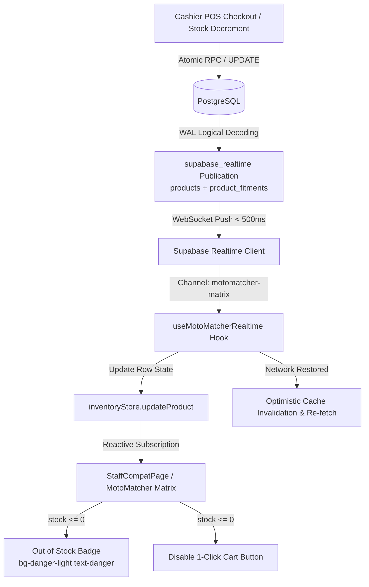
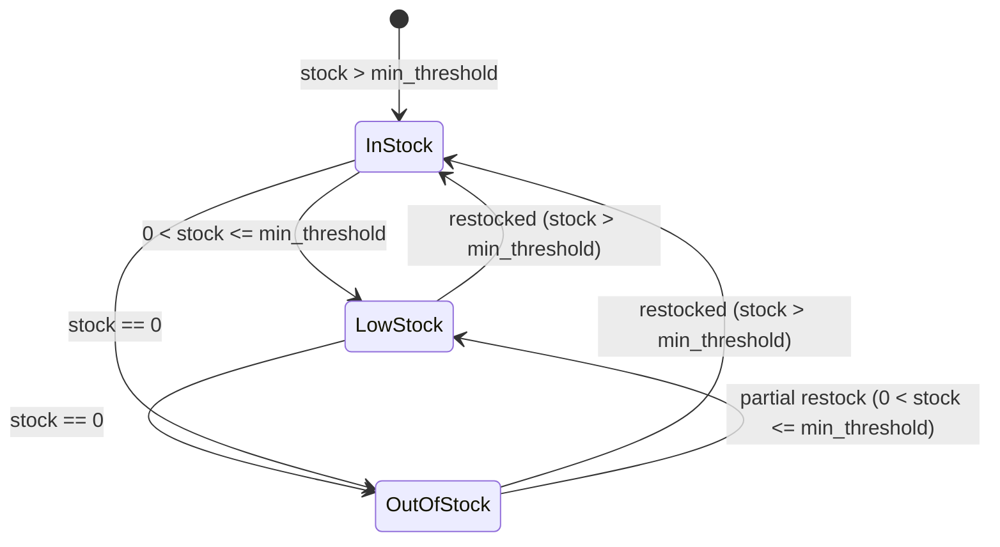

# Data Model: Supabase Realtime Fitment Updates & Stock Alert Broadcast for Floor Terminals

**Feature Branch**: `feat/SIAA-55-motomatcher-realtime-stock-sync`  
**Feature Spec**: [`specs/025-motomatcher-realtime-stock-sync/spec.md`](spec.md)  
**Jira Issue**: [SIAA-55](https://the-three-devsketeers.atlassian.net/browse/SIAA-55) (STORY-4.8)  
**Parent Epic**: [SIAA-4](https://the-three-devsketeers.atlassian.net/browse/SIAA-4) (EPIC-4: Smart MotoMatcher)  

---

## 1. Entity Overview & Flow Diagram

The real-time fitment and inventory synchronization subsystem enables floor terminals to dynamically reflect stock changes without page reloads:



---

## 2. Database Publication & Schema Definitions

### 2.1 Publication Registration (`supabase_realtime`)

```sql
-- Migration: 20261017000000_motomatcher_realtime.sql
DO $$
BEGIN
    IF NOT EXISTS (
        SELECT 1 FROM pg_publication_tables 
        WHERE pubname = 'supabase_realtime' AND tablename = 'products'
    ) THEN
        ALTER PUBLICATION supabase_realtime ADD TABLE public.products;
    END IF;
END
$$;

ALTER TABLE public.products REPLICA IDENTITY FULL;

DO $$
BEGIN
    IF NOT EXISTS (
        SELECT 1 FROM pg_publication_tables 
        WHERE pubname = 'supabase_realtime' AND tablename = 'product_fitments'
    ) THEN
        ALTER PUBLICATION supabase_realtime ADD TABLE public.product_fitments;
    END IF;
END
$$;

ALTER TABLE public.product_fitments REPLICA IDENTITY FULL;
```

### 2.2 Table Structures

#### `public.product_fitments`
| Column | Type | Constraints | Description |
| :--- | :--- | :--- | :--- |
| `id` | UUID | PRIMARY KEY, DEFAULT gen_random_uuid() | Unique join record ID |
| `product_id` | UUID | NOT NULL, REFERENCES products(id) ON DELETE CASCADE | Target product ID |
| `model_id` | UUID | NOT NULL, REFERENCES motorcycle_models(id) ON DELETE CASCADE | Compatible motorcycle model |
| `fitment_type`| TEXT | NOT NULL, CHECK (oem, aftermarket, universal) | Fitment tier |
| `year_range` | TEXT | NULL | Production year range |
| `notes` | TEXT | NULL | Technical / installation notes |
| `created_at` | TIMESTAMPTZ | NOT NULL, DEFAULT now() | Creation timestamp |

#### `public.products` (Relevant Realtime Fields)
| Column | Type | Constraints | Description |
| :--- | :--- | :--- | :--- |
| `id` | UUID | PRIMARY KEY | Product UUID |
| `sku` | TEXT | NOT NULL, UNIQUE | Master catalog SKU |
| `stock` | INTEGER | NOT NULL, CHECK (stock >= 0) | Physical stock level |
| `min_threshold` | INTEGER | NOT NULL, CHECK (min_threshold >= 0) | Low stock trigger threshold |
| `retail` | NUMERIC(10,2) | NOT NULL, CHECK (retail >= 0) | Retail price |
| `location` | TEXT | NULL | Physical shelf coordinate |

---

## 3. TypeScript Domain Models & Contracts

### 3.1 Hook Options & Result Types

```typescript
import type { Product } from '../types/product';
import type { RealtimeChannelStatus } from '../types/realtime';

export interface UseMotoMatcherRealtimeOptions {
  /**
   * Whether subscription is active (defaults to true)
   */
  enabled?: boolean;

  /**
   * Callback fired whenever any product stock or attribute updates in realtime
   */
  onStockUpdate?: (product: Product) => void;

  /**
   * Callback fired when an item crosses below or reaches its low-stock threshold
   */
  onLowStock?: (product: Product) => void;

  /**
   * Callback fired when an item's stock reaches 0 (Out of Stock)
   */
  onOutOfStock?: (product: Product) => void;

  /**
   * Callback fired when fitment mappings change for the active motorcycle model
   */
  onFitmentChange?: () => void;
}

export interface UseMotoMatcherRealtimeResult {
  /**
   * Whether the WebSocket channel is currently connected and subscribed
   */
  isConnected: boolean;

  /**
   * Current channel status ('SUBSCRIBED' | 'CONNECTING' | 'CLOSED' | 'CHANNEL_ERROR' | 'TIMED_OUT')
   */
  status: RealtimeChannelStatus;

  /**
   * Timestamp of last successfully received Realtime message
   */
  lastSyncedAt: Date | null;

  /**
   * Imperative re-sync trigger for cache invalidation
   */
  invalidateCache: () => void;
}
```

---

## 4. Availability & Stock State Machine



| State | Condition | Badge Styling (SWIFT Design Tokens) | Button Action |
| :--- | :--- | :--- | :--- |
| **In Stock** | `stock > min_threshold` | `bg-success-light text-success border-success/20` | Enabled ("Add to POS") |
| **Low Stock** | `0 < stock <= min_threshold` | `bg-accent-light text-accent border-accent/20` | Enabled ("Add to POS") |
| **Out of Stock** | `stock <= 0` | `bg-danger-light text-danger border-danger/20 badge badge-danger` | **Disabled** ("Out of Stock") |
