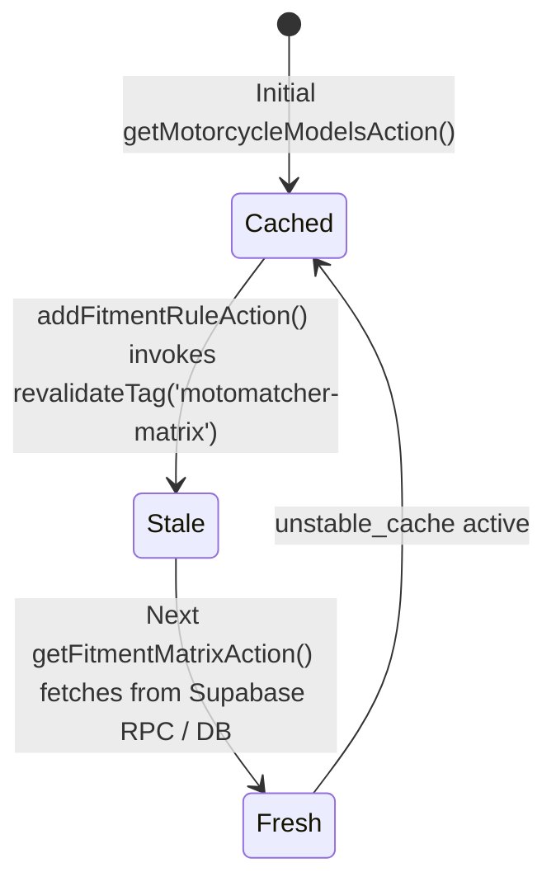

# Data Model: MotoMatcher Server Actions, Fitment Rules & Cart Dispatch

**Feature**: `025-motomatcher-server-actions-cart-wiring`  
**Ticket**: [SIAA-58](https://the-three-devsketeers.atlassian.net/browse/SIAA-58)  

---

## 1. Entity Models & DTOs

### 1.1 Server Action Envelope: `FitmentMatrixActionResult`
```typescript
export interface FitmentMatrixActionResult {
  success: boolean;
  data: MotoMatcherMatrixResult;
  error?: string;
}
```

### 1.2 Administrative Fitment Rule Input: `AddFitmentRuleInput`
```typescript
export interface AddFitmentRuleInput {
  productId: string;
  modelId: string;
  fitmentType?: 'oem' | 'aftermarket' | 'universal';
  yearRange?: string | null;
  notes?: string | null;
}

export interface AddFitmentRuleResult {
  success: boolean;
  ruleId?: string;
  error?: string;
}
```

### 1.3 MotoMatcher Matrix Part (Source Entity)
```typescript
export interface MotoMatcherMatrixPart {
  id: string;
  sku: string;
  name: string;
  brand: string;
  category: string;
  retail_price: number;
  stock_level: number;
  min_threshold: number;
  shelf_location: string | null;
  fitment_type: 'oem' | 'universal' | 'aftermarket';
  fitment_notes: string | null;
  year_range: string | null;
  is_universal: boolean;
  upsell_delta_amount: number | null;
  upsell_delta_percent: number | null;
  upsell_badge: string | null;
  oem_reference_sku: string | null;
}
```

### 1.4 Cart Item Adaptation (Destination Entity)
When dispatched via `addItem(item, qty)` in `lib/store/cart-store.ts`:
```typescript
export interface PartCartItem {
  id: string; // SKU
  type: 'part';
  sku: string;
  name: string;
  price: number; // mapped from retail_price or wholesale based on pricingMode
  qty: number;
  location?: string | null; // mapped from shelf_location
  retailPrice?: number; // mapped from retail_price
  wholesalePrice?: number; // mapped from product lookup or retail_price fallback
  stock?: number; // mapped from stock_level
  minThreshold?: number; // mapped from min_threshold
  isOverridden?: boolean;
}
```

---

## 2. Invalidation & Cache Tag Machine


