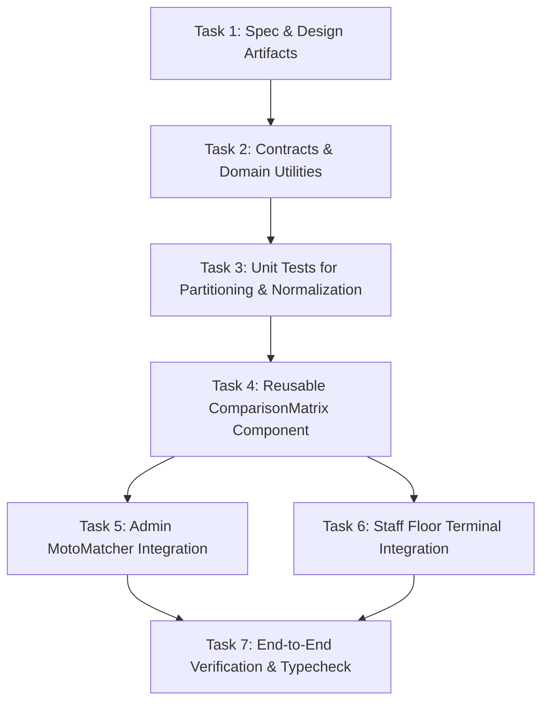

# Tasks: Side-by-Side OEM vs. Aftermarket Comparison Matrix

**Feature**: `025-oem-aftermarket-comparison-matrix`  
**Jira Ticket**: [SIAA-24](https://the-three-devsketeers.atlassian.net/browse/SIAA-24)  
**Parent Epic**: [SIAA-4](https://the-three-devsketeers.atlassian.net/browse/SIAA-4) (EPIC-4: Smart MotoMatcher)  

---

## Task Matrix & Dependency Graph

---

## Phase 1: Specifications, Contracts & Domain Modeling

- [x] **TASK-1.1**: Author specification, research, and data model artifacts for SIAA-24 comparison matrix (`specs/025-oem-aftermarket-comparison-matrix/spec.md`, `research.md`, `data-model.md`).
- [ ] **TASK-1.2**: Implement `ComparisonPartItem` schema, adapters, and partitioning utilities in `lib/motomatcher/comparison-matrix-contracts.ts`.
- [ ] **TASK-1.3**: Write comprehensive unit tests in `lib/motomatcher/__tests__/comparison-matrix.test.ts` validating partitioning (`oem: true` vs `oem: false`), product adaptation, stock alerts, and upsell delta formatting.

---

## Phase 2: Component Architecture & Visual Hierarchy

- [ ] **TASK-2.1**: Implement `<ComparisonMatrix />` component in `components/motomatcher/comparison-matrix.tsx`:
  - Dual-column responsive grid (`grid-cols-1 lg:grid-cols-2 gap-4`).
  - High-contrast semantic theme headers (Primary/Blue for OEM vs Secondary/Purple-Amber for Aftermarket).
  - Part card attribute rendering: SKU, Name, Brand, Shelf location badge (`MapPin`), Retail Price (₱), Stock badge (with low-stock threshold warning).
  - Upsell delta badge rendering for aftermarket upgrades.
  - "Add to POS Cart" button with temporary "Added to Cart" feedback (1800ms).
  - Graceful empty column fallback states (`PackageOpen` icon and contextual messages).

---

## Phase 3: Portal Integrations & User Scenarios

- [ ] **TASK-3.1**: Integrate `<ComparisonMatrix />` into `app/admin/motomatcher/admin-motomatcher-client.tsx`, replacing inline dual columns with the standardized component.
- [ ] **TASK-3.2**: Integrate `<ComparisonMatrix />` into `app/staff/compat/page.tsx`, replacing the generic single grid with side-by-side OEM vs. Aftermarket comparison while retaining subsystem category filtering.

---

## Phase 4: Convergence & Verification

- [ ] **TASK-4.1**: Run `npm test -- lib/motomatcher/__tests__/comparison-matrix.test.ts` to verify all domain and component logic.
- [ ] **TASK-4.2**: Run `npm run typecheck` and `npm run lint` inside the worktree to ensure zero regressions.
- [ ] **TASK-4.3**: Update `tasks.md` and complete atomic commits following `.agents/rules/atomic-commit.md`.
