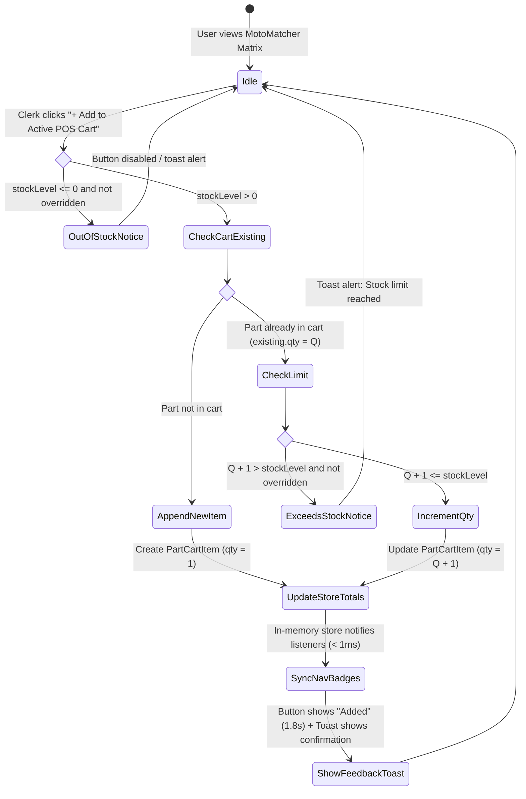

# Data Model: 1-Click Fast-Lane POS Cart Insertion & Live Upsell Dispatch

**Feature**: `026-fast-lane-cart-insertion`  
**Ticket**: [SIAA-25](https://the-three-devsketeers.atlassian.net/browse/SIAA-25)  

---

## 1. Core Domain Entities & Interfaces

### 1.1 Cart Insertion Dispatch Request & Response

```typescript
import type { ComparisonPartItem } from '@/lib/motomatcher/comparison-matrix-contracts';
import type { PartCartItem } from '@/lib/types/cart';

/**
 * Input request payload for adding a MotoMatcher part to POS cart
 */
export interface MotoMatcherCartDispatchRequest {
  /** The comparison matrix part item clicked by the user */
  part: ComparisonPartItem;
  /** Quantity to add (defaults to 1) */
  quantity?: number;
  /** Whether clerk has manager authorization to override out-of-stock guard */
  overrideStockGuard?: boolean;
}

/**
 * Standardized result from MotoMatcher cart insertion
 */
export interface MotoMatcherCartDispatchResult {
  /** True if item was added or quantity incremented */
  success: boolean;
  /** High-level status code for telemetry or branch logic */
  status: 'ADDED_NEW' | 'INCREMENTED_EXISTING' | 'OUT_OF_STOCK' | 'EXCEEDS_STOCK' | 'INVALID_PART';
  /** Human-readable message suitable for toast notifications */
  message: string;
  /** Resulting line item quantity in cart, or null if insertion failed */
  currentCartQty: number | null;
  /** Updated total items count across the entire cart */
  totalCartItemCount: number;
  /** Reference SKU */
  sku: string;
}
```

---

### 1.2 POS Cart Navigation Badge State

```typescript
/**
 * Navigation item dynamic badge configuration
 */
export interface DynamicNavBadge {
  /** Display text inside the badge (e.g., "3", "ON SHIFT") */
  text: string;
  /** Semantic theme variant mapping to design tokens */
  variant: 'primary' | 'secondary' | 'success' | 'warning' | 'danger';
}
```

---

### 1.3 State Transitions



---

## 2. Validation & Business Rules

| Entity / Property | Constraint | Action on Violation |
| :--- | :--- | :--- |
| `part.stockLevel` | Must be `> 0` to enable button | Button disabled with label "Out of Stock"; click attempts return `OUT_OF_STOCK`. |
| `targetQty` (`currentQty + 1`) | Must not exceed `product.stock` | Return `EXCEEDS_STOCK`; trigger alert toast: `"Cannot add more: Available stock limit reached for [Part Name]"`. |
| Duplicate SKU Addition | Match on `part.sku` in active cart items | Append quantity to existing line item (`qty += 1`); do not duplicate cart rows. |
| Pricing Tier Application | Inherit active `cartStore.pricingMode` ('retail' \| 'wholesale') | Part price set to `product.wholesale` if wholesale, else `product.retail`. |
| Badge Count Reactivity | Must sync within 50ms across all navigation views | Synchronous state update via `useSyncExternalStore` (< 1ms execution). |
