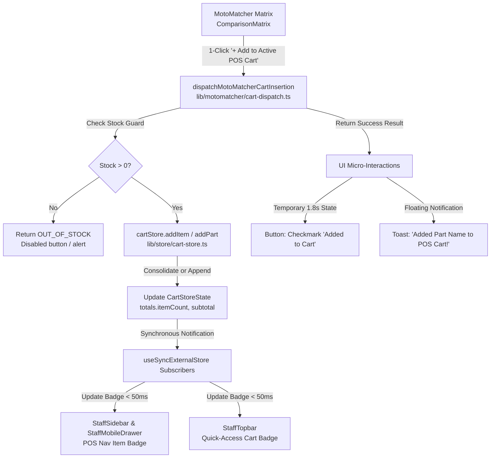

# Implementation Plan: 1-Click Fast-Lane POS Cart Insertion & Live Upsell Dispatch

**Feature**: `026-fast-lane-cart-insertion`  
**Ticket**: [SIAA-25](https://the-three-devsketeers.atlassian.net/browse/SIAA-25) (STORY-4.3)  
**Parent Epic**: [SIAA-4](https://the-three-devsketeers.atlassian.net/browse/SIAA-4) (Smart MotoMatcher)  
**Date**: 2026-10-14  
**Spec**: [`specs/026-fast-lane-cart-insertion/spec.md`](spec.md)  

---

## 1. Summary

In busy repair workshops and counter retail environments, clerks need to transition seamlessly from diagnosing parts fitment into creating an active POS sale. This feature implements **1-Click Fast-Lane POS Cart Insertion & Live Upsell Dispatch**, connecting the MotoMatcher side-by-side matrix directly to the global hybrid POS cart engine:
1. **1-Click Insertion with Micro-Feedback**: Instant insertion from part cards with checkmark transition and toast feedback (`"Added [Part Name] to POS Cart!"`).
2. **Real-Time Badge Counter Synchronization (< 50ms)**: Reactive cart badge updates across `StaffSidebar`, `StaffMobileDrawer`, and `StaffTopbar`.
3. **Quantity Consolidation & Stock Limits**: Subsequent clicks increment line item quantity rather than duplicating rows, with strict out-of-stock and stock-cap guards.
4. **Strict Token Adherence**: Zero hardcoded colors, built entirely using SWIFT design tokens (`app/globals.css` and `lib/tokens.ts`).

---

## 2. Technical Context

- **Language/Version**: TypeScript 5, Next.js (App Router, React 19)
- **Primary Dependencies**: `lucide-react`, React `useSyncExternalStore`, Tailwind CSS v4
- **State Management**: In-memory reactive `cartStore` (`lib/store/cart-store.ts`)
- **Testing**: Node.js native test runner (`node:test`, `node:assert/strict`) via `npm test`
- **Target Platform**: Desktop POS terminals, tablet floor terminals, mobile staff drawer
- **Performance Goals**: Sub-millisecond state updates; badge counter synchronization < 50ms (well within target)
- **Constraints**: Zero hardcoded hex/RGB colors; WCAG AA accessible contrast

---

## 3. Constitution Check

*GATE EVALUATION: Supreme architectural principles verified against `.specify/memory/constitution.md`*

| Principle | Status | Evaluation |
| :--- | :---: | :--- |
| **I. Semantic Design Tokens & Zero Hardcoded Colors** | PASS | All UI states (default, active, hover, checkmark, badge, toast) utilize SWIFT semantic tokens (`bg-primary`, `bg-secondary`, `bg-success`, `text-primary`, etc.). |
| **II. Single Source of Truth & Specification Fidelity** | PASS | Conforms to Jira SIAA-25 acceptance criteria, `../docs/features.md`, and `../mockup/` layout patterns. |
| **III. Type-Safe Data Architecture & Domain Integrity** | PASS | Strict TypeScript interfaces for dispatch requests, results, and cart items; zero `any` usage. |
| **IV. Test-First Quality & Contract Verification** | PASS | Unit tests covering all 4 acceptance scenarios in `lib/motomatcher/__tests__/cart-dispatch.test.ts`. |
| **V. Server-First Performance & Accessibility Standards** | PASS | Client boundaries limited to interactive leaves; ARIA live regions for toast announcements. |

---

## 4. Architecture Overview & Component Hierarchy

---

## 5. Phased Implementation Plan

### Phase 1: Pure Domain Dispatch Helper & Contract Tests
- **Artifacts**:
  - `lib/motomatcher/cart-dispatch.ts`: Expose `dispatchMotoMatcherCartInsertion(part, options)` which interfaces with `cartStore` to normalize part objects, validate stock caps, update quantity, and format toast messages.
  - `lib/motomatcher/__tests__/cart-dispatch.test.ts`: Automated tests covering:
    - 1-click addition of new OEM/aftermarket part.
    - Subsequent additions incrementing quantity (Q + 1) without duplication.
    - Out-of-stock guard prevention (0 stock).
    - Stock-cap limit prevention (targetQty > stock).
    - Real-time cart total item count reflection.

### Phase 2: Navigation Cart Badge Counter Synchronization
- **Artifacts**:
  - `components/staff/staff-sidebar.tsx`:
    - Subscribe to `useCartStore` to read `totals.itemCount`.
    - Dynamically attach count badge `{ text: String(itemCount), variant: 'primary' }` to the `pos` navigation item when `itemCount > 0`.
  - `components/staff/staff-mobile-drawer.tsx`:
    - Synchronize dynamic badge on mobile drawer navigation items.
  - `components/staff/staff-topbar.tsx`:
    - Add quick-access cart badge indicator linking directly to `/staff/pos`.

### Phase 3: MotoMatcher Comparison Matrix Integration & Toast Refinement
- **Artifacts**:
  - `components/motomatcher/comparison-matrix.tsx`:
    - Ensure button disabled state when `part.stockLevel <= 0` displaying "Out of Stock".
    - Seamlessly trigger `onAddToCart(part)` with temporary 1.8s checkmark transition.
  - `app/staff/compat/page.tsx` & `app/admin/motomatcher/admin-motomatcher-client.tsx`:
    - Use `dispatchMotoMatcherCartInsertion` in `handleAddToCart`.
    - Display standardized toast notifications for both success and stock-cap warnings.

### Phase 4: Quality Gates & Verification
- Run `npm test -- lib/motomatcher/__tests__/cart-dispatch.test.ts`.
- Run `npm run typecheck`.
- Run `npm run lint`.
