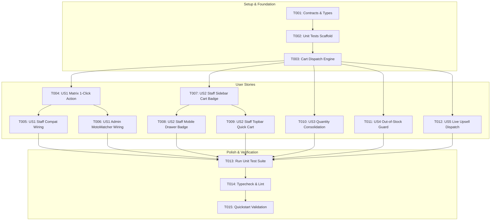

# Implementation Tasks: 1-Click Fast-Lane POS Cart Insertion & Live Upsell Dispatch

**Feature Branch**: `026-fast-lane-cart-insertion`  
**Jira Issue**: [SIAA-25](https://the-three-devsketeers.atlassian.net/browse/SIAA-25) (STORY-4.3)  
**Parent Epic**: [SIAA-4](https://the-three-devsketeers.atlassian.net/browse/SIAA-4) (Smart MotoMatcher)  
**Spec Reference**: [`specs/026-fast-lane-cart-insertion/spec.md`](spec.md)  
**Plan Reference**: [`specs/026-fast-lane-cart-insertion/plan.md`](plan.md)  

---

## Task Matrix & Dependency Graph

---

## Phase 1: Setup (Contracts & Types)

**Purpose**: Define TypeScript contracts and dispatch interfaces for MotoMatcher cart actions.

- [x] T001 [P] Verify and export cart insertion types and contracts in `specs/026-fast-lane-cart-insertion/contracts/cart-dispatch.contract.ts` and `lib/motomatcher/cart-dispatch.ts`

---

## Phase 2: Foundational (Blocking Prerequisites)

**Purpose**: Core dispatch engine and automated test harness required before UI wiring.

- [x] T002 [P] Create automated unit tests for cart dispatch engine in `lib/motomatcher/__tests__/cart-dispatch.test.ts`
- [x] T003 Implement pure cart dispatch helper in `lib/motomatcher/cart-dispatch.ts` wrapping `cartStore.addItem` with stock validation, quantity consolidation, and toast messaging

---

## Phase 3: User Story 1 - 1-Click Cart Insertion from Compatibility Matrix (Priority: P1) 🎯 MVP

**Goal**: Counter clerk can add any in-stock part from the MotoMatcher matrix to the active POS cart with a single click, receiving immediate checkmark feedback and a toast notification.

**Independent Test**: Navigate to `/staff/compat`, locate an in-stock part, and click "+ Add to Active POS Cart". The button shows "Added" for 1.8 seconds, a toast confirms `"Added [Part Name] to POS Cart!"`, and the item appears in `cartStore` with quantity 1.

- [x] T004 [US1] Update `ComparisonMatrix` in `components/motomatcher/comparison-matrix.tsx` to bind 1-click cart insertion with checkmark feedback and dispatch callback
- [x] T005 [P] [US1] Integrate cart dispatch helper and toast notification in `app/staff/compat/page.tsx`
- [x] T006 [P] [US1] Integrate cart dispatch helper and toast notification in `app/admin/motomatcher/admin-motomatcher-client.tsx`

---

## Phase 4: User Story 2 - Real-Time Cart Badge Counter Synchronization (Priority: P1)

**Goal**: Navigation headers and sidebar POS cart badge counters increment in real-time (< 50ms) upon adding parts from MotoMatcher without requiring route changes.

**Independent Test**: Observe sidebar "Fast-Lane POS" menu item while clicking "+ Add to Active POS Cart" on MotoMatcher. The badge increments instantly from N to N + 1.

- [x] T007 [P] [US2] Update `StaffSidebar` in `components/staff/staff-sidebar.tsx` to subscribe to `useCartStore` and dynamically display cart item count badge on Fast-Lane POS item
- [x] T008 [P] [US2] Update `StaffMobileDrawer` in `components/staff/staff-mobile-drawer.tsx` to synchronize active cart badge on mobile drawer navigation
- [x] T009 [P] [US2] Add quick-access cart badge indicator in `components/staff/staff-topbar.tsx` displaying live cart count and linking to `/staff/pos`

---

## Phase 5: User Story 3 - Duplicate Addition & Quantity Consolidation (Priority: P2)

**Goal**: Subsequent clicks on "+ Add to Active POS Cart" for the same part increment existing line item quantity (Q + 1) instead of creating duplicate lines, updating cart totals immediately.

**Independent Test**: Click "+ Add to Active POS Cart" twice on the same part card; verify cart state contains a single line item with `qty = 2` and recalculated subtotals.

- [x] T010 [US3] Implement quantity consolidation and cart total recalculation validation in `lib/motomatcher/cart-dispatch.ts` and `lib/store/cart-store.ts`

---

## Phase 6: User Story 4 - Out-of-Stock Prevention & Stock Cap Safeguard (Priority: P2)

**Goal**: Out-of-stock parts (0 stock) render with disabled "Out of Stock" button; attempts to add exceeding physical stock cap are blocked with an alert toast.

**Independent Test**: Part with 0 stock has disabled button; adding part beyond stock limit shows alert toast and does not increment past max stock.

- [x] T011 [US4] Enforce disabled out-of-stock state styling and stock-cap guard alert messages in `components/motomatcher/comparison-matrix.tsx` and `lib/motomatcher/cart-dispatch.ts`

---

## Phase 7: User Story 5 - Live Upsell Dispatch & Comparison Context (Priority: P3)

**Goal**: Aftermarket performance upgrades display price deltas and upgrade classification, queueing seamlessly into the active hybrid cart with tier pricing intact.

**Independent Test**: Add an aftermarket upgrade part to cart and verify upgrade metadata and wholesale/retail price tier reflect accurately in cart lines.

- [x] T012 [US5] Verify aftermarket upsell badge rendering and ensure aftermarket upgrade metadata propagates into cart items via `lib/motomatcher/cart-dispatch.ts`

---

## Phase 8: Polish & Cross-Cutting Verification

**Purpose**: End-to-end quality gates, static analysis, and verification.

- [x] T013 [P] Run unit test suite in `lib/motomatcher/__tests__/cart-dispatch.test.ts` and verify zero failures
- [x] T014 [P] Run TypeScript typecheck (`npm run typecheck`) and linting (`npm run lint`) across the workspace
- [x] T015 Execute manual end-to-end verification scenarios per `specs/026-fast-lane-cart-insertion/quickstart.md`

---

## Dependencies & Execution Order

### Phase Dependencies
- **Phase 1 (Setup)**: Can start immediately.
- **Phase 2 (Foundational)**: Depends on Phase 1; BLOCKS all User Stories.
- **Phase 3 (User Story 1 - MVP)**: Depends on Phase 2. Delivers core 1-click cart insertion.
- **Phase 4 (User Story 2)**: Depends on Phase 2; can proceed in parallel with or after Phase 3.
- **Phase 5 (User Story 3)**: Depends on Phase 2 & 3.
- **Phase 6 (User Story 4)**: Depends on Phase 2 & 3.
- **Phase 7 (User Story 5)**: Depends on Phase 2 & 3.
- **Phase 8 (Polish & Verification)**: Runs after desired user stories are implemented.

### Parallel Execution Opportunities
- `T005` (Staff compat wiring) and `T006` (Admin motomatcher wiring) can be executed in parallel.
- `T007` (StaffSidebar badge), `T008` (StaffMobileDrawer badge), and `T009` (StaffTopbar quick cart) can be executed in parallel.
- `T013` (Unit tests) and `T014` (Typecheck & Lint) can run in parallel.
