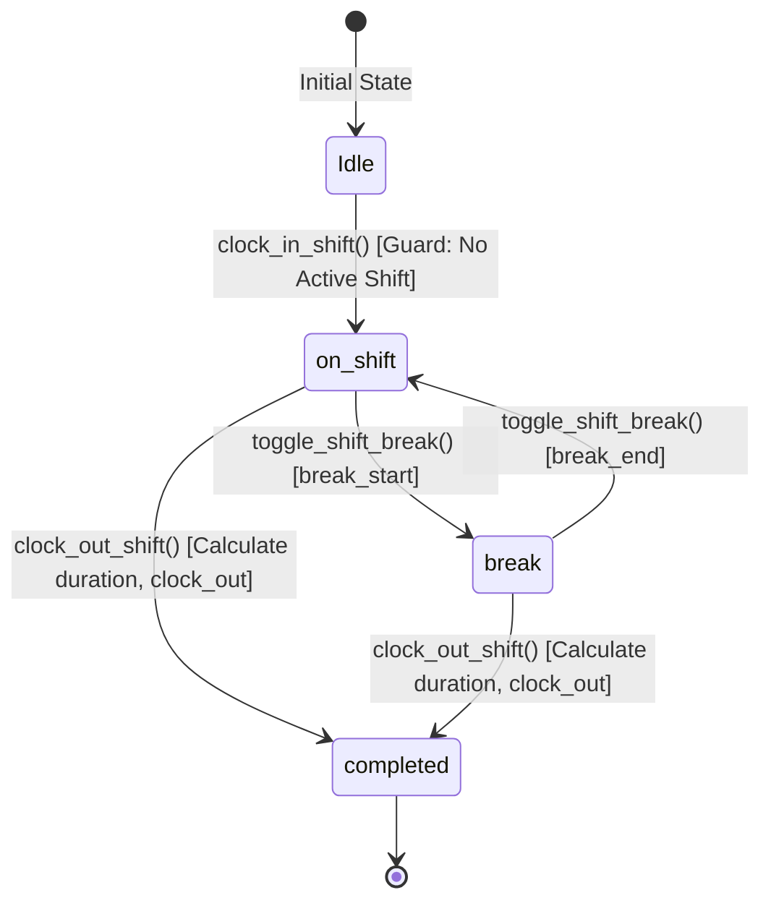

# Data Model: Supabase Atomic Shift Punch RPCs & Concurrency Guards

**Feature**: `027-atomic-shift-punch-rpcs`  
**Jira Ticket**: [SIAA-61](https://the-three-devsketeers.atlassian.net/browse/SIAA-61) (STORY-5.7)  

---

## 1. Relational Entities

### `public.staff_shifts` (Existing from SIAA-60, augmented with partial index)

| Column | Type | Constraints / Defaults | Description |
|---|---|---|---|
| `id` | `UUID` | `PRIMARY KEY DEFAULT gen_random_uuid()` | Unique shift identifier |
| `profile_id` | `UUID` | `NOT NULL REFERENCES public.profiles(id) ON DELETE CASCADE` | Shift owner profile |
| `staff_name` | `TEXT` | `NOT NULL` | Denormalized staff full name |
| `terminal_id` | `TEXT` | `NOT NULL DEFAULT 'Terminal #01'` | Terminal origin |
| `clock_in` | `TIMESTAMPTZ` | `NOT NULL DEFAULT timezone('utc'::text, now())` | Server timestamp of shift start |
| `clock_out` | `TIMESTAMPTZ` | `NULL` | Populated upon clock out |
| `duration_seconds` | `INTEGER` | `DEFAULT 0` | Server-calculated total seconds |
| `status` | `TEXT` | `NOT NULL DEFAULT 'on_shift' CHECK (status IN ('on_shift', 'break', 'completed'))` | Current lifecycle state |
| `notes` | `TEXT` | `NULL` | Optional memo / handoff notes |
| `created_at` | `TIMESTAMPTZ` | `NOT NULL DEFAULT timezone('utc'::text, now())` | Row creation timestamp |
| `updated_at` | `TIMESTAMPTZ` | `NOT NULL DEFAULT timezone('utc'::text, now())` | Row update timestamp |

#### Added Concurrency Index:
```sql
CREATE UNIQUE INDEX IF NOT EXISTS idx_staff_shifts_one_active_per_employee
ON public.staff_shifts (profile_id)
WHERE (status IN ('on_shift', 'break'));
```

---

### `public.staff_shift_audit_logs` (New Immutable Ledger)

| Column | Type | Constraints / Defaults | Description |
|---|---|---|---|
| `id` | `UUID` | `PRIMARY KEY DEFAULT gen_random_uuid()` | Unique audit event ID |
| `shift_id` | `UUID` | `NOT NULL REFERENCES public.staff_shifts(id) ON DELETE CASCADE` | Associated shift ID |
| `profile_id` | `UUID` | `NOT NULL REFERENCES public.profiles(id) ON DELETE CASCADE` | Employee profile ID |
| `terminal_id` | `TEXT` | `NOT NULL` | Terminal ID where punch occurred |
| `action` | `TEXT` | `NOT NULL CHECK (action IN ('clock_in', 'clock_out', 'break_start', 'break_end'))` | Transition event type |
| `notes` | `TEXT` | `NULL` | Audit notes or reasons |
| `created_at` | `TIMESTAMPTZ` | `NOT NULL DEFAULT timezone('utc'::text, now())` | Immutable event timestamp |

#### Indexes:
- `CREATE INDEX idx_staff_shift_audit_logs_shift ON public.staff_shift_audit_logs(shift_id);`
- `CREATE INDEX idx_staff_shift_audit_logs_profile_created ON public.staff_shift_audit_logs(profile_id, created_at DESC);`

---

## 2. Shift Lifecycle State Machine



### State Invariants:
1. **At Most One Active Shift**: A `profile_id` can have at most one shift where `status IN ('on_shift', 'break')`.
2. **Immutable Terminal State**: Once `status = 'completed'`, no further state changes are permitted.
3. **Monotonic Audit Trail**: Every valid state change produces exactly one immutable record in `staff_shift_audit_logs`.

---

## 3. Database RPC Signatures & Responses

### 3.1 `public.clock_in_shift`
```sql
FUNCTION public.clock_in_shift(
    p_terminal_id TEXT DEFAULT 'Terminal #01',
    p_notes TEXT DEFAULT NULL
) RETURNS JSONB;
```
**Returns**:
```json
{
  "success": true,
  "shift": {
    "id": "uuid",
    "profile_id": "uuid",
    "staff_name": "Maria Santos",
    "terminal_id": "Terminal #01",
    "clock_in": "2026-10-14T08:00:00Z",
    "clock_out": null,
    "duration_seconds": 0,
    "status": "on_shift",
    "notes": null
  },
  "audit_log_id": "uuid"
}
```

### 3.2 `public.clock_out_shift`
```sql
FUNCTION public.clock_out_shift(
    p_shift_id UUID,
    p_notes TEXT DEFAULT NULL
) RETURNS JSONB;
```
**Returns**:
```json
{
  "success": true,
  "shift": {
    "id": "uuid",
    "profile_id": "uuid",
    "staff_name": "Maria Santos",
    "terminal_id": "Terminal #01",
    "clock_in": "2026-10-14T08:00:00Z",
    "clock_out": "2026-10-14T16:59:00Z",
    "duration_seconds": 32340,
    "status": "completed",
    "notes": "End of shift"
  },
  "duration_formatted": "08h 59m",
  "audit_log_id": "uuid"
}
```

### 3.3 `public.toggle_shift_break`
```sql
FUNCTION public.toggle_shift_break(
    p_shift_id UUID
) RETURNS JSONB;
```
**Returns**:
```json
{
  "success": true,
  "shift": {
    "id": "uuid",
    "status": "break"
  },
  "previous_status": "on_shift",
  "current_status": "break",
  "action": "break_start",
  "audit_log_id": "uuid"
}
```
