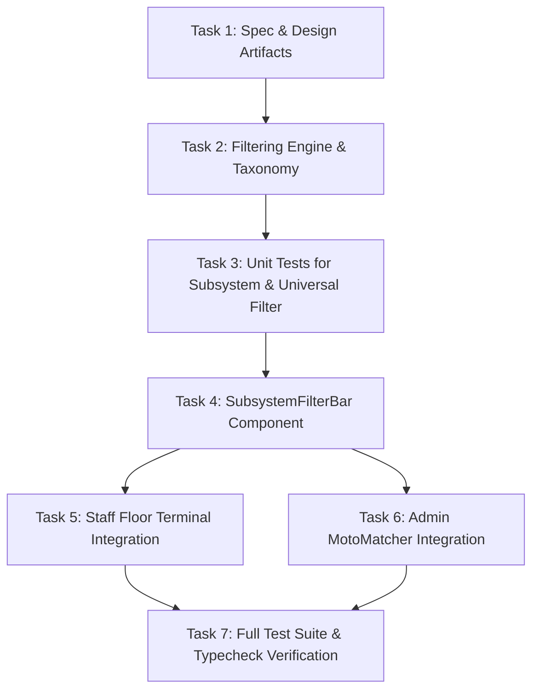

# Implementation Tasks: Subsystem Category & Universal vs. Dedicated Fitment Filtering

**Feature**: `027-subsystem-category-universal-fitment-filtering`  
**Jira Issue**: [SIAA-26](https://the-three-devsketeers.atlassian.net/browse/SIAA-26) (STORY-4.4)  
**Parent Epic**: [SIAA-4](https://the-three-devsketeers.atlassian.net/browse/SIAA-4) (EPIC-4: Smart MotoMatcher)  
**Spec Reference**: [`specs/027-subsystem-category-universal-fitment-filtering/spec.md`](spec.md)  
**Plan Reference**: [`specs/027-subsystem-category-universal-fitment-filtering/plan.md`](plan.md)  

---

## Task Matrix & Dependency Graph

---

## Phase 1: Specifications, Contracts & Domain Modeling

- [x] **TASK-1.1**: Author specification, research, data model, and contracts artifacts for SIAA-26 (`specs/027-subsystem-category-universal-fitment-filtering/spec.md`, `research.md`, `data-model.md`, `contracts/filtering.contract.ts`, `checklists/requirements.md`, `plan.md`, `quickstart.md`, `tasks.md`).

---

## Phase 2: Domain Filtering Engine & Subsystem Taxonomy

- [ ] **TASK-2.1**: Implement `SUBSYSTEM_CATEGORIES` taxonomy with labels and aliases in `lib/motomatcher/subsystem-filter.ts`.
- [ ] **TASK-2.2**: Implement pure filtering functions `filterMotoMatcherProducts` and `getMotoMatcherFilteredSet` in `lib/motomatcher/subsystem-filter.ts`:
  - Platform compatibility matching.
  - Universal exclusion when `includeUniversal === false`.
  - Subsystem category matching with alias normalization.
  - Synchronous aggregation of `totalMatches`, `oemCount`, and `aftermarketCount`.

---

## Phase 3: Automated Unit Testing (TDD)

- [ ] **TASK-3.1**: Create comprehensive unit tests in `lib/motomatcher/__tests__/subsystem-filter.test.ts`:
  - Scenario 1: Subsystem Category Pill Filtering (Brakes, Drivetrain/CVT, Fluids).
  - Scenario 2: "All Categories" Reset Action ("All Systems" / "ALL").
  - Scenario 3: Universal Parts Visibility Toggle (`includeUniversal: true` vs `includeUniversal: false`).
  - Scenario 4: Exact Result Count Indicators (oemCount, aftermarketCount, totalMatches).
  - Scenario 5: Universal platform selection mode.
  - Scenario 6: Category aliases matching ("CVT" matching "Drivetrain").

---

## Phase 4: UI Component Architecture: `<SubsystemFilterBar />`

- [ ] **TASK-4.1**: Implement reusable `<SubsystemFilterBar />` in `components/motomatcher/subsystem-filter-bar.tsx`:
  - Horizontal scrolling pill container for category chips.
  - Active chip styling (`bg-primary text-white border-primary shadow-xs`).
  - Inactive chip styling (`bg-bg-card border-border text-text-secondary hover:text-text-primary`).
  - "Include Universal Parts" toggle switch with accessible checkbox/button.
  - Strict SWIFT semantic design tokens (zero hardcoded colors).
  - ARIA attributes (`role="toolbar"`, `aria-label`, keyboard focus indicators).

---

## Phase 5: Portal Integrations & Synchronization

- [ ] **TASK-5.1**: Integrate `<SubsystemFilterBar />` and `getMotoMatcherFilteredSet` into `app/staff/compat/page.tsx`:
  - Replace ad-hoc category buttons with the standardized filter bar.
  - Wire `includeUniversal` state and toggle callback.
  - Update verified fitment banner counters to reflect synchronous totals.
- [ ] **TASK-5.2**: Integrate `<SubsystemFilterBar />` and `getMotoMatcherFilteredSet` into `app/admin/motomatcher/admin-motomatcher-client.tsx`:
  - Add `<SubsystemFilterBar />` between `<MotorcycleSelector />` and `<ComparisonMatrix />`.
  - Wire `includeUniversal` state and category filtering.
  - Synchronize counters in active platform banner and matrix headers.

---

## Phase 6: Convergence, Quality & Verification

- [ ] **TASK-6.1**: Run `npm test -- lib/motomatcher/__tests__/subsystem-filter.test.ts` to ensure 100% test coverage.
- [ ] **TASK-6.2**: Run full test suite `npm test` across the entire workspace to ensure zero regressions.
- [ ] **TASK-6.3**: Run `npm run typecheck` and `npm run lint` inside the worktree.
- [ ] **TASK-6.4**: Execute atomic commits following `.agents/rules/atomic-commit.md`.
