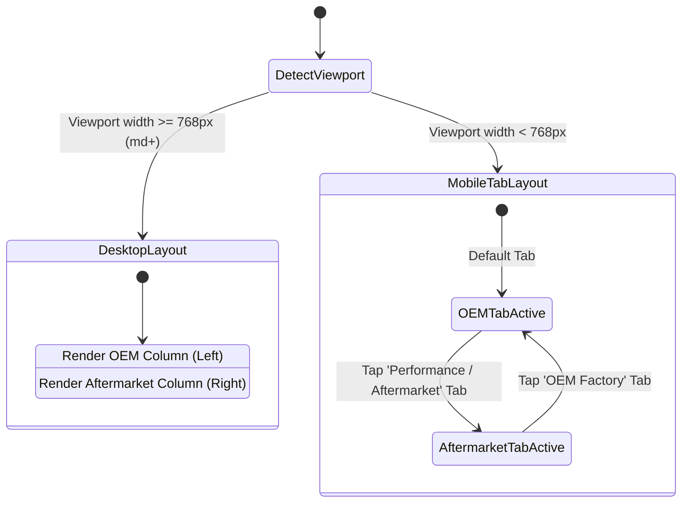

# Data Model: Staff Floor Terminal Touch-Optimized MotoMatcher & Shelf Locator Integration

**Feature**: `028-staff-terminal-motomatcher-shelf-locator`  
**Jira Issue**: [SIAA-27](https://the-three-devsketeers.atlassian.net/browse/SIAA-27) (STORY-4.5)  
**Parent Epic**: [SIAA-4](https://the-three-devsketeers.atlassian.net/browse/SIAA-4) (EPIC-4: Smart MotoMatcher)  

---

## 1. Domain Entities & Interface Extensions

### 1.1 Extended `ComparisonPartItem` Data Contract

Every part item in the OEM and Aftermarket comparison matrices carries full warehouse picking metadata:

```typescript
export interface ComparisonPartItem {
  id: string;
  sku: string;
  name: string;
  brand: string;
  category: string;
  retailPrice: number;
  wholesalePrice?: number;
  stockLevel: number;
  minThreshold: number;
  isOem: boolean;
  isUniversal?: boolean;
  upsellBadge?: string;
  
  /**
   * Warehouse storage coordinates (e.g., "Rack A-01 / Shelf 2", "Bin B3", or null if unassigned).
   * Formatted and rendered via <ShelfLocationTag />.
   */
  shelfLocation?: string | null;
}
```

### 1.2 `ComparisonMatrixProps` Touch & Viewport Configuration

Enables touch mode and responsive mobile tab state:

```typescript
export type ComparisonMatrixTab = "oem" | "aftermarket";

export interface ComparisonMatrixProps {
  oemParts: ComparisonPartItem[];
  aftermarketParts: ComparisonPartItem[];
  onAddToCart?: (part: ComparisonPartItem) => void;
  addedSku?: string | null;
  isLoading?: boolean;
  emptyOemMessage?: string;
  emptyAftermarketMessage?: string;
  className?: string;

  /**
   * When true, enforces touch-optimized minimum 44x44px hit targets and high-contrast styling.
   * Defaults to true on touch/staff terminals.
   */
  touchOptimized?: boolean;

  /**
   * Active tab on mobile / small viewports (< 768px).
   * Defaults to "oem" when unspecified.
   */
  activeMobileTab?: ComparisonMatrixTab;

  /**
   * Callback invoked when a user taps a mobile column tab.
   */
  onMobileTabChange?: (tab: ComparisonMatrixTab) => void;
}
```

### 1.3 `ShelfLocationTagProps` Contract

Leverages the standardized component from `components/inventory/shelf-location-tag.tsx`:

```typescript
export interface ShelfLocationTagProps {
  location?: string | null;
  className?: string;
  showIcon?: boolean;
}
```

### 1.4 Mobile Column Segment Definition

Defines the segmented controls rendered on viewports under 768px:

```typescript
export interface ComparisonMobileTabSegment {
  id: ComparisonMatrixTab;
  label: string;
  count: number;
  badgeLabel: string;
}
```

---

## 2. State Machine: Mobile Viewport & Active Tab


