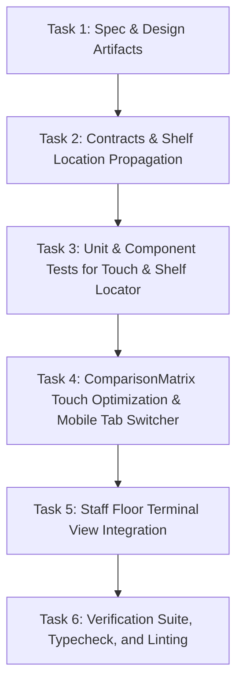

# Implementation Tasks: Staff Floor Terminal Touch-Optimized MotoMatcher & Shelf Locator Integration

**Feature**: `028-staff-terminal-motomatcher-shelf-locator`  
**Jira Issue**: [SIAA-27](https://the-three-devsketeers.atlassian.net/browse/SIAA-27) (STORY-4.5)  
**Parent Epic**: [SIAA-4](https://the-three-devsketeers.atlassian.net/browse/SIAA-4) (EPIC-4: Smart MotoMatcher)  
**Spec Reference**: [`specs/028-staff-terminal-motomatcher-shelf-locator/spec.md`](spec.md)  
**Plan Reference**: [`specs/028-staff-terminal-motomatcher-shelf-locator/plan.md`](plan.md)  

---

## Task Matrix & Dependency Graph

---

## Phase 1: Specifications, Contracts & Architecture Artifacts

- [x] **TASK-1.1**: Author specification, research, data model, contracts, checklist, plan, quickstart, and task artifacts for SIAA-27 (`specs/028-staff-terminal-motomatcher-shelf-locator/spec.md`, `research.md`, `data-model.md`, `contracts/touch-matrix.contract.ts`, `checklists/requirements.md`, `plan.md`, `quickstart.md`, `tasks.md`).

---

## Phase 2: Contracts & Shelf Location Propagation

- [x] **TASK-2.1**: Update `lib/motomatcher/comparison-matrix-contracts.ts`:
  - Extend `ComparisonMatrixProps` with `touchOptimized?: boolean`, `activeMobileTab?: "oem" | "aftermarket"`, `onMobileTabChange?: (tab: "oem" | "aftermarket") => void`.
- [x] **TASK-2.2**: Ensure `lib/motomatcher/subsystem-filter.ts` (`toComparisonPartItem`) properly passes `product.shelf_location` (or `product.shelfLocation`) into `ComparisonPartItem.shelfLocation`.

---

## Phase 3: Automated Unit & Component Tests (TDD)

- [x] **TASK-3.1**: Create/update unit and component tests in `components/motomatcher/__tests__/comparison-matrix.test.tsx`:
  - Verify `<ShelfLocationTag />` renders storage bay coordinates (`Rack A-01 / Shelf 2`).
  - Verify unassigned bays render the amber warning badge.
  - Verify minimum 44px touch targets (`min-h-[44px]`) on interactive buttons.
  - Verify mobile segmented tab switcher (< 768px) toggles between OEM and Aftermarket column views.
  - Verify "+ Add to POS Cart" click triggers callback with item data.

---

## Phase 4: Touch Ergonomics, Shelf Locator & Mobile Tab Switcher in `<ComparisonMatrix />`

- [x] **TASK-4.1**: Enhance `components/motomatcher/comparison-matrix.tsx`:
  - Replace inline map pin text with standardized `<ShelfLocationTag location={part.shelfLocation} />`.
  - Enforce touch-friendly `min-h-[44px]` height and adequate touch padding on action buttons.
  - Implement mobile segmented tab bar (`[ OEM Factory (X) ]` | `[ Performance / Aftermarket (Y) ]`) visible on mobile/tablet viewports (`block md:hidden`).
  - Render selected column view on mobile without horizontal scrolling or overflow.
  - Maintain desktop side-by-side dual columns on `md:` viewports and above.

---

## Phase 5: Staff Floor Terminal View Refinement

- [x] **TASK-5.1**: Enhance `app/staff/compat/page.tsx`:
  - Wire `touchOptimized={true}` into `<ComparisonMatrix />`.
  - Verify optimistic toast confirmation and shared floor cart handoff via `dispatchMotoMatcherCartInsertion`.

---

## Phase 6: Verification Suite, Typecheck, and Linting

- [x] **TASK-6.1**: Run automated test suite: `npm test -- components/motomatcher/__tests__/comparison-matrix.test.tsx`.
- [x] **TASK-6.2**: Run full TypeScript compilation check: `npm run typecheck`.
- [x] **TASK-6.3**: Run linter check: `npm run lint`.
