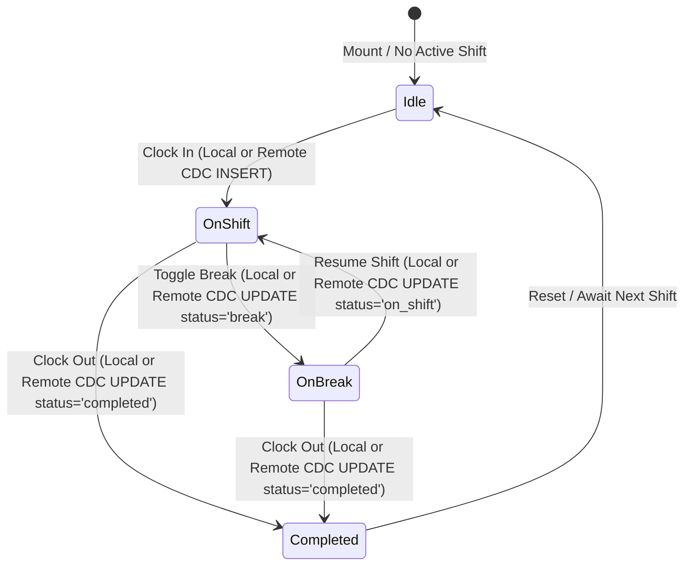

# Data Model: Supabase Realtime Terminal Attendance Sync & Multi-Station Shift Engine

**Feature**: Supabase Realtime Terminal Attendance Sync & Multi-Station Shift Engine  
**Feature Branch**: `feat/SIAA-63-supabase-realtime-terminal-attendance-sync`  
**Ticket**: [SIAA-63](https://the-three-devsketeers.atlassian.net/browse/SIAA-63) (STORY-5.8)  

---

## 1. Database Schema & Publication

### 1.1 `public.staff_shifts` Table (From SIAA-60)
```sql
CREATE TABLE IF NOT EXISTS public.staff_shifts (
    id UUID PRIMARY KEY DEFAULT gen_random_uuid(),
    profile_id UUID NOT NULL REFERENCES public.profiles(id) ON DELETE CASCADE,
    staff_name TEXT NOT NULL,
    terminal_id TEXT NOT NULL DEFAULT 'Terminal #01',
    clock_in TIMESTAMPTZ NOT NULL DEFAULT timezone('utc'::text, now()),
    clock_out TIMESTAMPTZ NULL,
    duration_seconds INTEGER DEFAULT 0,
    status TEXT NOT NULL DEFAULT 'on_shift' CHECK (status IN ('on_shift', 'break', 'completed')),
    notes TEXT NULL,
    created_at TIMESTAMPTZ NOT NULL DEFAULT timezone('utc'::text, now()),
    updated_at TIMESTAMPTZ NOT NULL DEFAULT timezone('utc'::text, now())
);
```

### 1.2 Publication Registration (SIAA-63)
```sql
-- Registration with supabase_realtime publication
DO $$
BEGIN
    IF NOT EXISTS (
        SELECT 1 FROM pg_publication_tables 
        WHERE pubname = 'supabase_realtime' AND tablename = 'staff_shifts'
    ) THEN
        ALTER PUBLICATION supabase_realtime ADD TABLE public.staff_shifts;
    END IF;
END
$$;

-- Full replica identity for complete UPDATE row broadcast
ALTER TABLE public.staff_shifts REPLICA IDENTITY FULL;
```

---

## 2. Realtime Change Data Capture (CDC) Event Model

```typescript
export type RealtimeShiftEventType = 'INSERT' | 'UPDATE' | 'DELETE';

export interface RealtimeShiftPayload {
  schema: 'public';
  table: 'staff_shifts';
  commit_timestamp: string;
  eventType: RealtimeShiftEventType;
  new: DbStaffShift;
  old: Partial<DbStaffShift>;
  errors: unknown[] | null;
}
```

---

## 3. Client State Machine & Store Data Structures

### 3.1 Shift Lifecycle Transitions


### 3.2 Enhanced Store State Model (`PunchStoreState`)
```typescript
export interface PunchStoreState {
  isShiftActive: boolean;
  shiftSeconds: number;
  punchLogs: PunchLog[];
  currentStaff: string;
  shiftStatus: 'on_shift' | 'break' | 'completed' | 'idle';
  lastError: PunchStoreError | null;
  activeStaffCount: number;
  lastSyncTimestamp: number | null;
}
```

### 3.3 Server Shift Rehydration Model
```typescript
export interface ShiftRehydrationInput {
  activeShift: DbStaffShift | null;
  recentLogs?: PunchLog[];
  currentTimeMs?: number; // Injected for deterministic testing
}
```
Formula for rehydration:
- If `activeShift` is present:
  - `startMs = new Date(activeShift.clock_in).getTime()`
  - `elapsed = Math.max(0, Math.floor((nowMs - startMs) / 1000))`
  - If `activeShift.status === 'break'`, `shiftSeconds = activeShift.duration_seconds ?? elapsed` (frozen).
  - If `activeShift.status === 'on_shift'`, `shiftSeconds = elapsed`.
