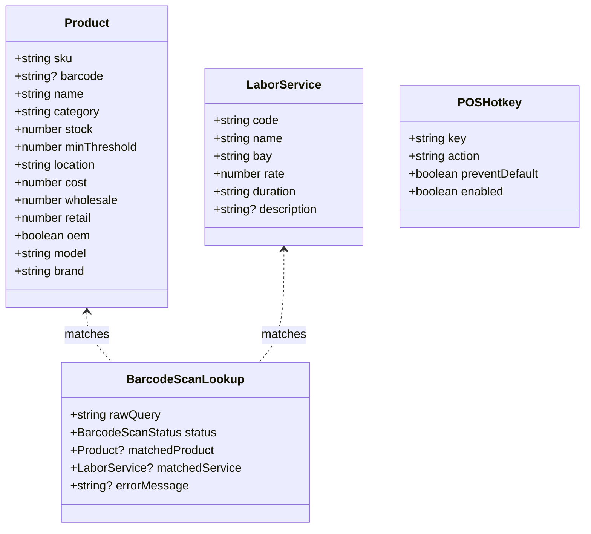

# Domain Data Models: Barcode Scan-Optimized Fast-Lane Checkout & POS Hotkeys

**Feature**: `029-barcode-scan-pos-hotkeys`  
**Jira Ticket**: [SIAA-28](https://the-three-devsketeers.atlassian.net/browse/SIAA-28) (STORY-5.1)  
**Parent Epic**: [SIAA-5](https://the-three-devsketeers.atlassian.net/browse/SIAA-5) (EPIC-5: Staff Shop Floor Terminal & Time Clock)  

---

## 1. Domain Entities & Type Definitions



---

## 2. Types & Schemas

### 2.1 Barcode Scan Status & Result

```typescript
export type BarcodeScanStatus =
  | 'MATCHED_PART'
  | 'MATCHED_SERVICE'
  | 'OUT_OF_STOCK_OVERRIDE'
  | 'NOT_FOUND'
  | 'EMPTY_QUERY';

export interface BarcodeScanResult {
  status: BarcodeScanStatus;
  query: string;
  matchedItem?: Product | LaborService;
  itemType?: 'PART' | 'SERVICE';
  requiresManagerOverride?: boolean;
  message?: string;
}
```

### 2.2 POS Category Filter Definitions

```typescript
export type POSCategoryFilter =
  | 'ALL'
  | 'SERVICES'
  | 'Brakes'
  | 'Drivetrain'
  | 'Fluids'
  | 'Ignition'
  | 'Engine'
  | 'Tires'
  | 'Suspension'
  | 'Electrical'
  | 'Accessories'
  | string;

export interface CategoryTabItem {
  id: POSCategoryFilter;
  label: string;
  isService?: boolean;
}
```

### 2.3 POS Hotkey Actions

```typescript
export type POSHotkeyAction =
  | 'CHECKOUT_PAY'      // F12
  | 'CLOSE_MODAL'       // Escape
  | 'FOCUS_SCANNER';    // F2 or Enter focus recovery

export interface POSHotkeyBinding {
  key: string;
  code: string;
  action: POSHotkeyAction;
  description: string;
}
```

---

## 3. Invariants & Business Logic Rules

1. **SKU / Barcode Lookup Invariant**:
   - Matching query $Q$ checks in order:
     1. Exact match on `Product.sku` (case-insensitive, trimmed)
     2. Exact match on `Product.barcode` (if provided)
     3. Exact match on `LaborService.code` (case-insensitive, trimmed)
     4. Substring match on `Product.name` or `LaborService.name`
2. **Stock Verification Invariant**:
   - For physical parts (`itemType === 'PART'`), if `stock <= 0`, status is `OUT_OF_STOCK_OVERRIDE` and Manager Override flow must be engaged.
   - For labor services (`itemType === 'SERVICE'`), stock guard is never applied (`stock` is infinite).
3. **Cart Preserving Invariant**:
   - When status is `NOT_FOUND`, no existing items in `useCartStore` may be altered, deleted, or cleared.
4. **Hotkey `F12` Guard Invariant**:
   - `F12` MUST always call `e.preventDefault()`.
   - `F12` triggers checkout ONLY when `cart.items.length > 0` and no blocking modals are active.
