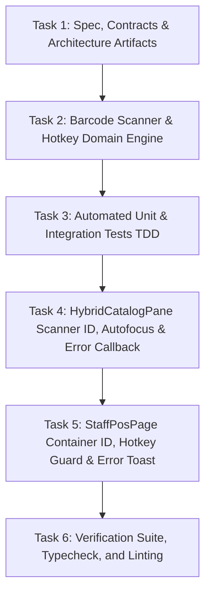

# Implementation Tasks: Barcode Scan-Optimized Fast-Lane Checkout & POS Hotkeys

**Feature**: `029-barcode-scan-pos-hotkeys`  
**Jira Issue**: [SIAA-28](https://the-three-devsketeers.atlassian.net/browse/SIAA-28) (STORY-5.1)  
**Parent Epic**: [SIAA-5](https://the-three-devsketeers.atlassian.net/browse/SIAA-5) (EPIC-5: Staff Shop Floor Terminal & Time Clock)  
**Spec Reference**: [`specs/029-barcode-scan-pos-hotkeys/spec.md`](spec.md)  
**Plan Reference**: [`specs/029-barcode-scan-pos-hotkeys/plan.md`](plan.md)  

---

## Task Matrix & Dependency Graph

---

## Phase 1: Specifications, Contracts & Architecture Artifacts

- [x] **TASK-1.1**: Author specification, research, data model, contracts, checklist, plan, quickstart, and task artifacts for SIAA-28 (`specs/029-barcode-scan-pos-hotkeys/spec.md`, `research.md`, `data-model.md`, `contracts/pos-barcode-hotkeys.contract.ts`, `checklists/requirements.md`, `plan.md`, `quickstart.md`, `tasks.md`).

---

## Phase 2: Barcode Scanner & Hotkey Domain Engine

- [ ] **TASK-2.1**: Implement `lib/pos/barcode-scanner.ts`:
  - `resolveBarcodeScanQuery(query, products, laborServices)`: normalizes query, matches against product SKU, product barcode, labor service code, and names.
  - Detects zero-stock condition for physical parts (`stock <= 0`) returning `OUT_OF_STOCK_OVERRIDE`.
  - Returns `NOT_FOUND` when query does not match any item.
  - `evaluatePosHotkey(key, isCartEmpty, isModalOpen)`: pure function evaluating whether `F12` triggers checkout, warns on empty cart, or ignores when modal is already open.

---

## Phase 3: Automated Unit & Integration Tests (TDD)

- [ ] **TASK-3.1**: Create `lib/pos/__tests__/barcode-scanner.test.ts`:
  - Verify Scenario 1: Exact SKU and barcode scan instant resolution (`MOT-3100-10W40`, `YAM-NMAX-BL01`).
  - Verify Scenario 2: Category filter resolution (filtering items by category in-memory).
  - Verify Scenario 3: `F12` hotkey behavior (triggers checkout when cart has items; blocks checkout with warning when cart is empty; always calls `preventDefault()`).
  - Verify Scenario 4: Unrecognized barcode returns `NOT_FOUND` status and preserves existing cart items.
  - Verify out-of-stock item returns `OUT_OF_STOCK_OVERRIDE`.

---

## Phase 4: UI Component Enhancements (`HybridCatalogPane` & `StaffPosPage`)

- [ ] **TASK-4.1**: Enhance `components/pos/hybrid-catalog-pane.tsx`:
  - Add `id="posItemSearchInput"` to input element.
  - Add `inputRef = useRef<HTMLInputElement>(null)` and ensure focus is maintained after `handleSearchKeyDown` on `[ENTER]`.
  - Integrate `resolveBarcodeScanQuery` into search input handler.
  - Add optional `onScanNotFound?: (query: string) => void` callback prop invoked when no match is found.
  - Ensure category pills ("All Fast Items", "Brakes", "Drivetrain", "Fluids", "Add Labor / Bay Service") correctly filter catalog in real-time.
- [ ] **TASK-4.2**: Enhance `app/staff/pos/page.tsx`:
  - Add `id="view-staff-pos"` to root section container for 1:1 specification fidelity with `mockup/staff.html`.
  - Wire `onScanNotFound` callback to display error toast: `"Item code or barcode not found"`.
  - Update `F12` global keydown handler to block default browser behavior, alert on empty cart, and open payment checkout modal when items exist.

---

## Phase 5: Verification Suite, Typecheck, and Linting

- [ ] **TASK-5.1**: Run automated test suite: `node --env-file=.env.local --experimental-strip-types --test lib/pos/__tests__/barcode-scanner.test.ts` and `npm test`.
- [ ] **TASK-5.2**: Run TypeScript compilation check: `npx tsc --noEmit`.
- [ ] **TASK-5.3**: Run ESLint validation: `npm run lint`.
