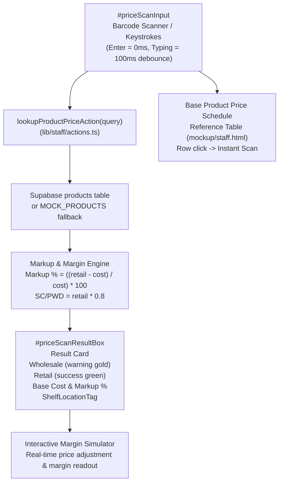

# Implementation Plan: Instant SKU / Barcode Price Checker & Margin Simulator

**Feature**: Instant SKU / Barcode Price Checker & Margin Simulator  
**Jira Issue**: [SIAA-31](https://the-three-devsketeers.atlassian.net/browse/SIAA-31) (STORY-5.4)  
**Spec Reference**: [`specs/030-instant-sku-barcode-price-checker/spec.md`](spec.md)  
**Target View**: Staff Shop Floor Terminal (`/staff/pricecheck`)  

---

## 1. Technical Architecture & Boundary Map



---

## 2. Component Hierarchy & File Structure

```text
swift/
├── lib/
│   └── staff/
│       ├── types.ts                    # Updated ProductPriceCheckItem & Result
│       ├── actions.ts                  # Enhanced lookupProductPriceAction with cost & markup math
│       └── margin-math.ts              # Pure unit-tested mathematical helper functions
├── components/
│   └── staff/
│       └── pricecheck/
│           ├── price-scan-card.tsx      # #priceScanResultBox with dual pricing, shelf locator, stock
│           ├── margin-simulator.tsx     # Interactive real-time margin preview drawer/panel
│           └── price-schedule-table.tsx # Reference table for top velocity items
├── app/
│   └── staff/
│       └── pricecheck/
│           └── page.tsx                 # Enhanced #view-staff-pricecheck root view
└── test/
    └── staff/
        ├── pricecheck-actions.test.ts   # Server action & calculation unit tests
        └── pricecheck-ui.test.tsx       # Component & user interaction tests
```

---

## 3. Step-by-Step Implementation Strategy

### Step 1: Types & Mathematical Foundation
- Create `lib/staff/margin-math.ts` with pure calculation functions (`computeGrossMarkupPercent`, `computeGrossMarginPercent`, `computeScPwdPrice`, `simulateMarginOutput`).
- Update `lib/staff/types.ts` to include `cost`, `grossMarkupPercent`, `wholesaleMarkupPercent` on `ProductPriceCheckItem`.

### Step 2: Server Action Enhancement
- Update `lookupProductPriceAction` in `lib/staff/actions.ts`:
  - When querying Supabase or `MOCK_PRODUCTS`, map `cost`, `wholesale`, `retail`.
  - Calculate `grossMarkupPercent` and `wholesaleMarkupPercent`.
  - Handle missing items by returning `{ success: false, code: 'PRODUCT_NOT_FOUND', error: 'No item found for barcode / code: ...' }`.

### Step 3: UI Component Deconstruction
- Implement `components/staff/pricecheck/price-scan-card.tsx`:
  - DOM container with `id="priceScanResultBox"`.
  - Wholesale price in warning gold (`text-warning`).
  - Retail price in success green (`text-success`).
  - Base acquisition cost and markup %.
  - `<ShelfLocationTag location={product.location} />`.
  - Stock badge with `getStockStatusLabel`.
- Implement `components/staff/pricecheck/margin-simulator.tsx`:
  - Interactive price input / increment controls.
  - Live margin and gross profit feedback.
- Implement `components/staff/pricecheck/price-schedule-table.tsx`:
  - High-velocity product schedule matching `mockup/staff.html` lines 240-270.
  - Interactive row click to load into the price scanner.

### Step 4: Page Assembly & Wiring
- Refactor `app/staff/pricecheck/page.tsx`:
  - Wrap in `id="view-staff-pricecheck"`.
  - Wire `#priceScanInput` with `onKeyDown` (Enter triggers immediate lookup) and debounced typing.
  - Render `#priceScanResultBox`, margin simulator, and price schedule table.
  - Support instant selection from table rows.

### Step 5: Verification & Quality Gates
- Write comprehensive unit tests in `test/staff/pricecheck-actions.test.ts` and `test/staff/pricecheck-ui.test.tsx`.
- Run `npx tsc --noEmit` and `npm test`.
- Verify zero hardcoded colors against SWIFT Constitution Principle I.
