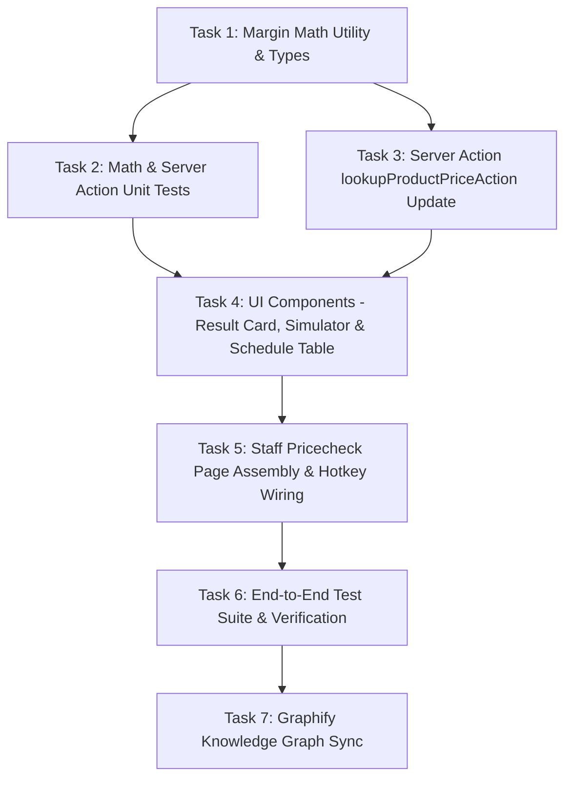

# Implementation Tasks: Instant SKU / Barcode Price Checker & Margin Simulator

**Feature**: Instant SKU / Barcode Price Checker & Margin Simulator  
**Jira Issue**: [SIAA-31](https://the-three-devsketeers.atlassian.net/browse/SIAA-31) (STORY-5.4)  
**Spec Reference**: [`specs/030-instant-sku-barcode-price-checker/spec.md`](spec.md)  
**Plan Reference**: [`specs/030-instant-sku-barcode-price-checker/plan.md`](plan.md)  

---

## Task Overview & Dependency Graph

---

## Phase 1: Foundation & Domain Math

- [x] **Task 1.1**: Create `lib/staff/margin-math.ts` with pure mathematical functions:
  - `computeGrossMarkupPercent(retail: number, cost: number): number`
  - `computeWholesaleMarkupPercent(wholesale: number, cost: number): number`
  - `computeGrossMarginPercent(retail: number, cost: number): number`
  - `computeScPwdPrice(retail: number): number`
  - `simulateMarginOutput(params: MarginSimulationParams): MarginSimulationOutput`
- [x] **Task 1.2**: Update `lib/staff/types.ts` to enrich `ProductPriceCheckItem` with `cost`, `grossMarkupPercent`, `wholesaleMarkupPercent`, and `barcode`.

---

## Phase 2: Server Actions & Backend Integration

- [x] **Task 2.1**: Update `lookupProductPriceAction` in `lib/staff/actions.ts`:
  - Compute `grossMarkupPercent` and `wholesaleMarkupPercent` using `margin-math.ts`.
  - Pass `cost` through for both Supabase queries and `MOCK_PRODUCTS` fallback.
  - Return formatted error `"No item found for barcode / code: [query]"` on `PRODUCT_NOT_FOUND`.
- [x] **Task 2.2**: Write unit tests in `test/staff/pricecheck-actions.test.ts` verifying:
  - Exact SKU lookup (`YAM-NMAX-BL01`, `HON-CLK-CVTB`)
  - Case-insensitive search and partial name search
  - Accurate calculation of gross markup % and SC/PWD discount
  - Correct error code and message on unknown SKU.

---

## Phase 3: Modular UI Components

- [x] **Task 3.1**: Create `components/staff/pricecheck/price-scan-card.tsx`:
  - Render with `id="priceScanResultBox"`.
  - Display wholesale price in warning gold (`text-warning` / `var(--warning)`).
  - Display retail price in success green (`text-success` / `var(--success)`).
  - Display base cost and gross markup % badge.
  - Render `<ShelfLocationTag location={product.location} />`.
  - Render stock status badge (`IN STOCK`, `LOW STOCK`, `OUT OF STOCK`).
- [x] **Task 3.2**: Create `components/staff/pricecheck/margin-simulator.tsx`:
  - Interactive retail/wholesale price input and quick-adjust step buttons.
  - Real-time calculation of simulated gross profit (₱), markup %, and margin %.
  - Visual status pill (`Profitable`, `Low Margin`, `Below Cost`).
- [x] **Task 3.3**: Create `components/staff/pricecheck/price-schedule-table.tsx`:
  - Render base product price schedule table matching `mockup/staff.html` lines 240-270.
  - Columns: SKU, Product Description, Wholesale Price, Retail Price, Gross Markup %, Shelf Location.
  - Clickable rows that invoke `onSelectSku(sku)` to populate the scanner.

---

## Phase 4: Page Assembly & Event Wiring

- [x] **Task 4.1**: Refactor `app/staff/pricecheck/page.tsx`:
  - Set root container to `id="view-staff-pricecheck"`.
  - Keep `#priceScanInput` with Enter-key instant trigger (`onKeyDown`) and debounced typing.
  - Integrate `<PriceScanCard />`, `<MarginSimulator />`, and `<PriceScheduleTable />`.
  - Render danger-styled empty state for unknown codes.
  - Ensure zero hardcoded hex/rgb values; strictly use SWIFT design tokens.

---

## Phase 5: Verification & Quality Gates

- [x] **Task 5.1**: Write UI component test suite in `test/staff/pricecheck-ui.test.tsx` verifying:
  - Sub-200ms DOM rendering of `#priceScanResultBox`
  - Presence of `#view-staff-pricecheck` and `#priceScanInput`
  - Accurate price formatting (₱ currency symbol)
  - Interactive margin simulator calculation updates
  - Row click interaction from reference table.
- [x] **Task 5.2**: Run static analysis and tests:
  - `npx tsc --noEmit`
  - `npm test -- test/staff/pricecheck`
  - `npm run lint`
- [x] **Task 5.3**: Synchronize knowledge graph via `graphify` auto-sync.
