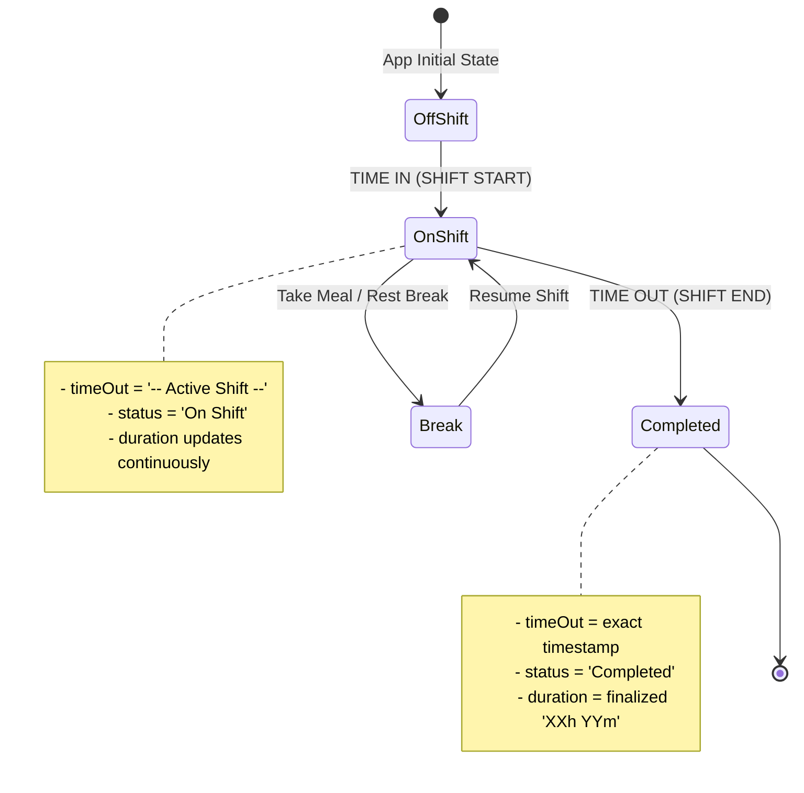

# Data Model: Staff Shift Attendance Log History & Timesheet Tracking

**Feature**: `specs/030-staff-shift-attendance-log-history`  
**Jira Ticket**: [SIAA-30](https://the-three-devsketeers.atlassian.net/browse/SIAA-30)  

---

## 1. Domain Entities & Interfaces

### 1.1 PunchLog (Client-Side Attendance Record)

Represents a single shift entry displayed in the "My Attendance & Shift Log History" table:

```typescript
export type ShiftStatus = 'On Shift' | 'Completed' | 'Break';

export interface PunchLog {
  id: string;               // Unique shift ID (e.g. "PUNCH-1729000000000" or UUID)
  date: string;             // ISO Date "YYYY-MM-DD"
  staff: string;            // Employee full name (e.g. "Mike Morales")
  timeIn: string;           // Formatted clock-in time (e.g. "08:00:15 AM")
  timeOut: string;          // Formatted clock-out time (e.g. "05:01:45 PM") or "-- Active Shift --"
  duration: string;         // Calculated duration string (e.g. "08h 59m" or "04h 12m")
  status: ShiftStatus;      // Operational shift status
  terminal?: string;        // Station identifier (e.g. "Terminal #01")
  notes?: string;           // Optional supervisor / staff punch notes
}
```

### 1.2 DbStaffShift (Supabase Database Representation)

Underlying relational table schema `public.staff_shifts`:

| Column | Type | Constraints | Description |
| :--- | :--- | :--- | :--- |
| `id` | `uuid` | `PRIMARY KEY, DEFAULT gen_random_uuid()` | Unique shift identifier |
| `staff_id` | `uuid` | `NOT NULL, REFERENCES staff_profiles(id)` | Associated staff member |
| `staff_name` | `text` | `NOT NULL` | Cached staff name for historical audit |
| `clock_in` | `timestamptz` | `NOT NULL, DEFAULT now()` | Exact timestamp of clock-in event |
| `clock_out` | `timestamptz` | `NULL` | Timestamp of clock-out event (null if active) |
| `duration_seconds` | `integer` | `NOT NULL, DEFAULT 0` | Authoritative elapsed work time in seconds |
| `status` | `varchar(20)` | `NOT NULL, CHECK (status IN ('on_shift', 'break', 'completed'))` | Database shift status |
| `terminal_id` | `text` | `NOT NULL, DEFAULT 'Terminal #01'` | Terminal origin |

---

## 2. Shift Lifecycle State Machine



---

## 3. Transformation & Formatting Rules

### 3.1 Date Formatting
- Raw input: ISO timestamp (e.g., `2026-09-28T08:00:15Z`).
- Table display: `YYYY-MM-DD`
- If the date matches today's local date (`new Date().toLocaleDateString('en-CA')`), display as `YYYY-MM-DD (Today)`.

### 3.2 Time Formatting
- 12-hour format with AM/PM: `hh:mm:ss AM/PM` (e.g., `08:00:15 AM`, `05:01:45 PM`).

### 3.3 Shift Duration Calculation
- Formula:
  $$\text{hours} = \lfloor \text{seconds} / 3600 \rfloor$$
  $$\text{minutes} = \lfloor (\text{seconds} \bmod 3600) / 60 \rfloor$$
  $$\text{formatted} = \text{String(hours).padStart(2, '0')} + \text{"h "} + \text{String(minutes).padStart(2, '0')} + \text{"m"}$$
- Examples:
  - 15,150 seconds $\rightarrow$ `04h 12m`
  - 32,340 seconds $\rightarrow$ `08h 59m`
  - 32,700 seconds $\rightarrow$ `09h 05m`

### 3.4 Sorting Invariant
- Shift records in the table MUST be sorted in reverse chronological order:
  $$\text{Record } A \text{ precedes } B \iff A.\text{date} > B.\text{date} \lor (A.\text{date} = B.\text{date} \land A.\text{timeIn} > B.\text{timeIn})$$
