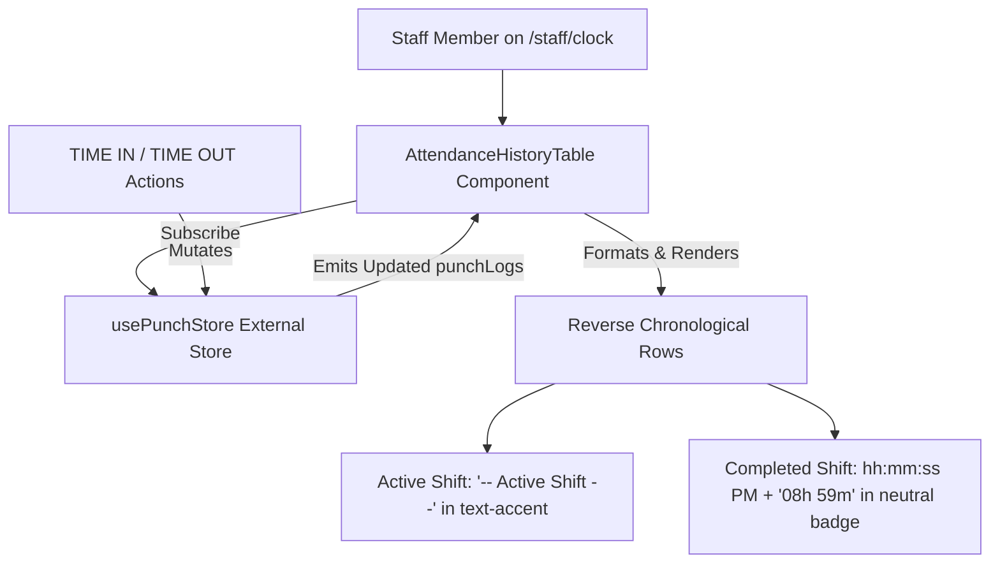

# Research & Technical Decisions: Staff Shift Attendance Log History & Timesheet Tracking

**Feature**: `specs/030-staff-shift-attendance-log-history`  
**Jira Ticket**: [SIAA-30](https://the-three-devsketeers.atlassian.net/browse/SIAA-30)  
**Parent Epic**: [SIAA-5](https://the-three-devsketeers.atlassian.net/browse/SIAA-5)  

---

## 1. Technical Context & Stack Constraints

- **Framework**: Next.js App Router (React 19, TypeScript 5)
- **Styling**: Tailwind CSS v4 with strict SWIFT Semantic Design Tokens (zero hardcoded hex, RGB, or default palette classes).
- **Icons**: `lucide-react` (`Calendar`, `Clock`, `User`, `CheckCircle2`, `AlertCircle`).
- **Store / State Engine**: `usePunchStore` (`useSyncExternalStore`) in `lib/store/punch-store.ts`.
- **Backend / Server Actions**: `lib/staff/actions.ts` (`getStaffAttendanceHistoryAction`, `clockInShiftAction`, `clockOutShiftAction`).

---

## 2. Architectural Analysis: Component Partitioning

### Component Boundaries
- **Container**: `app/staff/clock/page.tsx`
  - Host page for terminal shift logging. Houses the punch clock control panel and mounts the attendance log history table.
- **Dedicated Component**: `components/staff/clock/attendance-history-table.tsx`
  - Encapsulates the table markup, headers, reverse-chronological sorting, active shift highlight, status badge rendering, and empty states.
  - Subscribes reactively to `usePunchStore((state) => state.punchLogs)` for zero-latency UI synchronizations upon clock-in and clock-out.
  - Optionally receives initial server-fetched logs or falls back to store data.

---

## 3. Data Representation & Flow

---

## 4. Design Tokens & Styling Compliance

In accordance with the SWIFT Constitution and `AGENTS.md`:

| UI Element | Semantic Token Classes | Rationale |
| :--- | :--- | :--- |
| Table Card Container | `bg-bg-surface border border-border rounded-xl shadow-xs` | Matches panel card layout from `mockup/staff.html` |
| Table Header Row | `bg-bg-base/60 text-text-muted font-bold border-b border-border` | Subtle header surface contrast |
| Table Row Hover | `hover:bg-bg-hover transition-colors` | Interactive feedback on shop terminal |
| Active Shift Indicator | `text-mono text-accent font-semibold` | Highlights running shift without hardcoded colors |
| "On Shift" Badge | `bg-success-light text-success border border-success/20` | Semantic status for ongoing work |
| "Completed" Badge | `bg-bg-muted text-text-secondary border border-border` | Neutral badge for closed shifts |
| "Break" Badge | `bg-accent-light text-accent border border-accent/20` | Warning accent for meal/rest break |
| Date / Time Mono Text | `font-mono text-text-secondary` | Monospace alignment for tabular numeric data |

---

## 5. Backward Compatibility & Test Coverage

- **Prerequisites**: SIAA-29 (Terminal Digital Shift Punch Clock) defines punch-in/out triggers.
- **Existing Tests**: `lib/store/__tests__/punch-store-guard.test.ts`, `lib/store/__tests__/punch-store-realtime.test.ts`.
- **New Tests**: `components/staff/clock/__tests__/attendance-history-table.test.tsx` verifying:
  1. Render table columns (Date, Staff Name, Time-In, Time-Out, Shift Duration, Status).
  2. Active shift row displays `-- Active Shift --` and green `On Shift` badge.
  3. Dynamic update when shift clocks out with formatted duration (`XXh YYm`) and `Completed` badge.
  4. Reverse-chronological sorting and `(Today)` date annotation.
