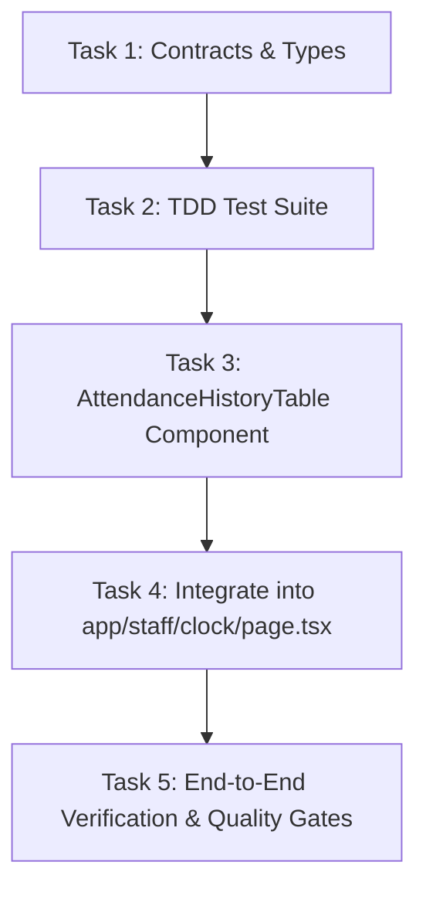

# Implementation Tasks: Staff Shift Attendance Log History & Timesheet Tracking

**Feature**: `specs/030-staff-shift-attendance-log-history`  
**Feature Branch**: `feat/SIAA-30-staff-shift-attendance-log-history`  
**Jira Ticket**: [SIAA-30](https://the-three-devsketeers.atlassian.net/browse/SIAA-30)  
**Parent Epic**: [SIAA-5](https://the-three-devsketeers.atlassian.net/browse/SIAA-5)  

---

## Task Overview & Dependencies

---

## Phase 1: Contracts & Domain Models

- [ ] **Task 1: Establish Attendance History Contracts and Types**
  - Path: `specs/030-staff-shift-attendance-log-history/contracts/attendance-history.ts`
  - Ensure export of `PunchLog`, `ShiftStatus`, and `AttendanceHistoryTableProps` schemas.
  - Reconcile with `lib/types/logs.ts` and `lib/store/punch-store.ts` for full compatibility.

---

## Phase 2: Test-First Development (TDD)

- [ ] **Task 2: Implement Unit Tests for Attendance History Table**
  - Path: `components/staff/clock/__tests__/attendance-history-table.test.tsx`
  - Test Scenario 1: Table column headers rendering (Date, Staff Name, Time-In, Time-Out, Shift Duration, Status).
  - Test Scenario 2: Active shift row highlighting (`-- Active Shift --` in warning accent and green "On Shift" badge).
  - Test Scenario 3: Completed shift display (exact clock-out timestamp, computed `XXh YYm` duration, and neutral "Completed" badge).
  - Test Scenario 4: Reverse-chronological sorting and `(Today)` date suffix.
  - Test Scenario 5: Graceful empty state when log history is empty.

---

## Phase 3: Component Implementation

- [ ] **Task 3: Implement AttendanceHistoryTable Component**
  - Path: `components/staff/clock/attendance-history-table.tsx`
  - Replicate `#view-staff-clock` panel card structure from `mockup/staff.html`.
  - Connect to `usePunchStore()` for reactive state synchronization on punch actions.
  - Strictly apply SWIFT semantic design tokens (`bg-bg-surface`, `bg-bg-base`, `text-text-primary`, `bg-success`, `bg-accent`, `border-border`).
  - Provide fallback support for `initialLogs` prop.

---

## Phase 4: Route View Integration

- [ ] **Task 4: Integrate AttendanceHistoryTable into /staff/clock**
  - Path: `app/staff/clock/page.tsx`
  - Replace the temporary static table in `#view-staff-clock` with `AttendanceHistoryTable`.
  - Wire punch clock actions (`clockIn`, `clockOut`) from `usePunchStore()` to demonstrate dynamic updates.
  - Ensure clean layout harmony with the punch clock control panel.

---

## Phase 5: Verification & Quality Gates

- [ ] **Task 5: Execute Quality Verification Gates**
  - Run typecheck: `npm run typecheck`
  - Run linter: `npm run lint`
  - Run test suite: `npm test`
  - Ensure 0 errors, 0 warnings, and 100% test pass rate.
