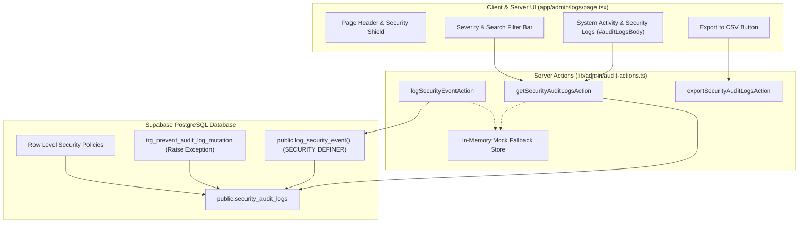

# Implementation Plan: Supabase Forensic Security Audit Logs Schema, Immutable Ledger & RPC Logger

**Feature**: Supabase Forensic Security Audit Logs Schema, Immutable Ledger & RPC Logger  
**Ticket**: [SIAA-62](https://the-three-devsketeers.atlassian.net/browse/SIAA-62) (STORY-7.9)  
**Parent Epic**: [SIAA-7](https://the-three-devsketeers.atlassian.net/browse/SIAA-7)  
**Branch**: `feat/SIAA-62-supabase-forensic-security-audit-logs`  

---

## 1. Architectural Boundaries & Component Map

---

## 2. File Implementation Breakdown

1. **Contracts & Validation**:
   - `lib/types/audit.ts` / `lib/contracts/audit.ts`: Shared TypeScript types and Zod schemas for audit logs, options, and event logging parameters.
2. **Database Migration**:
   - `supabase/migrations/20261012000003_security_audit_logs.sql`:
     - Creates table `public.security_audit_logs`
     - Adds indexes `idx_security_audit_logs_created_at_desc`, `idx_security_audit_logs_user_id`, `idx_security_audit_logs_severity`
     - Revokes `UPDATE, DELETE, TRUNCATE`
     - Creates immutability function & trigger `trg_prevent_audit_log_mutation`
     - Enables RLS and creates `SELECT` and `INSERT` policies
     - Defines `public.log_security_event` stored procedure with `SECURITY DEFINER`
3. **Server Actions & Mock Layer**:
   - `lib/admin/audit-actions.ts`:
     - Provides `getSecurityAuditLogsAction`
     - Provides `logSecurityEventAction`
     - Provides `exportSecurityAuditLogsAction`
     - Seamless fallback to mock audit store for unit tests and offline dev
4. **Unit & Integration Tests**:
   - `lib/admin/__tests__/audit-actions.test.ts`:
     - Tests querying, filtering by severity, sorting, error handling
     - Tests `logSecurityEventAction` parameter validation and storage
     - Tests `exportSecurityAuditLogsAction` RFC 4180 CSV compliance and quoting
5. **UI Component & Route Wiring**:
   - `components/admin/logs/audit-logs-table.tsx`: Interactive client table rendering `#auditLogsBody`, severity badges, terminal IP formatting, search/filter inputs, and CSV export.
   - `app/admin/logs/page.tsx`: Server Component composing the page shell, fetching initial audit logs via `getSecurityAuditLogsAction()`, and mounting the table.

---

## 3. Verification & Quality Gates

- `npm test`: Verify audit actions unit test suite passes with 100% assertions green.
- `npx tsc --noEmit`: Ensure strict TypeScript compilation with zero type errors.
- `npm run lint`: Confirm ESLint passes without errors or warnings.
- SWIFT Design Tokens Audit: Confirm zero arbitrary hex/rgb values in all created UI files.
