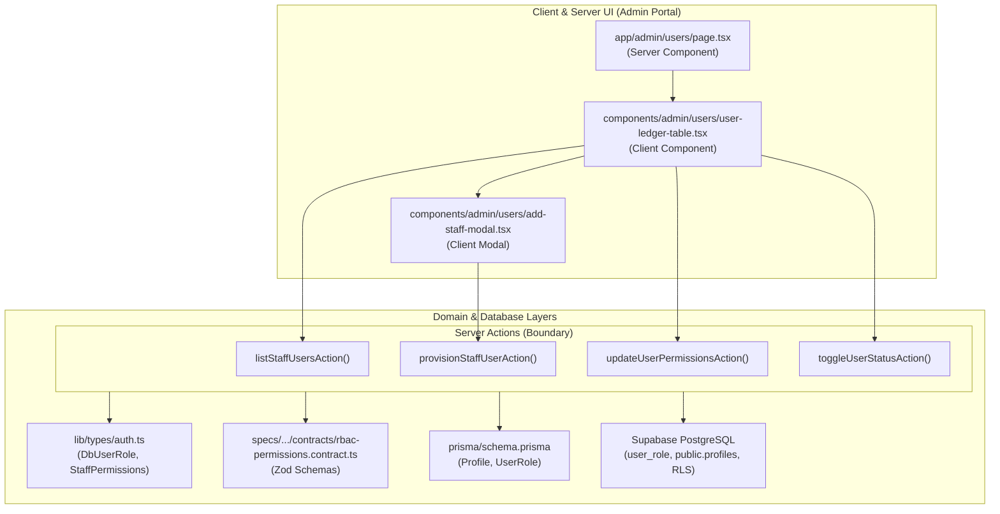

# Technical Implementation Plan: Supabase RBAC Extension & Admin Provisioning Actions

**Feature**: Supabase RBAC Extension, Granular Permission Flags Schema & Admin Provisioning Actions  
**Feature Directory**: `specs/030-supabase-rbac-extension-granular-permission-flags`  
**Jira Issue**: [SIAA-56](https://the-three-devsketeers.atlassian.net/browse/SIAA-56)  
**Parent Epic**: [SIAA-7](https://the-three-devsketeers.atlassian.net/browse/SIAA-7)  
**Branch**: `feat/SIAA-56-supabase-rbac-extension-granular-permission-flags`  

---

## 1. Architectural Overview & Boundary Mapping

---

## 2. Component Hierarchy & File Manifest

1. **Database Migration**: `supabase/migrations/20261019000000_rbac_permissions.sql`
   - Alters enum `user_role` to include `inventory_clerk`.
   - Adds `permissions` JSONB column with non-null default.
   - Adds trigger `enforce_admin_self_protection()` to prevent self-demotion / deactivation.
   - Updates `handle_new_user()` trigger to persist permissions and support `inventory_clerk`.

2. **Application Schema**: `prisma/schema.prisma`
   - Extends `enum UserRole` with `inventory_clerk`.
   - Adds `permissions Json` to `model Profile`.

3. **Domain Models & Types**: `lib/types/auth.ts`
   - Extends `DbUserRole` with `'inventory_clerk'`.
   - Adds `StaffPermissions` interface and defaults.
   - Extends `UserProfileRecord` and `UserSession` with structured permissions.

4. **Validation Contracts**: `specs/030-supabase-rbac-extension-granular-permission-flags/contracts/rbac-permissions.contract.ts`
   - Defines Zod validation schemas: `DbUserRoleSchema`, `StaffPermissionsSchema`, `ProvisionStaffUserSchema`, `UpdateUserPermissionsSchema`, `ToggleUserStatusSchema`.

5. **Server Actions**: `lib/admin/user-actions.ts`
   - `listStaffUsersAction()`: Fetches all staff profiles sorted by created timestamp.
   - `provisionStaffUserAction(payload)`: Provisions new employee with service-role privileges or fallback in-memory mock.
   - `updateUserPermissionsAction(userId, permissions)`: Validates admin authorization and updates permission flags.
   - `toggleUserStatusAction(userId, status)`: Toggles active status with self-deactivation guard.

6. **UI Components**:
   - `app/admin/users/page.tsx`: Server component layout fetching staff list and rendering container.
   - `components/admin/users/user-ledger-table.tsx`: Interactive table with search, role filtering, status toggle, and permission badges.
   - `components/admin/users/add-staff-modal.tsx`: Modal dialog with accessible form, keyboard ESC support, validation, and optimistic update.

7. **Test Suite**: `lib/admin/__tests__/user-actions.test.ts`
   - Unit tests covering user listing, provisioning, permission updates, self-lockout rejection, and non-admin escalation protection.

---

## 3. Design System & Tokens Enforcement

All components MUST strictly use semantic design tokens:
- Surfaces: `bg-bg-card`, `bg-bg-surface`, `bg-bg-base`, `bg-bg-hover`
- Text: `text-text-primary`, `text-text-secondary`, `text-text-muted`
- Action/Brand: `bg-primary`, `text-primary`, `border-primary`, `hover:bg-primary-hover`, `bg-primary-light`
- Status: `bg-success-light text-success`, `bg-accent-light text-accent`, `bg-danger-light text-danger`, `bg-info-light text-info`
- Borders: `border-border`, `border-border-subtle`
- Zero hardcoded hex, RGB, or non-token Tailwind colors.
