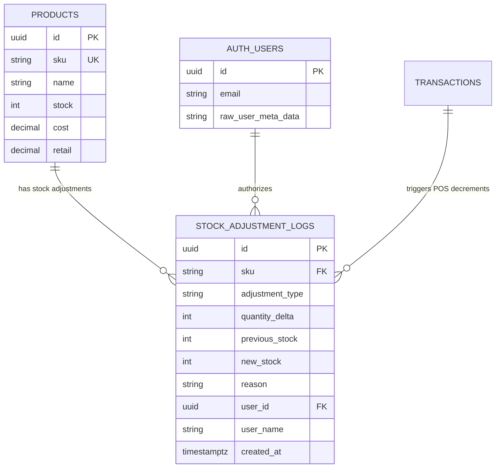

# Data Model: Stock Adjustment Audit Trail Ledger & Shrinkage Analytics

**Feature**: Stock Adjustment Audit Trail Ledger Query Engine & Shrinkage Analytics Action  
**Jira Issue**: [SIAA-65](https://the-three-devsketeers.atlassian.net/browse/SIAA-65) (STORY-7.10)  
**Spec Reference**: [`specs/031-stock-adjustment-audit-trail-ledger/spec.md`](spec.md)  

---

## 1. Domain Entities & Storage Schema

### 1.1 Database Table: `public.stock_adjustment_logs`
Provisioned via migration `20261011000000_stock_adjustment_rpc.sql` ([SIAA-46](https://the-three-devsketeers.atlassian.net/browse/SIAA-46)):

| Column | Type | Constraints | Description |
| :--- | :--- | :--- | :--- |
| `id` | `UUID` | `PRIMARY KEY DEFAULT gen_random_uuid()` | Unique immutable log identifier |
| `sku` | `TEXT` | `NOT NULL REFERENCES public.products(sku)` | Associated product SKU |
| `adjustment_type` | `TEXT` | `NOT NULL` | Type of adjustment (e.g. Physical Count, Damaged Goods, POS Sale) |
| `quantity_delta` | `INTEGER` | `NOT NULL CHECK (quantity_delta != 0)` | Net change in units (+/-) |
| `previous_stock` | `INTEGER` | `NOT NULL CHECK (previous_stock >= 0)` | Product stock immediately before adjustment |
| `new_stock` | `INTEGER` | `NOT NULL CHECK (new_stock >= 0)` | Product stock immediately after adjustment |
| `reason` | `TEXT` | `NOT NULL DEFAULT ''` | Operator justification, reference, or receipt number |
| `user_id` | `UUID` | `NULL REFERENCES auth.users(id) ON DELETE SET NULL` | Auth ID of operator performing adjustment |
| `user_name` | `TEXT` | `NOT NULL DEFAULT 'Staff Member'` | Operator display name for quick audit display |
| `created_at` | `TIMESTAMPTZ` | `NOT NULL DEFAULT timezone('utc'::text, now())` | Immutable UTC timestamp |

### 1.2 Entity Relationship Diagram (ERD)



---

## 2. TypeScript Domain Models & DTOs

### 2.1 Audit Log Item (`StockAdjustmentLogEntry`)
```typescript
export interface StockAdjustmentLogEntry {
  id: string;
  sku: string;
  adjustmentType: string;
  quantityDelta: number;
  previousStock: number;
  newStock: number;
  reason: string;
  userId?: string | null;
  userName: string;
  createdAt: string; // ISO 8601 string
}
```

### 2.2 Filter Query Options (`StockAuditFilterOptions`)
```typescript
export interface StockAuditFilterOptions {
  sku?: string;
  adjustmentType?: string; // 'All' or specific type
  startDate?: string;     // ISO Date string
  endDate?: string;       // ISO Date string
  search?: string;        // Text search across SKU, reason, user_name
  limit?: number;         // Defaults to 50
  offset?: number;        // Defaults to 0
}
```

### 2.3 Analytics Summary Metrics (`StockAuditSummaryMetrics`)
```typescript
export interface StockAuditSummaryMetrics {
  totalCount: number;
  netDelta: number;
  totalShrinkage: number; // Sum of negative deltas (expressed as positive count)
  totalIntake: number;    // Sum of positive deltas
}
```

### 2.4 Server Action Response (`StockAuditLogsResponse`)
```typescript
export interface StockAuditLogsResponse {
  success: boolean;
  logs: StockAdjustmentLogEntry[];
  metrics: StockAuditSummaryMetrics;
  total: number;
  error?: string;
}
```

### 2.5 CSV Export Result (`StockAuditExportResult`)
```typescript
export interface StockAuditExportResult {
  success: boolean;
  csvContent?: string;
  filename?: string;
  recordCount?: number;
  error?: string;
}
```

---

## 3. CSV Export Record Schema

Standardized CSV export layout:
```text
Timestamp,SKU,Adjustment Type,Quantity Delta,Previous Stock,New Stock,Reason / Reference,Authorized User
2026-10-15 08:30:15 UTC,YAM-NMAX-BL01,Damaged Goods,-2,14,12,Water damage in warehouse,Alex Morgan (Auditor)
2026-10-15 09:15:00 UTC,HON-CLK-CVTB,Physical Count,+5,20,25,Annual Q4 inventory reconciliation,John Doe (Staff)
```
